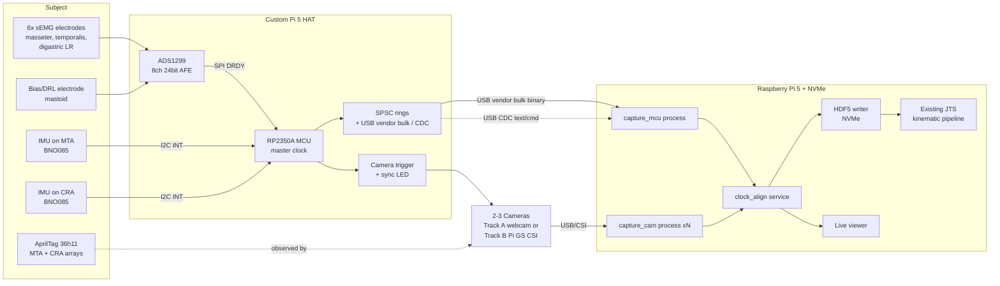
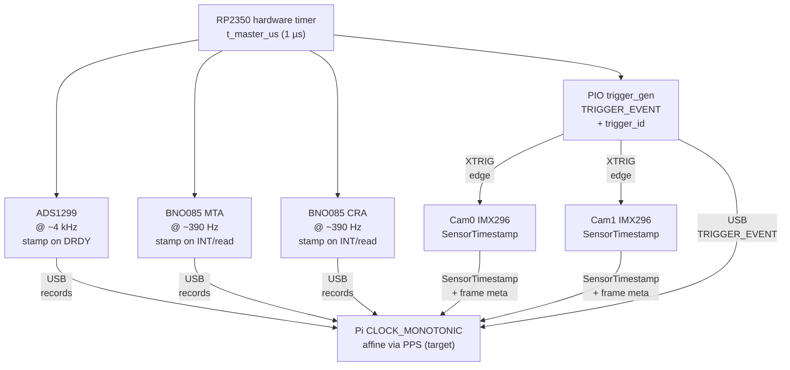

<!--
This file is part of JTS-MM (https://github.com/paulotto/jts-mm).
SPDX-FileCopyrightText: 2026 Paul-Otto Müller
SPDX-FileCopyrightText: 2026 David Stebich
SPDX-License-Identifier: CC-BY-4.0
-->

# 01 — System Architecture

This document describes the system at the block-diagram level: the physical signal chain, the logical data flow, the timing relationships between modalities, and the operating modes.

## 1. Top-level block diagram



### 1.1 Bring-up vs production matrix

| Concern | Bring-up (bench code) | Production |
|---------|----------------------|------------|
| MCU firmware | single-core polling, `0xAD 0x53` EMG stream | [`firmware/jtsmm/`](../firmware/jtsmm/) — dual-core polling/DMA, `0x55 0xAA` records over USB vendor bulk + CDC ([`h05 architecture`](hardware/h05_sensor_pipeline_architecture.md)) |
| Host software | EMG record/view | [`software/jtsmm/`](../software/jtsmm/) — multimodal capture + HDF5 |
| Optical tracking | — | [`software/optical/`](../software/optical/) + `jtsmm record --optical-track` (lores ArUco → `/optical/` in `session.h5`); standalone `optical track` |
| Jaw kinematics | — | [`software/jaw_tracking/`](../software/jaw_tracking/) — JTS analysis on tracking HDF5 |
| Configuration | CLI flags / bench commands | [`~/jtsmm.yaml`](software/s08_runtime_configuration.md) (`jtsmm config init`) schema v1 + `config apply` JSON |
| Default EMG rate | 250 Hz (bench) | **4000 SPS** (`mcu.emg.profile: acquisition`) |
| IMU path | I2C poll / `imu_test` | INT + **I2C DMA**, profile-driven reports |
| Camera trigger | GPIO define only | PIO `trigger_gen` + `TRIGGER_EVENT` records |
| Contract | ad hoc | [`schema/v1/`](../schema/v1/jtsmm.schema.json) shared by host + firmware |

## 2. Subsystem responsibilities

| Subsystem | Implemented in | Owns | Outputs |
|-----------|----------------|------|---------|
| Electrodes + DRL | physical | Skin–metal interface, common-mode reference | Six differential analog signals + bias |
| ADS1299 AFE | HAT silicon | EMG amplification, ADC, DRDY pin | 24-bit samples @ **4 kHz** default (`acquisition`; max 4 kSPS) |
| IMUs | MTA/CRA daughterboards | 9-DoF sensing + on-chip fusion | Quaternion + raw 9-DoF @ **200–400 Hz** (profile-driven) |
| RP2350A MCU | HAT silicon | **Master clock**, sample collection, trigger emission, USB streaming | Framed `t_master_us`-tagged records |
| Camera subsystem | external | Image frames + trigger acknowledgement | Raw frames + per-frame metadata |
| Pi 5 capture processes | software | Drain MCU + cameras, attach OS timestamps | Per-modality queues |
| `clock_align` service | software | Cross-clock alignment, drift estimation | Unified `t_master_us` view |
| HDF5 writer | software | Persistent storage on NVMe | One HDF5 file per session |
| Existing JTS pipeline | software | Kinematics, registration, visualization | Mandibular pose trajectories |

## 3. Signal chain — physical

```
Skin ──> Ag/AgCl electrode ──> snap / touch-proof DIN 42802 (electrode end) ──> shielded patient cable(s) ──> HAT connector(s)
HAT connector — **0** 13× 2.54 mm pins (bring-up) · **A** 1× trunk · **B** 4× regional (production) · **C** 7× per-channel · **F** 13× DIN — see [`h03`](hardware/h03_emg_frontend.md) §10.2
HAT input ──> ESD/RFI filter (100 Ω/leg + 4.7 nF C0G differential CFilt + TPD4E1B06 TVS + CM choke) ──> ADS1299 PGA
ADS1299 PGA ──> Σ-Δ ADC ──> internal DRDY ──> SPI ──> RP2350A
RP2350A ──> timestamp ──> SPSC ring ──> USB vendor bulk ──> Pi 5 capture_mcu
```

For IMUs (same per-IMU path):

```
IMU MEMS ──> on-chip fusion (BNO085) ──> I2C ──> RP2350A ──> timestamp ──> SPSC ring ──> USB vendor bulk ──> Pi 5
```

For cameras (Track B, hardware-triggered):

```
RP2350A GPIO ──> 74LVC buffer ──> [1.5k/1.8k ÷ on HAT] ──> camera XTR+ (XTR− = GND)
Camera CSI/USB ──> Pi 5 ──> libcamera/OpenCV ──> capture_cam ──> frame + PTS
```

For cameras (Track A, software-synced):

```
RP2350A GPIO ──> low-current driver ──> visible SYNC_LED (in camera FOV; timing fiducial only)
Camera USB ──> Pi 5 ──> V4L2/UVC ──> capture_cam ──> frame + UVC PTS + LED-on detection
```

Track A pose uses **AprilTag 36h11** on MTA/CRA under visible lab light — not IR retroreflective rings ([`hardware/h01_camera_subsystem.md`](hardware/h01_camera_subsystem.md)).

## 4. Timing architecture

The single most important design rule of the project:

> **There is exactly one master clock. It lives on the RP2350A. Every record in every stream carries `t_master_us` (microseconds since MCU boot).**



**Hardware sync** (shared XTRIG / MCU IRQ stamps) is the load-bearing path for Track B. **Software sync** (affine maps, PPS, LED-flash) disciplines *foreign* clocks. EMG/IMU never need an affine rewrite. See [`hardware/h06_synchronization.md`](hardware/h06_synchronization.md) and [`software/s06_time_synchronization.md`](software/s06_time_synchronization.md) for implemented vs target.

### 4.1 Clock domains

1. **MCU clock** — RP2350A hardware timer at 1 MHz (`time_us_64`). Resolution 1 µs, drift ≈ ±30 ppm.
2. **Pi 5 monotonic clock** — Linux `CLOCK_MONOTONIC`. Mapped to master by `pps` handshakes at take start and end (affine fit; offset-only for takes < 30 s).
3. **Camera timestamps** — Track B: libcamera `SensorTimestamp` associated to MCU `TRIGGER_EVENT`s (libcamera has no MCU `trigger_id`): the first frame is anchored on the trigger nearest its PPS-mapped `SensorTimestamp`, then cadence tracking on `SensorTimestamp` deltas (fit-based prediction / slip handling are fallbacks); Track A target: UVC PTS + LED-flash.

### 4.2 Nominal sample rates

| Stream | Rate | Why |
|--------|------|-----|
| EMG (ADS1299) | **4 kHz** default (`acquisition` profile) | Science capture; sinc³ passband flat to 500 Hz (−0.7 dB vs −2.7 dB at 2 kHz); `high_rate` and `noise_characterization` (lead-off off) are also 4 kHz; the firmware rejects 8/16 kSPS |
| IMU (BNO085 fusion) | **390 Hz** default (`kinematics_accel`, delivers ~398 alone) | Game rotation vector + accelerometer (250 Hz); configurable per [`s08`](software/s08_runtime_configuration.md) |
| IMU (BNO085 raw gyro) | up to ~400 Hz | Not in default; enable via `raw_only` / `datasheet_motion` / `custom` |
| Cameras Track B | 40 Hz default (up to 100 Hz, `imx296_high_fps`) | HW-triggered IMX296 in binned mode; matches typical motion-capture frame rates |
| Cameras Track A | 30–60 Hz | UVC webcam limitation |
| MCU → Pi USB (vendor bulk) | ~5 Mbit/s | Binary records on a dedicated vendor bulk endpoint; CDC carries only text. Well below the RP2350 Full-Speed ~1 MB/s ceiling |

### 4.3 Synchronization budget

| Pair | Target | Mechanism |
|------|--------|-----------|
| EMG ↔ IMU | <50 µs | Both sampled by the same MCU on shared timer ticks |
| EMG ↔ Camera (Track B) | <100 µs | Camera exposed on hardware trigger from MCU |
| EMG ↔ Camera (Track A) | <2 ms | LED-flash event observed by camera + UVC PTS regression |
| EMG ↔ Pi monotonic | <1 ms | `pps` handshakes at take start + end (`host.capture.pps_samples` each); offset-only fit until the samples span ≥ 30 s; the final fit re-maps phase/event stamps |
| Camera ↔ Camera (intra-track) | <100 µs | Common hardware trigger (Track B) or common LED-flash (Track A) |

These targets are budgeted; the actual achieved jitter is measured in the sync-validation experiment described in [`hardware/h06_synchronization.md`](hardware/h06_synchronization.md).

### 4.4 Parameter matrix (one place to look up the numbers)

The defining numeric parameters of the system, their default value, the range the design supports, the `jtsmm.yaml` config key, and the authoritative doc. This table is the **quick-reference**; each linked doc is the source of truth for its own row.

| Parameter | Default | Supported range | `jtsmm.yaml` key | Source |
|-----------|---------|-----------------|------------------|--------|
| EMG sample rate | **4000 SPS** | 250 / 500 / 1000 / 2000 / 4000 SPS | `mcu.emg.sample_rate_sps` (via profile) | [`h03`](hardware/h03_emg_frontend.md) §7, [`s08`](software/s08_runtime_configuration.md) |
| EMG PGA gain | 6 | 1, 2, 4, 6, 8, 12, 24 | `mcu.emg.default_gain` | [`h03`](hardware/h03_emg_frontend.md) §3 |
| ADS1299 supply | AVDD 5 V / DVDD 3.3 V | AVDD 4.75–5.25 V, DVDD 1.8–3.6 V | (fixed in HW) | [`h03`](hardware/h03_emg_frontend.md) §1, [`h07`](hardware/h07_power_grounding_safety.md) §1 |
| EMG reference | ADS1299 internal **4.5 V** | VREF = 4.5 V (full range); alt. external REF5045 | (fixed in HW/firmware) | [`h03`](hardware/h03_emg_frontend.md) §9 |
| ADC anti-alias | on-chip Sinc | datasheet decimation | (fixed in HW) | [`h03`](hardware/h03_emg_frontend.md) §7 |
| EMG DSP chain (Pi) | HPF 20 Hz, notch 50 Hz, LPF | mains removal only | `host.emg_filter.mains_mode` (track / notch / off; other `emg_filter` keys are rejected) | [`s04`](software/s04_emg_signal_processing.md) |
| IMU game-RV rate | **390 Hz** | up to catalog `max_rate_hz` | `mcu.imu_*.fusion.rate_hz` | [`h04`](hardware/h04_imu_subsystem.md) §6, [`s08`](software/s08_runtime_configuration.md) |
| IMU gyro raw rate | 400 Hz | up to ~400 Hz | `mcu.imu_*.reports.gyroscope.rate_hz` | [`h04`](hardware/h04_imu_subsystem.md) §6 |
| IMU bus | I2C @ 400 kHz | I2C / SPI (alt) | `mcu.platform.i2c.hz` | [`h04`](hardware/h04_imu_subsystem.md) §4 |
| Camera track | B (Pi GS) | A (webcam) / B (Pi GS) | `host.cameras.track` | [`h01`](hardware/h01_camera_subsystem.md) |
| Camera frame rate | 40 Hz (B) | A: 30–60 / B: 60–120 | `host.cameras.list[].trigger.expect_rate_hz` | [`h01`](hardware/h01_camera_subsystem.md) |
| Marker detector | apriltag | apriltag / aruco / retro | `host.cameras.marker_detector` | [`s03`](software/s03_camera_pipeline.md) |
| Camera trigger | 40 Hz (12 ms pulse; profile/firmware preset 30 Hz) | 1–200 Hz | `mcu.trigger.rate_hz` | [`h06`](hardware/h06_synchronization.md) §3.4 |
| Sync LED flash | CDC `flash on [hz] [width]` (default 1 Hz, 200 µs) | rate/width configurable | `mcu.trigger` (`track_a_led` profile = 30 Hz / 200 µs) | [`h05`](hardware/h05_microcontroller_firmware.md) §4.3 |

## 5. Data flow — logical

### 5.1 Frame format (USB vendor bulk)

The MCU pushes framed records to the Pi over the vendor bulk IN endpoint (text and commands use CDC):

```
+--------+--------+--------+--------+--------+--------+
| MAGIC  | TYPE   | LEN    | T_MASTER_US (8 bytes)    |
+--------+--------+--------+--------+--------+--------+
| PAYLOAD ... (LEN bytes) ... CRC16 (2 bytes)         |
+-----------------------------------------------------+
```

- `MAGIC` is `0x55 0xAA` (sync word). Receivers resync on it after any framing error.
- `TYPE` distinguishes record classes: EMG block, IMU MTA, IMU CRA, trigger event, log, heartbeat, PPS reply.
- `T_MASTER_US` is the sample time *of the first sample in the payload* (for blocked records) or the event time (for trigger / heartbeat).
- `CRC16` is CCITT, polynomial `0x1021`, seeded `0xFFFF`. Bad CRC → drop record, increment a counter, request resync.

The detailed type catalog lives in [`hardware/h05_microcontroller_firmware.md`](hardware/h05_microcontroller_firmware.md) §3.

### 5.2 HDF5 layout

The on-disk HDF5 is a **strict superset** of the existing JTS schema. The sketch below is **illustrative**; the **canonical, field-by-field schema is in [`software/s02_data_pipeline.md`](software/s02_data_pipeline.md) §8** (this tree omits some datasets such as `samples_uv`, the per-report IMU timestamps, and the `/derived/` groups). New groups:

```
session.h5
├── /optical/                  (JTS-compatible poses; `jtsmm record --optical-track`)
│   ├── t_master_us
│   ├── pose_mta, pose_cra, pose_ct
│   ├── quality/{mta,cra,ct}/  (n_tags, n_cameras, reprojection_rms)
│   └── ...
├── /emg/                      (NEW)
│   ├── samples                (N, 8) int24 sign-extended to int32
│   ├── t_master_us            (N,) uint64
│   └── attrs: gain, sample_rate, channel_names, filter_settings, mvc_session_ref
├── /imu_mta/                  (NEW)
│   ├── quat                   (M, 4) float32  [w, x, y, z]
│   ├── accel                  (M, 3) float32  [m/s^2]
│   ├── gyro                   (M, 3) float32  [rad/s]
│   ├── mag                    (M, 3) float32  [µT]   (optional)
│   ├── t_master_us            (M,) uint64
│   └── attrs: device, fusion_mode, calibration_ref
├── /imu_cra/                  (NEW, same layout as /imu_mta)
├── /cameras/
│   ├── cam0/
│   │   ├── frames             (K,) uint64 file offsets into a sidecar video
│   │   ├── t_master_us        (K,) uint64
│   │   ├── trigger_id         (K,) uint64
│   │   └── attrs: intrinsics_ref, extrinsics_ref, resolution, format
│   └── cam1/, cam2/  ...
├── /sync/                     (NEW)
│   ├── pi_to_master           (P, 4) [t_pi, t_master, residual_us, n_samples_used]
│   ├── cam_pts_to_master/cam0 (P, 4) per camera
│   └── attrs: model, residual_rms_us
└── /meta/                     (NEW)
    ├── session_id, subject_id (anonymized), date, operator
    ├── hardware_serial, firmware_version, software_versions
    └── calibration_refs (links to /calibrations/* in a separate file or within)
```

The canonical on-disk schema is documented in [`software/s02_data_pipeline.md`](software/s02_data_pipeline.md) §8; the physical file/directory layout, video sidecars, and retention are in [`software/s07_visualization_storage.md`](software/s07_visualization_storage.md).

## 6. Operating modes

### 6.1 Bench mode

- No subject connected. Function generator → EMG input. IMU on a turntable or static.
- Purpose: hardware bring-up, gain/noise validation, sync stress tests.
- Activated by: `session.mode: bench` / `mcu.emg.profile: bench` in the config, then `jtsmm record`.

### 6.2 Calibration mode

- Subject wears MTA + CRA + electrodes.
- The system records:
  - Camera intrinsics (ChArUco target sweeps).
  - Camera extrinsics (multi-cam visible ChArUco).
  - IMU 6-position static + slow rotation.
  - EMG MVC trials per muscle (subject clenches, etc.).
- Purpose: produce a `calibration.h5` file referenced by subsequent acquisitions.
- Activated by: `optical calibrate` (cameras), `jtsmm imu calibrate`, `jtsmm ct-calibrate`.

### 6.3 Acquisition mode (the main mode)

- All modalities running, recording to one `session.h5`.
- The MCU pushes EMG/IMU continuously; the Pi captures camera frames triggered by the MCU.
- Real-time viewer shows live signals + camera previews, **drops frames** if visualization is too slow (recording is never blocked by visualization).
- Activated by: `jtsmm record --subject <id> --protocol <name>`.

### 6.4 Replay mode

- Read-only consumption of a recorded session by the kinematic pipeline.
- Compatible with the existing JTS code at <https://github.com/paulotto/jaw_tracking_system>.
- Activated by: `jtsmm replay <session.h5>` or by directly opening the file in the existing JTS scripts.

## 7. Data rates and storage budget

Worst-case sustained data rates:

| Stream | Rate × payload | MB/s |
|--------|----------------|------|
| EMG: 8 ch × 4 kHz × 3 bytes | 96 kB/s (≈ 180 kB/s as 45 B USB frames) | 0.10 |
| IMU MTA: ~50 bytes × 400 Hz | 20 kB/s | 0.02 |
| IMU CRA: same | 20 kB/s | 0.02 |
| Cameras Track B: 3 × 1456×1088 × 1 byte (mono) × 60 Hz | ≈ 285 MB/s raw | 285 |
| MCU framing + sync overhead | ~10 kB/s | 0.01 |

Camera frames dominate. We **do not store raw RGB**; we store mono 8-bit (Track B is mono anyway) and encode to lossless (`FFV1`) or near-lossless (`H.264 CRF 15`) sidecar `.mkv` files. Effective compressed rates are ~20–60 MB/s aggregate, sustainable on a Pi 5 NVMe drive (≥500 MB/s sequential write).

A 1-hour session is therefore on the order of **40–200 GB** of camera data + a few hundred MB of HDF5. Sessions are organized as one directory per recording with the HDF5 plus per-camera sidecar files.

## 8. Major architectural choices and their alternatives

| Choice | Picked | Alternative | Why we picked what we picked |
|--------|--------|-------------|-------------------------------|
| Host SBC | Raspberry Pi 5 (8 GB) | Pi 4, Jetson Nano/Orin, NUC | Cost, CSI lanes (dual on Pi 5), open community, official HAT ecosystem |
| MCU | RP2350A on HAT | STM32, Teensy 4.x, ESP32-S3 | Cheap, deterministic via PIO, plenty of GPIO, no RF on the analog board |
| EMG AFE | ADS1299 | ADS1298, ADS131M08, INA333 + MCP3564 | Same silicon as OpenBCI (proven, code reusable); 8 ch matches 6 EMG + 2 spare |
| IMU | BNO085 ×2 | ICM-42688-P (raw fusion), MPU-9250 | On-chip fusion saves firmware effort; widely available; ROS / Adafruit support |
| Camera Track A | Logitech C920-class webcams | Arducam B0298 USB GS | Cheapest path; ubiquitous; well-supported by V4L2 |
| Camera Track B | Pi GS Camera (IMX296) | Waveshare/InnoMaker IMX296, Arducam USB3 | Native CSI, **XTR+ / XTR−** fast trigger, libcamera `imx296` |
| Time sync | MCU master + LED/HW trigger | PTP, gPTP, GenICam IEEE-1588 | Cost + simplicity; PTP would require gigabit-PHY-aware switches |
| Storage | HDF5 + sidecar video | rosbag2, MCAP | Backwards-compatible with existing JTS; HDF5 is well-supported by SciPy/PyTables |
| Software | Python + libcamera/OpenCV | ROS 2 nodes everywhere | Faster to ship; ROS 2 wrappers are an *optional* layer (see [`software/s02_data_pipeline.md`](software/s02_data_pipeline.md) §7) |

## 9. Extensibility hooks

The architecture deliberately leaves space for things we are not building right now but follow-on work will need:

- **Force / pressure sensors** at the exoskeleton interface: the ADS1299 has 8 channels and we use 6 for EMG. Two channels can be repurposed for half-bridge force readouts, or an extra ADC chip can be added on the HAT (footprint on PCB ≠ populated for v1).
- **Wireless variant**: the USB-CDC link can be replaced by an isolated UART → Bluetooth bridge without changing the MCU framing.
- **Real-time control output**: the RP2350A has spare GPIO and one PIO state machine reserved for a future quadrature or PWM output driving the exoskeleton actuator.
- **ROS 2 integration**: each capture process exposes a Python API that a ROS 2 node can wrap without modification.

## 10. File / topic cross-reference

| Question | Read |
|----------|------|
| "Which cameras do I order?" | [`hardware/h01_camera_subsystem.md`](hardware/h01_camera_subsystem.md), [`04_component_catalog.md`](04_component_catalog.md#8-cameras) |
| "How is the ADS1299 wired up?" | [`hardware/h03_emg_frontend.md`](hardware/h03_emg_frontend.md) |
| "Where exactly does the electrode go on the temporalis?" | [`hardware/h03_emg_frontend.md`](hardware/h03_emg_frontend.md) §4, [`operations/op02_subject_preparation.md`](operations/op02_subject_preparation.md) |
| "How does the MCU keep everything in sync?" | [`hardware/h06_synchronization.md`](hardware/h06_synchronization.md), [`software/s06_time_synchronization.md`](software/s06_time_synchronization.md) |
| "What's in the HDF5 file?" | [`software/s02_data_pipeline.md`](software/s02_data_pipeline.md) §8 (schema); [`software/s07_visualization_storage.md`](software/s07_visualization_storage.md) (files on disk) |
| "What are the config keys?" | [`software/s08_runtime_configuration.md`](software/s08_runtime_configuration.md) |
| "How do I run a session?" | [`operations/op01_setup_checklist.md`](operations/op01_setup_checklist.md) |
