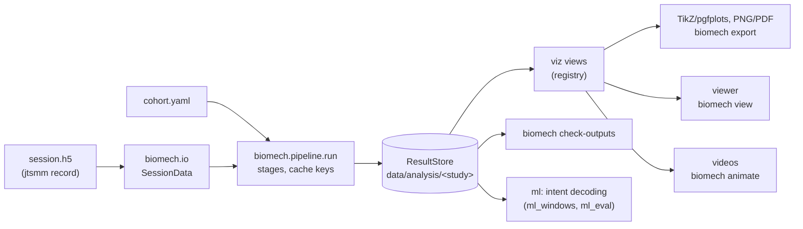

<!--
This file is part of JTS-MM (https://github.com/paulotto/jts-mm).
SPDX-FileCopyrightText: 2026 Paul-Otto Müller
SPDX-License-Identifier: CC-BY-4.0
-->

# Offline analysis (`biomech`)

How recorded JTS-MM sessions (JTS-MM: the open-source multimodal jaw tracking system, i.e.
optical tracking, inertial measurement units (IMU) and surface EMG (sEMG) on one clock) become
study results: the pipeline, the method definitions (with the mathematics), the tools, and
where the code is. Two studies use it:
- the **dataset study** (dataset paper): configuration in
  [`experiments/icorr2027`](../../experiments/icorr2027/README.md), frozen analysis plan in
  [`analysis_plan.md`](../../experiments/icorr2027/analysis_plan.md), every amendment (D…),
  erratum (E…) and exploratory addition (X…) in
  [`change_log.md`](../../experiments/icorr2027/change_log.md);
- the **system-validation study** (systems paper, JTS-MM against Qualisys and Delsys):
  [`experiments/jtsmm_validation`](../../experiments/jtsmm_validation/README.md), its own plan
  [`analysis_plan.md`](../../experiments/jtsmm_validation/analysis_plan.md) and
  [`change_log.md`](../../experiments/jtsmm_validation/change_log.md) (deviations VD…,
  errata EV…), method doc an14.

Codes such as C1 (pre-specified outcome), D… or VD… (post hoc deviation), E… / EV… (erratum)
and X… (exploratory) refer to these plans and their change logs; [an07](an07_statistics.md) (*Evaluation stance*,
*Families and multiplicity*) explains the evidence levels.



**Layering:** `jtsmm` holds the signal primitives shared with real-time use (mains removal,
causal filters, onset detectors, IMU maths); `jts` (`software/jaw_tracking`) holds landmark
calibration and jaw kinematics; `biomech` holds study-level analysis; `ml` holds intent
decoding. Dependencies only point downstream.

## 1. Quick start (the recorded pilot data)

```bash
# once: one venv for everything (repo root)
python -m venv software/jtsmm/.venv
software/jtsmm/.venv/bin/pip install -e "software/jtsmm[analysis,dev]" -e software/jaw_tracking \
    -e "software/biomech[all,dev]" -e "software/ml[dev]"
```

The sessions are expected in `data/pilot_study/jtsmm_data/` (untar `jtsmm_data.tar.gz` there;
`--data-dir` or `$JTSMM_DATA_DIR` override it). Results go to `data/analysis/icorr2027/`. Both
are git-ignored: they are subject data.

| Step | Command (`make -C experiments/icorr2027 <target>` or the `biomech` CLI) |
|---|---|
| Validate the cohort manifest | `make check` · `biomech cohort check --config experiments/icorr2027/study.yaml` |
| Run everything (cached; ≈ 40 min cold on the pilot, `ml_eval` and `ml_online` are most of it) | `make all` · `biomech run --config … -j 6` |
| Run one stage / participant | `biomech run --config … --stage timing --subject s03` (dependencies first; `--force` re-runs) |
| What is up to date | `make status` · `biomech status --config …` |
| Per-stage timing of a run | `biomech bench --config … [--run ID]` (→ `<out_dir>/bench/<run>.csv`) |
| Sensitivity variant (e.g. pre-D14 masking) | `biomech sensitivity --config … lowfreq_mask -j 6` (no name: list the variants; an08 §1) |
| Print or save one table | `biomech show --config … stats_timing timing_cohort [--csv out.csv]` |
| Viewer (http://127.0.0.1:8060, local only) | `make view` · `biomech view --config … [--port 8061]` |
| Paper figures and tables (+ `preview.pdf`, size check) | `make paper` |
| Every view, perspective and participant | `make export-all` · `biomech export --config … --all [--kind data] [--perspectives default] [--pid s01] [--to DIR]` |
| Participant report (all data views + key tables, PDF) | `biomech report --config … --pid s01` |
| Synchronized video (+ LaTeX filmstrip) | `make video [PID=s03 LAYOUT=kinematics PHASE=open_close SPEED=0.25]` · `biomech animate --config … --pid s01 --layout multimodal --phase chewing` |
| Check every output (numbers, figures, videos, privacy) | `make check-all` · `biomech check-outputs --config …` |
| Remove leftovers of interrupted writes | `biomech gc --config …` |
| Try everything without subject data | `biomech synth --out /tmp/synth` (4 synthetic participants with a known truth, runs all stages), then use `--config /tmp/synth/study.yaml` |

The Makefile uses `biomech` from the activated venv, or else `software/jtsmm/.venv/bin/biomech`
(`make BIOMECH=… ` overrides). Camera frames enter a video only with `biomech animate
--with-camera`; they show the participant and are never committed.

**Viewer pages** (an09): Overview (`/`: stage × participant status, run/cancel with
progress), Signals (`/signals`, alias `/explorer`: synchronized raw data and camera frames; the
*Atlas* tab shows every data view), Results (`/results`, alias `/analysis`: every registered
result view grouped by domain, with perspective/statistic/participant controls, Export →
LaTeX/PDF at the current zoom, and a *Tables* tab for every stored table), Paper (`/paper`: the
paper sets' items, the depiction gallery, *Export the paper set*, *Export every view*), Videos
(`/videos`, alias `/animation`: preview, render in the background, cancel, link to the MP4).

## 2. The pipeline

Each stage is a pure function registered in `biomech/stages.py`; `biomech.pipeline.run`
executes the graph participant-major: one worker runs a participant's whole chain of stages
with a shared `UnitCache` (open sessions, the cleaned EMG `EmgPrep`, the pose chain), and each
cohort stage starts as soon as its inputs are finished (an08 §1). Every result is cached under a
key = hash(stage name and version, stage parameters + `signals` block, analysis code, the
participant record and input-file fingerprints, upstream keys), so a changed parameter or code
line re-runs exactly what depends on it (an08 §2); presentation code (`viz`, `viewer`, `anim`,
`check`) never invalidates results.

| Stage | Scope | Depends on | Computes | Doc |
|---|---|---|---|---|
| `qc` | participant | — | phase inventory, sync, EMG line frequency, SNR, mains share, artifact masks (analysis mask; low-frequency rule as a flag, D14), usability flags (shape / amplitude / rest / low-frequency), IMU and optical coverage | an01 §3, an03 §2 |
| `qc_cohort` | cohort | qc | aggregate demographics, flags, overview, electrode impedance (D21) | an01 §3, §3.4 |
| `kinematics` | participant | qc | relative pose chain → maxillary frame, landmark roles, cycles and flags, clinical metrics, derivatives, helical axes, hinge models, coupling, jaw geometry (D21) | an02 |
| `emg` | participant | qc, kinematics | references (largest activity recorded, D11), normalized activation per task, cycle profiles, co-contraction index (CCI), asymmetry/activity indices, spectra (X1), mask validation and mask sensitivity (D14) | an03 §2, §4, §5, §7 |
| `imu` | participant | qc, kinematics | sanitized streams, one-time calibration (mounting, heading), opening estimators, onset signals, movement bandwidth (X1) | an04 §1–§6 |
| `emg_relevance` | participant | emg | which muscle is active in which task (D19) | an03 §4.1 |
| `uncertainty` | participant | kinematics | Monte Carlo noise floor of the hinge residual (G′1): bench and in-vivo nulls, the D24 / D25 variants and the D33 condyle-hinge nulls, Monte-Carlo p | an06 §3, an02 §6b, an07 §14 |
| `labels` | participant | kinematics | intent labels from kinematics (the decoding ground truth) | an05 §4 |
| `labels_check` | cohort | labels, kinematics | validity of the intent labels: Cohen's κ against a second, independent rule on random windows (fixed and rest-floor thresholds; table `kappa`) | an05 §4.1, an07 §16.3 |
| `timing` | participant | kinematics, imu, emg | mechanical and EMG onsets (3 detectors × 3 rules), lead, causal margin, chance null of the lead (D23); ensemble timing (X2); causal release (X3); post hoc family C2-E with its surrogates (X6) | an05 §1–§3 |
| `stats_kinematics` | cohort | kinematics, uncertainty | reference values, reliability (ICC/SEM/MDC), hinge and noise summaries, FHA, condyle sensitivity | an02 §7, an07 §8, §12, §14 |
| `stats_emg` | cohort | emg, qc | activation (linear mixed model, LMM), rest activity, CCI, indices, statistical parametric mapping (SPM; confirmatory + descriptive), spectral cohort, mask validation | an03 §4, an07 §6, §10 |
| `stats_timing` | cohort | timing | lead and margin per detector × rule (Wilcoxon, Holm families), the test against the chance null, specification values, usability, ensemble and release cohorts; C2-E cohort tests (intersection-union, serial gatekeeping) and decision | an05 §3, an07 §4.2, §7 |
| `stats_imu` | cohort | imu, kinematics | IMU agreement, repeated-measures Bland–Altman (subject and leave-one-subject-out (LOSO) models) | an04 §4a, an07 §9 |
| `variability` | cohort | kinematics, emg, stats_kinematics, stats_timing, qc | specification curve, cycles needed, protocol heterogeneity (S2) | an07 §11 |
| `requirements` | cohort | kinematics, imu, uncertainty, stats_kinematics, stats_timing, stats_imu | derived exoskeleton requirements: design value (Harrell–Davis P95 with its order-statistic lower bound and the maximum, E31), performance medians, MOVER interval of the IMU limits (D26), post hoc C2-E rows; statistic, derivation, evidence level | an07 §13, an02 §7a |
| `camerafree`, `camerafree_cohort` | participant / cohort | qc, kinematics, imu, labels → camerafree | camera-free jaw pose (X5): rotation ladder E1–E3, translation E4–E6, anchors, drift; X5b / X5c; cohort medians, ladder contrasts, E4gen | an04 §7, an07 §15, an13 §6 |
| `validation` | cohort | qc | reference-system validation (G) when reference data exist (status only in the dataset study) | an06 §1 |
| `ref_*` (group `validation`, 16 stages) | participant / cohort | per stage | the separate system-validation study (JTS-MM vs Qualisys / Delsys): `ref_sync`, `ref_tip`, `ref_quality`, `ref_kinematics`, `ref_landmarks`, `ref_agreement`, `ref_sampling`, `ref_emg`, `ref_emg_side`, `ref_trueness`, `ref_fusion`, `ref_camerafree`, `ref_hinge`, `ref_budget`, `ref_imu_lever`, `ref_imu_accel` | an14 §2 (stage table), §3–§11b |
| `ml_windows`, `ml_eval` | participant / cohort | labels, qc → ml_windows | decoding windows and features; nested LOSO, blocked cross-validation (CV), latency, false activations (`software/ml`) | an05 §5, docs/ml |
| `ml_online` | cohort | ml_windows, ml_eval, timing, labels | pseudo-online (simulated real-time) replay of the causal chain and decoder in 20 ms chunks (X4, exploratory) | an05 §5, docs/ml (ml08) |

Parameters and their defaults: `software/biomech/biomech/etc/biomech.yaml` (each line
commented); a study overrides them in its `study.yaml`. Column names, units, decimals and
plausible ranges: `biomech/etc/catalog.yaml`.

## 3. Reading order and index

Start with an01 → an02 → an03 → an04 → an05 for the measurements, an06 → an07 for uncertainty
and statistics (an07 is the reference for every statistical procedure; the method docs link to
it), then an08 for the results API, export and the command reference (§6), an13 for what each
paper figure and table shows, and an09–an12 for the tools. The method docs an01–an07 and an14
open with a notation table and give each computation as *what and why*, the formula as the
code computes it, the parameters, the code pointer and a *Paper wording* paragraph.

| Doc | Content |
|---|---|
| [an01](an01_cohort_and_quality.md) | Notation; cohort manifest, inclusion and repeated takes, QC metrics (EMG, IMU, optical), usability flags instead of exclusion, electrode impedance (§3.4, D21) |
| [an02](an02_frames_and_kinematics.md) | §0 notation and rigid-body primitives; pose chain, the eight landmarks, maxillary frame, cycles, clinical metrics, derivatives, helical axes, hinge models (C1), jaw geometry (§6a), the hinge residual against measurement noise (§6b), participant metrics and norms, kinematic inputs of the requirements (§7a) |
| [an03](an03_emg_processing.md) | Notation; montage, EMG cleaning (grid frequency, mains model), artifact masks, MVC/RVC normalization (largest activity recorded, D11), usability per analysis family, outcomes and activity relevance (§4.1, D19), spectra (X1), low-frequency mask validation |
| [an04](an04_imu_processing.md) | §0 notation; what was recorded (game rotation vector + raw acceleration incl. gravity, dynamic calibration), preprocessing, calibration, opening estimators, the IMU opening model and the C3a outcome (§4a), timing/decoding signals, bandwidth (X1), and the camera-free jaw-pose study (§7, X5 / X5b / X5c) |
| [an05](an05_timing_and_onsets.md) | §0 notation; onset detectors and rules, mechanical onsets (ω, \|a_rel\|, α), EMG→motion lead and its chance null (D23 / D34), causal budget, ensemble timing (X2), causal release (X3), the post hoc family C2-E (X6), intent labels (§4) and their validity check (§4.1, stage `labels_check`), decoding with the full mathematics (§5: features, SVM, protocols, metrics, permutation and few-shot tests, pseudo-online replay) |
| [an06](an06_uncertainty_and_validation.md) | Notation; reference validation (G) and backup G′ (Monte Carlo nulls incl. D24 / D25 / D33, in-vivo noise floor, cross-modal), the Qualisys hinge check (VD21) and the error budget (cited from an14) |
| [an07](an07_statistics.md) | **Statistics reference** with notation and an index (method → section → where used): reporting population (D35), evaluation stance, families and multiplicity, descriptives and bootstrap, signed-rank tests and Hodges–Lehmann, Monte-Carlo and permutation p, Holm, intersection-union and gatekeeping, models (LMM), C2 families, reliability, Bland–Altman, SPM, variability (S2), norms, requirements (E31, D26), C1 nulls, camera-free, Cohen's κ, the systems-study agreement statistics, thresholds and exclusions |
| [an08](an08_results_api_and_export.md) | Run API and cache keys, snapshots, sensitivity runs, ResultStore, catalog, figure/table export (venues, reader text, captions, paper sets, in-text numbers), synthetic ground truth, command reference, adding an analysis |
| [an09](an09_viewer.md) | Analysis viewer (all pages) |
| [an10](an10_data_atlas.md) | Data atlas (views of the data itself), perspectives, participant report |
| [an11](an11_animation.md) | Animated visualizer: videos, Plotly preview, filmstrip and `animate` export |
| [an12](an12_output_check.md) | `biomech check-outputs`: every check area, the variant-aware paper checks, participant counts (caption n against the item's source tables), reader text (incl. codes dropped from labels and sentences), `check-paper` |
| [an13](an13_paper_views_and_dashboards.md) | Paper sets (dataset: blocks A / B / C; systems: metrology order; the reporting-population variant), paper figures and tables (every number's rule), dashboards, the C2-E and camera-free views |
| [an14](an14_system_validation.md) | System validation against Qualisys/Delsys (separate study, systems paper), with notation (§0), the stage table (§2), clock and frame timing (§3.1–§3.8), CT tip, reference quality, primary outcome and error budget, cycle agreement, EMG and bench metrology, fusion, point marking, the later additions (VD9–VD23, EV6–EV14) and the views (§12) |
| [an14 rename list](an14_r6_rename_list.md) | VD33 (change-log entry J30): every exported phrase renamed from "reference" / σ_ref / "error" to Qualisys / Delsys / σ_Q / "difference", and the occurrences kept with their reason |
| [an20](an20_acquisition_quality.md) | Acquisition quality of the dataset (X11, change-log entry J14), taken over from the earlier evaluation of the recording system: frame drops and the frame-trigger association, camera time base, IMU-to-camera lag per take (three takes ~10 ms late; the `imu_latency` variant), stereo calibration in use and its cross test, recording days, trajectory sensitivity to the calibration; checks against the original evaluation scripts |

## 4. Code map (`software/biomech/biomech/`)

| Module | Role | Doc |
|---|---|---|
| `config.py`, `paths.py`, `cohort.py` | defaults + study YAML (strict types), data-dir resolution, cohort manifest | an01, an08 |
| `pipeline.py`, `stages.py` | stage registry and plugins, cache keys, `run()` (participant-major scheduler, shared `UnitCache`), the stage functions | an08 §1 |
| `sensitivity.py` | sensitivity runs (`biomech sensitivity`) and their table-by-table comparison | an08 §1 |
| `results/` (`store.py`, `provenance.py`, `access.py`, `bench.py`, `snapshot.py`, `schema.py`, `release.py`) | `ResultStore` (atomic writes, run lock, `gc`), manifests, read tracking (coverage guard), run timing, snapshots and `compare`, data dictionary (`describe`), pseudonymized dataset release (`export-data`) | an08 §1, §2 |
| `io/` (`session.py`, `inventory.py`, `context.py`, `reference.py`) | phase-windowed session access, inventory, `DataContext` (cached per-participant data), the Qualisys (QTM `.mat`) and Delsys CSV readers of the validation study | an01, an08, an14 |
| `qc/` (`metrics`, `report`, `streams`, `impedance`) | QC metrics, the usability table, stream products for the atlas, electrode impedance (D21) | an01 |
| `frames/` | landmark roles and their checks, maxillary frame | an02 |
| `kinematics/` (`pose_chain`, `se3`, `cycles`, `peak_cycles`, `clinical`, `derivatives`, `helical`, `hinge_fit`, `coupling`, `geometry`, `traces`, `analysis`) | pose chain → metrics, cycles, finite helical axes (FHA), hinge models, coupling, jaw geometry | an02 |
| `emg/` (`pipeline`, `artifacts`, `prepare`, `analysis`, `causal`, `relevance`) | cleaning chain, masks, references, activation, profiles, indices, the causal chain, activity relevance (D19) | an03 |
| `spectral.py` | Welch PSD, MNF/MDF, band shares, power quantiles (X1) | an03 §5, an04 §6 |
| `imu/` (`preprocess`, `calibration`, `analysis`, `lever`, `camerafree`, `stage_camerafree`) | streams, calibration, estimators, onset signals, bandwidth; the camera-free study (X5) | an04, an07 |
| `timing/` (`lead.py`, `ensemble.py`, `release.py`, `surrogates.py`, `locking.py`, `coupling.py`, `changepoint.py`, `c2e.py`) | single-cycle onsets and leads, the chance null (D23); ensemble timing (X2); causal release detector (X3); the one surrogate engine (S1, S2, seeding); locking, mixture location and Theil–Sen (C2-E P1–P3); lagged correlation and continuous coupling (P5); variance changepoint (P6); the C2-E family | an05 |
| `labels/` (`auto_labels`, `kappa`) | intent labels; their validity check against a second rule (stage `labels_check`; `scripts/audit_recompute/labels_kappa.py` runs the same code on older snapshots) | an05 §4, §4.1 |
| `uncertainty/` (`montecarlo`) | Monte Carlo noise floor and its nulls | an06 §3 |
| `stats/` (`core`, `families`, `waveforms`, `requirements`, `cohort_*` incl. `cohort_c2e`, `cohort_camerafree`) | descriptives, shared test building blocks, LMM, reliability, SPM, requirements, cohort tables | an07 |
| `validation/` (`stages.py`, `stages_ref.py`, `stages_camerafree.py` and the method modules) | the system-validation study (`ref_*` stages) | an14 |
| `papers.py` | paper sets: items, targets, the reporting-population variant, the pinned store | an13 |
| `timebase.py`, `ensembles.py` | gap-aware time base and resampling; trial ensembles and perspectives | an08, an10 |
| `catalog.py` + `etc/catalog.yaml` | labels, units, decimals, plausible ranges of every column | an08 §3 |
| `viz/` (`spec`, `layout`, `style`, `render_pgf/mpl/plotly`, `export`, `downsample`, `caption`, `manifest`, `numbers`, `serialize`, `gallery`) | figure/table specs, one layout engine, three renderers, LTTB/min-max downsampling of long signals, structured captions, export manifest, in-text numbers, spec and source-data files, the depiction gallery | an08 §4 |
| `viz/views/` (`registry`, `blocks`, `vocab`, `forms`, `tables`; view modules `paper`, `paper_icorr`, `paper_journal`, `paper_dataset`, `paper_c2e`, `camerafree`, `dashboards`, `data`, `frequency`, `results_emg`, `results_timing`, `results_ml`, `results_kinematics`, `results_qc`, `results_online`, `results_pipeline`, `results_sensitivity`, `validation*`) | registered views (auto-discovered, grouped by domain), shared panel builders, labels/units | an08 §7, an10, an13 |
| `report.py` | participant report | an10 |
| `anim/` | videos, Plotly preview, filmstrip | an11 |
| `check/outputs.py`, `check/coverage.py`, `check/integrity.py`, `check/text.py` | `check-outputs` (incl. the participant counts); which stored outputs no view shows; export integrity; reader text (incl. `dropped_code_issues`) | an12, an13 §4 |
| `viewer/` | Dash viewer (`pages/control`, `explorer`, `analysis` (Results + table browser + paper board), `animation`; `runs.py`, `videos.py`) | an09 |
| `testing/synth.py` | synthetic ground-truth study generator | an08 §5 |
| `cli.py` | the `biomech` command | an08 §6 |

The decoding stages live in `software/ml/ml/` (`biomech_stages.py`: `ml_windows`,
`ml_eval`; `online/`: the pseudo-online replay stage `ml_online`, X4), registered through the
`biomech.stages` entry point ([`software/ml/README.md`](../../software/ml/README.md),
[`docs/ml/`](../ml/README.md)). The camera-free stages are in `imu/stage_camerafree.py`, the
validation stages in `validation/stages*.py`; `biomech stages` lists every registered stage
with its group (dataset / validation) and dependencies.

Signal primitives used here live in `software/jtsmm/jtsmm/emg/` (`mains.py`: harmonic mains model;
`onset.py`: TKEO / Hodges–Bui / envelope detectors) and `software/jtsmm/jtsmm/imu/`.
Tests: `software/biomech/tests/` (`pytest -m "not slow"` for the fast suite; the slow tests run
the full graph on the synthetic ground truth).
