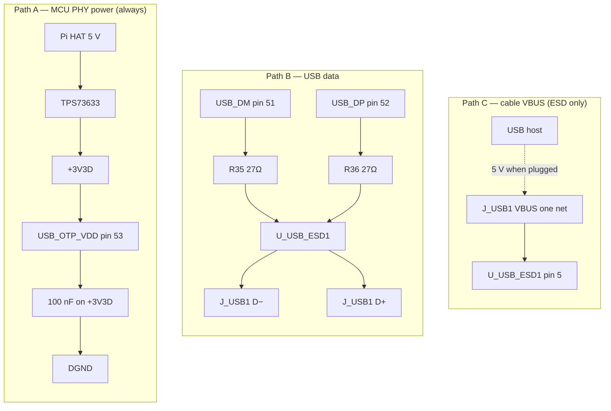

<!--
This file is part of JTS-MM (https://github.com/paulotto/jts-mm).
SPDX-FileCopyrightText: 2026 Paul-Otto Müller
SPDX-License-Identifier: CC-BY-4.0
-->

# h05 — MCU Schematic Build Guide (KiCad capture walkthrough)

Step-by-step companion to `[h05_microcontroller_firmware.md](h05_microcontroller_firmware.md)` for capturing **RP2350A + USB + ADS1299 SPI/control** in KiCad 10. Work inside `hardware/jtsmm_hat/sheets/mcu.kicad_sch`.

> **All physical pin numbers in this guide are for the RP2350A QFN-60** (RP2350 datasheet §14.8.2). They differ from the legacy RP2040 QFN-56. The **GPIO function assignments are unchanged**; only package pin numbers and the core-regulator topology change.

> **SWD / flash / BOOTSEL:** footprint and bench procedure are in `[h08_rp2350_flashing.md](h08_rp2350_flashing.md)` — do not duplicate here; only reference the required nets.

> **IMU JSTs:** on `[imu_connectors.kicad_sch](../../hardware/jtsmm_hat/sheets/imu_connectors.kicad_sch)` — see `[h04_imu_schematic_build_guide.md](h04_imu_schematic_build_guide.md)`.

## How to read the diagrams

Same legend as `[h03_emg_schematic_build_guide.md](h03_emg_schematic_build_guide.md)` and `[_schematic_build_guide_conventions.md](_schematic_build_guide_conventions.md)`.

---

## Step 0 — Library, symbols, and footprints

> **Footprint audit:** `[h09_footprint_master_table.md](h09_footprint_master_table.md)` · P0: **L_VREG** must be **0806/2016** (not 0603).

Resolve symbols before capture so nothing rescues to a placeholder (same workflow as `[h03_emg_schematic_build_guide.md](h03_emg_schematic_build_guide.md)` Step 0).

**Symbols in KiCad 10 global libs** (default install): `MCU_RaspberryPi:RP2350A`, `Memory_Flash:W25Q128JVP`, `Device:C` / `Device:R` / `Device:L` / `Device:LED`, `Device:Crystal_GND24`, `Switch:SW_Push`, `Power_Protection:USBLC6-2SC6`, `Connector:USB_C_Receptacle_USB2.0_16P`, `Connector:Conn_01x03_Pin`.

| Catalog ID   | Part                                                                            | KiCad symbol                                                      | Notes                                                                                                                                                                                    |
| ------------ | ------------------------------------------------------------------------------- | ----------------------------------------------------------------- | ---------------------------------------------------------------------------------------------------------------------------------------------------------------------------------------- |
| H-IC-05      | **RP2350A** (QFN-60, 7×7 mm, 0.4 mm pitch)                                      | `MCU_RaspberryPi:RP2350A`                                         | Ref `**U_MCU1`**; on-chip SMPS per datasheet Figure 19 (§1.1).                                                                                                                           |
| H-PAS-08     | **3.3 µH** core-regulator inductor                                              | `Device:L`                                                        | Ref `**L2`**; **VREG_LX → DVDD**; Abracon **AOTA-B201610S3R3-101-T**; §1.1                                                                                                               |
| H-IC-06      | **W25Q128JVP** (WSON-8)                                                         | `Memory_Flash:W25Q128JVP`                                         | **128 Mbit** QSPI boot flash; ref `**U_FLASH1`**; footprint `Package_SON:WSON-8-1EP_6x5mm_P1.27mm_EP3.4x4.3mm`                                                                           |
| H-PAS-01     | **12 MHz** crystal (**ABM8-272-T3**, **±30 ppm**, Pi reference)                 | `Device:Crystal_GND24`                                            | Ref **Y1**; Value `12MHz`; pins **1/3** → XIN/XOUT, **2/4 (G)** → `DGND`. Footprint `Crystal_SMD_3225-4Pin_3.2x2.5mm`. Circuit §1.3 (Pi *Hardware design with RP2350* Figure 10).        |
| —            | Load caps ×2 (**C41**, **C42**)                                                 | `Device:C`                                                        | **15 pF** C0G/NPO each (**C_L = 10 pF** on **ABM8-272-T3**). Formula §1.3.                                                                                                               |
| —            | XOUT series resistor (**R53**)                                                  | `Device:R`                                                        | **1 kΩ** **0603** in series on **XOUT** between **U_MCU1** pin 22 and **Y1** pin 3 (limits overdrive at **3.3 V IOVDD**).                                                                |
| H-PAS-01-UPG | **12 MHz** upgrade crystal (**ABM8-12.000MHZ-12-B1U-T**, **±10 ppm**) — not fitted | `Device:Crystal_GND24`                                            | Not on the sheet (revision 0.0.1); an alternative to **Y1** — see §1.3 upgrade row.                                                                            |
| —            | Upgrade load caps (**18 pF**) — not fitted                                      | `Device:C`                                                        | **18 pF** C0G each, in place of **C41** / **C42**, only with the upgrade crystal. Not on the sheet.                                                |
| H-CON-06     | **USB-C** receptacle (USB 2.0 device, **horizontal**)                           | `Connector:USB_C_Receptacle_USB2.0_16P`                           | **GCT USB4105-GF-A**; ref `**J_USB1`**; footprint `Connector_USB:USB_C_Receptacle_GCT_USB4105-xx-A_16P_TopMnt_Horizontal` — see §1.5.0a                                                  |
| —            | USB ESD                                                                         | `Power_Protection:USBLC6-2SC6`                                    | On **D+ / D−** near **J_USB1**; ref `**U_USB_ESD1`**                                                                                                                                     |
| —            | CC resistors ×2                                                                 | `Device:R`                                                        | **5.1 kΩ** each: **CC1** / **CC2** → `DGND` — capture uses `**R37`**, `**R38**` (§1.5.3)                                                                                                 |
| —            | USB series resistors ×2                                                         | `Device:R`                                                        | **27 Ω** in series on **USB_DP** / **USB_DM** at RP2350A side (RP2350 minimal / *Hardware design with RP2350* §5.1) — §1.5.2                                                             |
| H-PAS-06     | **BOOTSEL** tactile                                                             | `Switch:SW_Push`                                                  | Ref **SW_BOOTSEL1**; **~QSPI_SS** / flash **~CS** net → **R17** 1 kΩ → switch → `DGND`; **R51** 10 kΩ from that net to `+3V3D` (§1.4)                                                                |
| H-PAS-06     | **RUN** (reset) tactile                                                         | `Switch:SW_Push`                                                  | Ref **SW_RESET1**; **RUN** → switch → **R16** 1 kΩ → `DGND` — **no external pull-up** (§1.4)                                                                                      |
| H-PAS-06     | **USER1** tactile                                                               | `Switch:SW_Push`                                                  | Ref **SW_USER1**; **GPIO10** → **R26** 1 kΩ → switch → `DGND`; enable **internal pull-up** in firmware (§1.4)                                                                                           |
| H-PAS-06     | **USER2** tactile                                                               | `Switch:SW_Push`                                                  | Ref **SW_USER2**; **GPIO11** → **R40** 1 kΩ → switch → `DGND`; enable **internal pull-up** in firmware (§1.4)                                                                                          |
| H-PAS-05     | Panel status LEDs ×4                                                            | `Device:LED`                                                      | **0603**; **3.3 V** direct (HB, fault, EMG_LO) or **+5V_IN** switched (CAP blue) — Step 6                                                                                                |
| H-PAS-09     | **LED_USER** addressable RGB                                                    | **4-pin WS2812** symbol *(preferred)* or `Device:LED` placeholder | **WS2812B-2020**; `**LED_WS2812B-2020_PLCC4_2.0x2.0mm`**; **VDD → `+5V_IN`**; **GPIO4** → **R25** (220 Ω) → **DIN**; **100 nF** on **VDD**; **DOUT** NC — Step 6 §6.1 |
| —            | LED series R (0603 panel)                                                       | `Device:R`                                                        | **470 Ω** @ **3.3 V** (**R41** HB, **R24** fault, **R28** EMG_LO); **470 Ω** @ `**+5V_IN`** (**R27**, CAP blue anode) — Step 6 §6.0                                                                             |
| —            | CAP LED low-side switch                                                         | `Transistor_FET:AO3400A`                                          | Ref `**Q1**` — **GPIO24** → **R56** → gate; **R54** gate pulldown — §6.0.2                                                                                                               |
| —            | ADS1299 SPI series R                                                            | `Device:R`                                                        | **22 Ω** @ RP2350: **R19** SCLK, **R20** MOSI, **R18** MISO, **R61** `/CS` (Step 4; SBAS499 Fig. 80)                                                                                     |
| —            | Decoupling / pull-ups                                                           | `Device:C`, `Device:R`                                            | 100 nF, 10 µF, 10 kΩ per Steps 1–4                                                                                                                                                       |
| —            | SWD breakout                                                                    | `Connector:Conn_01x03_Pin`                                        | Ref `**J_SWD1`** — **GND, SWCLK, SWDIO**; see `[h08](h08_rp2350_flashing.md)` §4.2                                                                                                       |
| —            | Optional 2×5 ARM debug                                                          | `Connector:Conn_02x05_Odd_Even`                                   | Not on the sheet; only for a 10-pin ribbon (`[h08](h08_rp2350_flashing.md)` §4.3)                                                                                                    |

> **Do not use** `Device:Resonator` or `Device:Oscillator` for **H-PAS-01** — those are different part classes. For a true **2-pin** crystal footprint only, `Device:Crystal` is acceptable; **ABM8 / 4-pad** parts should use `**Crystal_GND24`**.

> **C_L vs C0 vs external caps — do not confuse these.** Three different capacitances appear around the crystal:
>
> - **Load capacitance C_L** — what the crystal datasheet specifies (e.g. **10 pF** on **ABM8-272-T3**, **12 pF** on the upgrade **ABM8-12-B1U-T**).
> - **Shunt (static) capacitance C0** — fixed crystal property (~3 pF on ABM8). You do not choose it.
> - **External load caps (C41, C42)** — one from **XIN** and one from **XOUT** to `DGND`. With two equal caps: `**C_L ≈ C_ext/2 + C_stray`**. Pi minimal layout assumes `**C_stray ≈ 3 pF**`; use `**C_ext ≈ 2 × (C_L − C_stray)**` when retuning.
> - **XOUT series resistor (R53)** — Pi pairs **ABM8-272-T3** (50 Ω max ESR) with **1 kΩ** at **3.3 V IOVDD** to limit crystal drive (*Hardware design with RP2350* §4). Omit **R53** only on the **upgrade** tier (higher ESR crystal) — see table below.

### 1.3 12 MHz crystal — Pi default vs ±10 ppm upgrade

**Default (populate):** match Raspberry Pi *Hardware design with RP2350* **Figure 10** / §4.1 — **ABM8-272-T3**, **15 pF** load caps, **1 kΩ** series resistor (**R53**, in the **XOUT** line). Same part as Pico 2; JLCPCB/LCSC **C20625731**.

**Upgrade (alternative, not on the sheet):** **ABM8-12.000MHZ-12-B1U-T** (±10 ppm, **C_L = 12 pF**, **18 pF** caps, **no series resistor**), in place of the default tier. **Only one crystal tier can be fitted.**

**Wiring (3225 4-pad ABM8-class):** `Device:Crystal_GND24`; pins **1/3** → **XIN/XOUT** (pin 3 via **R53** on the default tier); pins **2/4 (G)** → `DGND`; footprint `**Crystal:Crystal_SMD_3225-4Pin_3.2x2.5mm`**.

```text
Default (Pi):
  U_MCU1 XIN (21) ────────────► Y1 pin 1 ──┬── C41 15pF ── DGND
  U_MCU1 XOUT (22) ─ R53 1kΩ ─► Y1 pin 3 ──┴── C42 15pF ── DGND
  Y1 pins 2,4 (G) ── DGND

Upgrade (alternative — no series resistor):
  XIN ──► Y1_UPG pin 1 ──┬── C41_UPG 18pF ── DGND
  XOUT ─► Y1_UPG pin 3 ──┴── C42_UPG 18pF ── DGND
```

| Tier        | MPN                                 | ±ppm      | C_L       | ESR (max) | Caps **each**                        | **R53**  | Populate                  |
| ----------- | ----------------------------------- | --------- | --------- | --------- | ------------------------------------ | -------- | ------------------------- |
| **Default** | **ABM8-272-T3**                     | ±30       | **10 pF** | 50 Ω      | **15 pF** (**C41**, **C42**)         | **1 kΩ** | **YES**                   |
| **Upgrade** | **ABM8-12.000MHZ-12-B1U-T**         | ±10       | **12 pF** | 120 Ω     | **18 pF** (**C41_UPG**, **C42_UPG**) | omit     | not on the sheet          |
| Other       | **ECS-120-8-33B-CTN-TR**            | ±15 stab. | **8 pF**  | 100 Ω     | **10–12 pF**                         | retune   | not stocked               |
| Reject      | **ABM8G-18-D2-T**, **ABM8-12-B2-T** | —         | **18 pF** | 120 Ω     | **27–33 pF**                         | —        | wrong with 15/18 pF lands |

**Hard rule:** never mix tiers (e.g. **272-T3** with **18 pF**, or **12-B1U-T** with **15 pF**) — detunes XOSC and can break **USB boot**.

**After changing crystal MPN:** recompute caps and update **Populate** / **DNP** fields.

**As captured on `mcu.kicad_sch` (revision 0.0.1):**

1. **Y1** = MPN **ABM8-272-T3**; **C41/C42** Value **15pF**.
2. **R53** **1 kΩ** in series: **U_MCU1 XOUT** → **R53** → **Y1** pin 3 / **C42**.
3. The upgrade tier (**Y1_UPG**, **C41_UPG**, **C42_UPG** with the **12-B1U-T** / **18 pF** network) is not on the sheet.

**Footprint mapping** (assign after ERC-clean schematic):

| Part            | Footprint (stock KiCad unless noted)                                                                                                                                                   |
| --------------- | -------------------------------------------------------------------------------------------------------------------------------------------------------------------------------------- |
| RP2350A         | `Package_DFN_QFN:QFN-60-1EP_7x7mm_P0.4mm` (60-pin + central exposed-pad ground)                                                                                                        |
| L_VREG (3.3 µH) | `**jtsmm:AOTAB201610S3R3101T`** (Abracon **AOTA-B201610S3R3-101-T**, RP2350 minimal land with polarity dot) — **not 0603**                                                               |
| W25Q128JVP      | `Package_SON:WSON-8-1EP_6x5mm_P1.27mm_EP3.4x4.3mm` (Winbond **JVP** = WSON + exposed pad)                                                                                              |
| Y1 (12 MHz)     | `Crystal:Crystal_SMD_3225-4Pin_3.2x2.5mm` — **ABM8-272-T3**; the upgrade **ABM8-12-B1U-T** uses the same land                                                                        |
| USB-C           | `Connector_USB:USB_C_Receptacle_GCT_USB4105-xx-A_16P_TopMnt_Horizontal` — MPN **USB4105-GF-A**; 3D: `…/USB_C_Receptacle_GCT_USB4105-xx-A_16P_TopMnt_Horizontal.step`                   |
| USBLC6-2SC6     | `Package_TO_SOT_SMD:SOT-23-6`                                                                                                                                                          |
| SW_Push         | `Button_Switch_SMD:SW_SPST_CK_RS282G05A3` (MPN **RS-282G05A3-SMRT**)                                                                                           |
| LED (0603)      | `LED_SMD:LED_0603_1608Metric` (colour per Step 6 silkscreen)                                                                                                                           |
| LED_USER (RGB)  | `LED_SMD:LED_WS2812B-2020_PLCC4_2.0x2.0mm` — **not** `LED_0603_1608Metric`                                                                                                             |
| Passives        | `Capacitor_SMD:C_0603_1608Metric` / `Resistor_SMD:R_0603_1608Metric` — **exceptions:** all 100 nF (**C43, C47–C52, C64, C65, C67–C71**) and **C45 / C66** (4.7 µF) → `**C_0402_1005Metric`** (§1.1.2); **C39** (10 µF) → `C_0805_2012Metric` |
| SWD 3-pin       | `Connector_JST:JST_SH_SM03B-SRSS-TB_1x03-1MP_P1.00mm_Horizontal` (**J_SWD1**)                                                                                   |

I2C **2.2 kΩ** pull-ups live on `[imu_connectors.kicad_sch](../../hardware/jtsmm_hat/sheets/imu_connectors.kicad_sch)` — do not duplicate on **mcu** (`[h04_imu_schematic_build_guide.md](h04_imu_schematic_build_guide.md)`).

---

## Step 1 — RP2350A minimum system

Authoritative references: RP2350 datasheet (§6.3 power supplies, §14.8 pinout); *Hardware design with RP2350* (minimal design example, Figure 19 default combined supply). **USB bootloader requires a 12 MHz crystal** (datasheet XIN/XOUT pin text).

### 1.1 Power, ground, and on-chip 1.1 V SMPS core regulator

All 3.3 V supplies — **IOVDD**, **QSPI_IOVDD**, **USB_OTP_VDD**, **ADC_AVDD**, and the regulator input **VREG_VIN** — connect to `**+3V3D`**; **VREG_AVDD** is fed from `+3V3D` through **R39**. Unlike the RP2040 (internal LDO), the RP2350 core supply **DVDD = 1.1 V** is produced by an **on-chip SMPS buck**: **VREG_LX** drives an external **3.3 µH** inductor into the **DVDD** net (datasheet §6.3.7–6.3.8, Figure 19). Values are the canonical ones in `[../04_component_catalog.md](../04_component_catalog.md)` **H-PAS-08** and must match `[h07_power_grounding_safety.md](h07_power_grounding_safety.md)` §1.

| RP2350A pin(s)                                                                         | Net                     | Connection                                                                                                                                                                                                      |
| -------------------------------------------------------------------------------------- | ----------------------- | --------------------------------------------------------------------------------------------------------------------------------------------------------------------------------------------------------------- |
| **IOVDD** (pins **1, 11, 20, 30, 38, 45**) | `+3V3D`                 | Nine **100 nF 0402** on the common `+3V3D` net serve all 3.3 V pins: **C47, C48, C50, C51, C67, C68, C69, C70, C71** — placement §1.1.2; **10 µF** bulk **C39** (**0805**) |
| **USB_OTP_VDD** (53)                                                                   | `+3V3D`                 | Same `+3V3D` net (no separate capacitor net) — **not** USB-C **VBUS** (§1.5.0)                                                                                                                                 |
| **QSPI_IOVDD** (54)                                                                    | `+3V3D`                 | Same `+3V3D` net                                                                                                                                                                                                |
| **ADC_AVDD** (44)                                                                      | `+3V3D`                 | Same `+3V3D` net (ADC unused on this HAT)                                                                                                                                                                       |
| **VREG_VIN** (49)                                                                      | `+3V3D`                 | **C45** **4.7 µF** (**0402**) → `DGND` at the pin — SMPS input (CIN)                                                                                                                                            |
| **VREG_AVDD** (46)                                                                     | `+3V3D` via RC          | **R39** **33 Ω** series from `+3V3D` + **C40** **4.7 µF** (**0603**) → `DGND` — quiet analog supply for the regulator                                                                                           |
| **VREG_LX** (48)                                                                       | `VREG_LX` (switch node) | → **L2** **3.3 µH** → `DVDD`; keep this loop tiny (§9)                                                                                                                                                             |
| **VREG_FB** (50)                                                                       | `DVDD`                  | Feedback sense — tie directly to the **DVDD** output net                                                                                                                                                        |
| **VREG_PGND** (47)                                                                     | `DGND`                  | Regulator power ground (switching return)                                                                                                                                                                       |
| **DVDD** (×3: pins 6, 23, 39)                                                          | `DVDD`                  | From the inductor output; **C66** **4.7 µF** (**0402**, COUT at **L2**) + **C46** **4.7 µF** (**0603**) + **100 nF 0402** **C64**, **C65**                                                                       |
| **GND** (center exposed pad)                                                           | `DGND`                  | Exposed pad; on the board **four vias** (0.4 mm drill) connect it to the `DGND` plane                                                                                                                          |

```text
+3V3D ──┬── C39 10 µF (0805) ── DGND
        ├──► IOVDD ×6 + USB_OTP_VDD (53) + QSPI_IOVDD (54) + ADC_AVDD (44) — 9× 100 nF 0402 on the +3V3D net (C47, C48, C50, C51, C67–C71)
        ├──► VREG_VIN (49) + C45 4.7 µF 0402 (CIN) to DGND
        └── R39 33 Ω ──► VREG_AVDD (46) + C40 4.7 µF 0603 to DGND

VREG_LX (48) ── L2 3.3 µH ──┬──► DVDD (6, 23, 39) + C64 / C65 100 nF 0402 + C46 4.7 µF 0603
                             ├──► VREG_FB (50)
                             └── C66 4.7 µF 0402 (COUT) to DGND
VREG_PGND (47) ── DGND

DGND ──► exposed pad (vias on the PCB)
```

> **Nets:** The nine **+3V3D** 100 nF capacitors share one `**+3V3D`** / `**DGND**` net. **C64** and **C65** are on the `**DVDD`** net (1.1 V). The `DVDD` net has no label on the sheet (KiCad net name `Net-(U_MCU1-VREG_FB)`). **C49** and **C52** are **not** MCU supply capacitors: **C49** is on USB **VBUS** (§1.5.0), **C52** on `+5V_IN` at **LED_USER1** (§6.1).

### 1.1.1 Schematic capture map (`mcu.kicad_sch`)

Cross-reference for the current capture (RP2350 datasheet **Figure 19** combined supply):

| Function            | Ref(s)                                                       | Value / MPN                                                                                 |
| ------------------- | ------------------------------------------------------------ | ------------------------------------------------------------------------------------------- |
| MCU                 | **U_MCU1**                                                   | RP2350A (MPN field **RP2350A-CT**, LCSC **C42411118**)                                      |
| +3V3D bulk          | **C39**                                                      | 10 µF **0805** **GRM21BR61C106KE15L**                                                       |
| +3V3D HF            | **C47, C48, C50, C51, C67–C71**                              | **100 nF ×9** — **0402** **GRM155R71C104KA88D** (LCSC **C71629**)                           |
| VREG CIN            | **C45**                                                      | 4.7 µF **0402** **GRM155R61E475ME15D** (LCSC **C2858031**) at **VREG_VIN**                  |
| VREG_AVDD filter    | **R39** + **C40**                                            | 33 Ω + 4.7 µF **0603** **GRM188R61A475KE15D** (LCSC **C71633**)                             |
| Buck inductor       | **L2**                                                       | 3.3 µH AOTA-B201610S3R3-101-T                                                               |
| DVDD bulk           | **C66**, **C46**                                             | **C66:** 4.7 µF **0402** **GRM155R61E475ME15D** (COUT at **L2**); **C46:** 4.7 µF **0603** **GRM188R61A475KE15D** |
| DVDD HF             | **C64**, **C65**                                             | 100 nF **0402** **GRM155R71C104KA88D**                                                      |
| Boot flash          | **U_FLASH1**                                                 | W25Q128JVPIM + **C43** (100 nF **0402**) + **C44** (1 µF **0603**) at flash **VCC**         |
| USB VBUS bypass     | **C49**                                                      | 100 nF **0402** on the **VBUS** net at **U_USB_ESD1** pin 5                                 |
| LED_USER1 bypass    | **C52**                                                      | 100 nF **0402** on `+5V_IN` at **LED_USER1** VDD                                            |
| Crystal             | **Y1** + **C41**/**C42** + **R53**                           | **ABM8-272-T3** + **15 pF** + **1 kΩ** (Pi §4)                                              |
| USB                 | **J_USB1**, **U_USB_ESD1**, **R35**/**R36**, **R37**/**R38** | USB4105-GF-A, USBLC6, 27 Ω D±, 5.1 kΩ CC                                                    |
| SWD                 | **J_SWD1**                                                   | 3-pin JST-SH                                                                                |

### 1.1.2 MCU decoupling — 0402 capacitors and placement

Per *Hardware design with RP2350* §2.2.1: use **smaller passives** so every supply pad gets a local **100 nF** (the board has **4 layers** with a `DGND` plane on `In1.Cu` — beyond the Pi minimal 2-layer board).

**BOM (11× at the MCU):** **C47, C48, C50, C51, C64, C65, C67, C68, C69, C70, C71** — **Murata GRM155R71C104KA88D** (0402, X7R). Footprint: `Capacitor_SMD:C_0402_1005Metric`. Nine are on `+3V3D` (**C47, C48, C50, C51, C67–C71**), two on `DVDD` (**C64**, **C65**).

**Placement on the board (revision 0.0.1):** `U_MCU1` and all its supply capacitors are on the **bottom** side (`B.Cu`), around the package. The table gives, for each capacitor, the nearest supply pin of `U_MCU1` on the same net and the distance from capacitor pad to MCU pad (centre to centre):

| Ref | Net     | Nearest RP2350A pin(s)                         | Distance |
| --- | ------- | ---------------------------------------------- | -------- |
| C50 | `+3V3D` | 1 (IOVDD)                                      | 1.1 mm   |
| C48 | `+3V3D` | 11 (IOVDD)                                     | 2.3 mm   |
| C67 | `+3V3D` | 20 (IOVDD)                                     | 3.2 mm   |
| C68 | `+3V3D` | 30 (IOVDD)                                     | 1.5 mm   |
| C69 | `+3V3D` | 38 (IOVDD)                                     | 4.7 mm   |
| C71 | `+3V3D` | 45 (IOVDD) / 44 (ADC_AVDD)                     | 3.7 mm   |
| C47 | `+3V3D` | 45 (IOVDD) / 44 (ADC_AVDD)                     | 4.6 mm   |
| C51 | `+3V3D` | 54 (QSPI_IOVDD) / 53 (USB_OTP_VDD)             | 3.6 mm   |
| C70 | `+3V3D` | 1 (IOVDD) / 54 (QSPI_IOVDD)                    | 3.8 mm   |
| C45 | `+3V3D` | 49 (VREG_VIN); also 53 at 2.1 mm, 54 at 2.4 mm | 1.5 mm   |
| C65 | `DVDD`  | 6 (DVDD)                                       | 2.4 mm   |
| C64 | `DVDD`  | 39 (DVDD)                                      | 2.9 mm   |
| C46 | `DVDD`  | 23 (DVDD)                                      | 3.5 mm   |
| C66 | `DVDD`  | 50 (VREG_FB), at the output pad of **L2**      | 2.8 mm   |
| C40 | `VREG_AVDD` | 46 (VREG_AVDD)                             | 3.6 mm   |

The bulk capacitor **C39** (10 µF) is on `B.Cu` about 9 mm from the nearest `+3V3D` pin. The buck loop (**L2**, **C45**, **C66**) sits on `B.Cu` next to pins 48–50, in the digital part of the board (`[h10_kicad_pcb_layout_guide.md](h10_kicad_pcb_layout_guide.md)` §5.2).

> **Ultra-low-noise alternative (datasheet Figure 21):** disable the on-chip regulator and feed **DVDD** from an external **1.1 V LDO** (no inductor, VREG_VIN/VREG_AVDD/VREG_LX handling per Figure 21). Not used in v1 — the star-ground already isolates the digital switching node from the analog domain (`[h07_power_grounding_safety.md](h07_power_grounding_safety.md)` §1).

### 1.2 Crystal (12 MHz) — default Pi layout

| Net / part               | RP2350A / ref                      | Notes                                                                |
| ------------------------ | ---------------------------------- | -------------------------------------------------------------------- |
| **XIN** (21)             | **Y1** pin 1                       |                                                                      |
| **C41**                  | **XIN** / **Y1** pin 1 → `DGND`    | **15 pF** C0G; the 18 pF upgrade tier is not on the sheet (Step 0, §1.3) |
| **XOUT** (22)            | via **R53** **1 kΩ** → **Y1** pin 3 | Pi damping resistor (*HW design with RP2350* §4)                    |
| **C42**                  | **Y1** pin 3 → `DGND`              | **15 pF** C0G                                                        |
| **Y1** pins 2, 4 (**G**) | `DGND`                             | Case ground                                                          |

### 1.3 QSPI boot flash — **W25Q128JVP** (`U_FLASH1`)

**Why this part:** RP2350A has **no internal flash** (unlike the in-package RP2354A); it boots from external **QSPI** via the **QSPI_IOVDD** domain. The Pico 2 reference uses **2 MiB (W25Q16)**; **W25Q128JVP** is **16 MiB (128 Mbit)** — same **3.3 V** Winbond family, **quad-SPI**-capable, proven on RP-class boards. Gives headroom for UF2, firmware, and future storage without changing the netlist. **Do not** use SPI-only wiring: **IO2/IO3** must reach the RP2350A **QSPI_SD2/SD3** pins for quad boot.

| Flash pin | Name                 | Connect to                            | Notes                                                                                                           |
| --------- | -------------------- | ------------------------------------- | --------------------------------------------------------------------------------------------------------------- |
| 1         | **~CS**              | **~QSPI_SS** (RP2350A pin 60)         | Shared with **BOOTSEL** switch (see §1.4)                                                                       |
| 2         | **DO / IO1**         | **QSPI_SD1** (59)                     |                                                                                                                 |
| 3         | **~WP / IO2**        | **QSPI_SD2** (58)                     | **Quad IO2** — not tied to +3V3 alone                                                                           |
| 4         | **GND**              | `DGND`                                |                                                                                                                 |
| 5         | **DI / IO0**         | **QSPI_SD0** (57)                     |                                                                                                                 |
| 6         | **CLK**              | **QSPI_SCLK** (56)                    |                                                                                                                 |
| 7         | **~HOLD / IO3**      | **QSPI_SD3** (55)                     | **Quad IO3** — not tied to +3V3 alone                                                                           |
| 8         | **VCC**              | `+3V3D` (same rail as **QSPI_IOVDD**) | **C43** 100 nF + **C44** 1 µF → `DGND` at the pin                                                              |
| 9         | **EP** (exposed pad) | `**DGND`**                            | **Required** — soldered pad + **multiple vias** to ground plane (thermal + return path per Winbond WSON layout) |

```text
RP2350A QSPI                   W25Q128JVP (U_FLASH1)
────────────                   ───────────────
~QSPI_SS (60) ──────────────── ~CS (1)
QSPI_SCLK (56) ─────────────── CLK (6)
QSPI_SD0 (57) ──────────────── DI/IO0 (5)
QSPI_SD1 (59) ──────────────── DO/IO1 (2)
QSPI_SD2 (58) ──────────────── ~WP/IO2 (3)
QSPI_SD3 (55) ──────────────── ~HOLD/IO3 (7)
+3V3D ──────────────────────── VCC (8) + C43 100 nF + C44 1 µF
DGND ───────────────────────── GND (4) + EP (9)
```

On the board `U_FLASH1` sits on `B.Cu` about 14 mm (centre to centre) from `U_MCU1`; the QSPI clock track is about 16 mm long. Keep CLK/CS/IO traces short (*Hardware design with RP2350*).

### 1.4 Buttons — RUN, BOOTSEL, USER (RP2350 minimal pattern)

All panel tactiles are **normally open**, **active low**: idle = **high**, pressed = **low** (short to `DGND`).

**Reference:** Raspberry Pi `**RP2350_60QFN_minimal`** KiCad project. The RP2350 provides **internal pull-ups** on **RUN** and **~QSPI_SS**. On the sheet, **RUN** has no external pull-up; the **BOOTSEL** / flash **~CS** net has **R51** (10 kΩ) to `+3V3D`. Each switch has a **1 kΩ** resistor in series (**R16** RESET, **R17** BOOTSEL, **R26** USER1, **R40** USER2).

> **No TESTEN pin.** The RP2040 had **TESTEN** (tie to GND). **RP2350 QFN-60 has no TESTEN** (datasheet §14.8.2).

#### RESET → **RUN** (pin 26)

**Action:** Pressing **RESET** forces a chip reset; on release the MCU boots from external flash.

**Wiring (match minimal reference):**

```text
RP2350A RUN (26) ──► SW_RESET1 (N.O.) ──[R16 1 kΩ]──► DGND
```

| Button   | RUN voltage            | Effect           |
| -------- | ---------------------- | ---------------- |
| Released | **High** (internal PU) | Normal operation |
| Pressed  | **Low**                | **Reset**        |

The **1 kΩ** in series with the switch (**R16**, Pico minimal) limits peak current if the pin is driven. There is no **10 kΩ** pull-up to `+3V3D` on **RUN** — the internal pull-up is sufficient.

Silkscreen: **RESET** / **RUN**. Ref **SW_RESET1**.

#### BOOTSEL → shared **flash ~CS** net

**Action:** If **~QSPI_SS** / flash **~CS** is **low at power-on or reset**, the **ROM UF2 bootloader** runs. If **high**, normal boot from **W25Q128JVP**.

**One net, three loads:** RP2350 **~QSPI_SS** (60), flash **~CS** (`U_FLASH1` pin 1), **BOOTSEL** switch (through **R17**); **R51** (10 kΩ) pulls the net to `+3V3D`.

**Wiring on the sheet:**

```text
+3V3D ──[R51 10 kΩ]──┬──► RP2350A ~QSPI_SS (60)
                     │
                     ├──► W25Q128JVP ~CS (1)
                     │
                     └──[R17 1 kΩ]──► SW_BOOTSEL1 (N.O. tactile) ──► DGND
```

| At power-on / after RESET | CS net                               | Result                 |
| ------------------------- | ------------------------------------ | ---------------------- |
| BOOTSEL **released**      | **High** (RP2350 idle + **R51**)     | Boot **from flash**    |
| BOOTSEL **held**          | **Low**                              | **UF2 ROM bootloader** |

**UF2 procedure:** (1) hold **BOOTSEL**, (2) tap **RESET** or apply power, (3) release **BOOTSEL** when the PC sees the **RP2350** volume.

During normal XIP, the RP2350 **drives ~CS** low for flash transactions and high when idle — the pull-up (**R51** and the internal one) sets the open-button default. **Do not** press **BOOTSEL** while firmware is running.

Silkscreen: **BOOTSEL**. Ref **SW_BOOTSEL1**.

#### USER buttons (**SW_USER1**, **SW_USER2**)

Use the **same electrical pattern**: GPIO → **1 kΩ** → switch → `DGND`, **no external pull-up**.

| Ref          | GPIO       | Firmware                                          |
| ------------ | ---------- | ------------------------------------------------- |
| **SW_USER1** | **GPIO10** | `gpio_init` + `**gpio_pull_up`**; read active-low |
| **SW_USER2** | **GPIO11** | Same                                              |

```text
GPIO10 ──[R26 1 kΩ]──► SW_USER1 (N.O.) ──► DGND
GPIO11 ──[R40 1 kΩ]──► SW_USER2 (N.O.) ──► DGND
```

The sheet has no external pull-ups on GPIO10 / GPIO11. **Required in firmware:** enable the **internal pull-up** (see `[h05_microcontroller_firmware.md](h05_microcontroller_firmware.md)`).

> **RP2350-E9:** Do not rely on **internal pull-down** for a guaranteed logic low. Buttons use **pull-up + switch to GND**, which is unaffected.

### 1.5 USB device port (dedicated **USB_DM** / **USB_DP** — not GPIO)

The Pi 5 talks to the RP2350A over **USB Full-Speed (12 Mbit/s) USB-CDC**, not over I2C or SPI on the 40-pin header. The RP2350A PHY is **USB 1.1 / FS only** — **two data wires** (**D+**, **D−**). There is **no** USB 3 SuperSpeed on the chip.

**Parts on `mcu.kicad_sch`:** **J_USB1** = `USB_C_Receptacle_USB2.0_16P` + **GCT USB4105-GF-A** (horizontal); **U_USB_ESD1** = `USBLC6-2SC6`; **R35/R36** = **27 Ω** on D± (at RP2350A pins); **R37/R38** = **5.1 kΩ** CC pull-downs (not 10 kΩ); **C49** = 100 nF on the VBUS net. Net labels on the sheet: `USB1-DN` / `USB1-DP` between **R35/R36** and **U_USB_ESD1**, `USB1-D-` / `USB1-D+` between **U_USB_ESD1** and **J_USB1**; the VBUS net has no label (this guide calls it `USB_VBUS_ESD`).

USB capture has **three independent paths**. Keep them on **separate nets** — do not merge “because both are USB-related”:

| Path                  | Net name (suggested)      | Voltage                       | What it does on this HAT                                                                      |
| --------------------- | ------------------------- | ----------------------------- | --------------------------------------------------------------------------------------------- |
| **A — MCU PHY power** | `+3V3D` → **USB_OTP_VDD** | **3.3 V**                     | Powers the RP2350A USB transceiver + OTP — from the **Pi header LDO**, always                 |
| **B — USB data**      | `USB_DM`, `USB_DP`        | digital                       | **D−** and **D+** only — through **U_USB_ESD1** to **J_USB1**                                 |
| **C — Cable VBUS**    | `USB_VBUS_ESD`            | **~5 V** (host, when plugged) | **ESD reference only** — **J_USB1 VBUS** → **U_USB_ESD1 pin 5**; **does not power the board** |

#### 1.5.0 FAQ — VBUS pins, caps, and common mistakes

**Do I connect each of the four J_USB1 VBUS pads separately?**

**No.** **A4**, **A9**, **B4**, and **B9** are **duplicate contacts** for the same Type-C **VBUS** net. On the **schematic**, tie all four symbol pins to **one net** (`USB_VBUS_ESD`). On the **PCB**, pour or route **one** net — do **not** give each pad its own branch or its own capacitor.

**Do I need a 100 nF capacitor on every VBUS pin?**

**No — not one cap per VBUS pad.** The four pads share one net; **one** **100 nF** (**C49**) from that net to `DGND` at **U_USB_ESD1** supports the ESD IC’s **VBUS** pin during cable hot-plug. That is **unrelated** to the `+3V3D` capacitors at **USB_OTP_VDD (53)** (MCU PHY at **3.3 V**) and to **C64** / **C65** on `**DVDD`**.

| Cap location                        | Ref(s)           | Count              | Net                     | Required?                                   |
| ----------------------------------- | ---------------- | ------------------ | ----------------------- | ------------------------------------------- |
| **RP2350A USB_OTP_VDD (53)**        | shared `+3V3D` 100 nF (§1.1.2) | —            | `+3V3D` / `DGND`        | **Yes** — §1.1                              |
| **RP2350A DVDD (6, 23, 39)**        | **C64**, **C65** | **2×** 100 nF 0402 | `DVDD` / `DGND`         | **Yes** — §1.1 (**not** USB PHY)            |
| **J_USB1 VBUS** (all pads, one net) | **C49**          | **1×** 100 nF 0402 | `USB_VBUS_ESD` / `DGND` | Bypass for **USBLC6** pin 5                 |
| **Per VBUS pad**                    | —                | **0**              | —                       | **Wrong** — pads are paralleled             |

**Is `USB_OTP_VDD` the same as `VBUS`?**

**No.** They are different names, different voltages, and different nets:

| Name            | Where                           | Voltage             | Purpose                                      |
| --------------- | ------------------------------- | ------------------- | -------------------------------------------- |
| **USB_OTP_VDD** | RP2350A pin **53** only         | **3.3 V** (`+3V3D`) | MCU USB PHY + OTP supply                     |
| **VBUS**        | **J_USB1** pins **A4/A9/B4/B9** | **~5 V** from cable | ESD clamp reference at **U_USB_ESD1-5** only |

```text
  WRONG:  J_USB1 VBUS ──────► RP2350A USB_OTP_VDD (53)
  WRONG:  J_USB1 VBUS ──────► +5V_IN / +3V3D
  WRONG:  four VBUS pads ──► four separate caps

  CORRECT (PHY power — path A):
       Pi 5 V ──► +5V_IN ──► TPS73633 ──► +3V3D ──► USB_OTP_VDD (53)
       (separate 1.1 V core: L2 ──► DVDD ── C64/C65 100nF ── DGND — NOT USB_OTP_VDD)

  CORRECT (cable VBUS — path C):
       J_USB1 VBUS (A4,A9,B4,B9 = ONE net) ──► U_USB_ESD1 pin 5
              └── C49 100nF ── DGND (one capacitor for the net)
```

The HAT is **self-powered**: `+5V_IN` from the Pi **40-pin header** → `+3V3D` → **USB_OTP_VDD**. Plugging a USB cable does **not** replace that path.

#### 1.5.0b Full USB wiring (schematic capture)

One diagram for all three paths. **Solid** = always present; **dashed** = only when a host cable is plugged in.

```text
╔══════════════════════════════════════════════════════════════════════════════╗
║  PATH A — MCU USB PHY power (3.3 V, from Pi header — NOT from J_USB1)       ║
╚══════════════════════════════════════════════════════════════════════════════╝

  [Pi 40-pin 5 V] ──► +5V_IN ──► [TPS73633] ──► +3V3D ──► U_MCU1 USB_OTP_VDD (53)

  [L2 buck] ──► DVDD (6, 23, 39) ── C64/C65 100nF ── DGND   (1.1 V core — NOT USB_OTP_VDD)

╔══════════════════════════════════════════════════════════════════════════════╗
║  PATH B — USB Full-Speed data (D+ / D−)                                     ║
╚══════════════════════════════════════════════════════════════════════════════╝

  U_MCU1 USB_DM (51) ──[R35 27Ω]──► U_USB_ESD1 pin 1 ── pin 6 ──► J_USB1 D− (A7 ║ B7)
  U_MCU1 USB_DP (52) ──[R36 27Ω]──► U_USB_ESD1 pin 3 ── pin 4 ──► J_USB1 D+ (A6 ║ B6)
                                          │
  U_USB_ESD1 pin 2 (GND) ─────────────────┴──────────────────────────► DGND

  J_USB1 CC1 (A5) ──[R37 5.1k]── DGND        J_USB1 CC2 (B5) ──[R38 5.1k]── DGND
  J_USB1 GND (A1,A12,B1,B12) + SHIELD ─────────────────────────────► DGND
  J_USB1 SBU1/2 (A8,B8) ── NC

╔══════════════════════════════════════════════════════════════════════════════╗
║  PATH C — Cable VBUS (5 V ESD reference — does NOT power the HAT)            ║
╚══════════════════════════════════════════════════════════════════════════════╝

  [USB host] - - - - cable - - - -► J_USB1 VBUS pads (A4,A9,B4,B9 = ONE net)
                                            │
                                            ├──► U_USB_ESD1 pin 5 (VBUS)
                                            └── C49 100nF ── DGND
```

**Duplicate Type-C pads:** symbols show **A** and **B** sides separately. Pairs **A6∥B6**, **A7∥B7**, **A4∥A9∥B4∥B9**, and **A1∥A12∥B1∥B12** are **the same net** on the PCB — one copper connection each, not four independent branches.

```text
  J_USB1 (USB4105 — logical nets, not to scale)

        A-side                         B-side
     ┌──────────┐                   ┌──────────┐
     │ A6  D+   ╞═══════════════════╡ B6  D+   │──► USB_DP  (via U_USB_ESD1 I/O2)
     │ A7  D−   ╞═══════════════════╡ B7  D−   │──► USB_DM  (via U_USB_ESD1 I/O1)
     │ A4  VBUS ┐                   ┌ B4  VBUS │
     │ A9  VBUS ├── ONE net ────────┤ B9  VBUS ├──► USB_VBUS_ESD ──► U_USB_ESD1-5
     │ A5  CC1  │                   │ B5  CC2  │
     │ A1  GND  ╞═══════════════════╡ B1  GND  │──► DGND (+ SHIELD)
     └──────────┘                   └──────────┘
          │                              │
     [R37 5.1k]                      [R38 5.1k]
          └──────────── DGND ────────────┘
```

**USBLC6** is **not** a USB hub or level shifter — only **TVS/ESD** in series on D±. Pin **5** is the protector’s **VBUS** input for clamping; it is **not** “5 V power for the MCU”.

> **27 Ω vs RP2040 Pico 22 Ω:** RP2350 minimal reference uses **27 Ω** (**R35/R36**) at the **RP2350A pins**, not at the connector (*Hardware design with RP2350* §5.1).



#### 1.5.0a **J_USB1** connector choice (horizontal USB 2.0)

**Selected (H-CON-06):** GCT **USB4105-GF-A** — USB 2.0 Type-C, **16 contacts**, **top-mount horizontal** (cable exits the **board edge**, typical for Pi HATs).

| Field         | Value                                                                                                        |
| ------------- | ------------------------------------------------------------------------------------------------------------ |
| **Symbol**    | `Connector:USB_C_Receptacle_USB2.0_16P`                                                                      |
| **Footprint** | `Connector_USB:USB_C_Receptacle_GCT_USB4105-xx-A_16P_TopMnt_Horizontal`                                      |
| **3D model**  | `${KICAD10_3DMODEL_DIR}/Connector_USB.3dshapes/USB_C_Receptacle_GCT_USB4105-xx-A_16P_TopMnt_Horizontal.step` |
| **MPN**       | **USB4105-GF-A** (gold flash, −120 depth variant also valid)                                                 |
| **LCSC**      | **C3020560**                                                                                                 |

**Why USB4105 over alternatives:**

| Part / footprint                                       | Orientation                    | Verdict                                                                                                                                |
| ------------------------------------------------------ | ------------------------------ | -------------------------------------------------------------------------------------------------------------------------------------- |
| **USB4115-GF-A** (`USB_C_Receptacle_GCT_USB4115-03-C`) | **Vertical** — plug from above | Rejected for HAT edge access; KiCad 3D model often missing/misaligned                                                                  |
| **USB4110-GF-A** (`USB_C_Receptacle_GCT_USB4110`)      | Horizontal 16P                 | Valid, but shell stakes are **SMD-only**; less mechanical margin on a handled HAT                                                      |
| **USB4105-GF-A** (chosen)                              | Horizontal 16P                 | **Same 16P pin names as the KiCad symbol** (no orphan A2…B11 pads); **through-hole shell stakes**; **official KiCad footprint + STEP** |

Electrical pinout (§1.5.2) is **unchanged** — only the **land pattern and PCB placement** differ. **No schematic re-wiring** is needed (same symbol and pin names). On the **PCB**, after **Update PCB from Schematic**, move `J_USB1` to the board edge and redraw the **D+/D− copper** to the new pad locations; aim for ~**90 Ω differential impedance** on those traces (width/spacing per stackup — separate from the **27 Ω** series resistors **R35/R36**).

> **Alternate ESD pin swap (ST datasheet drawing):** I/O1 = D+, I/O2 = D− is also valid. **Do not** cross them (DM→D+ or DP→D−).

#### 1.5.2 **J_USB1** — every pin (`USB4105-GF-A` / `USB_C_Receptacle_USB2.0_16P`)

Duplicate pads are **one net each** on the schematic and **paralleled on the PCB** — see §1.5.0b. **Do not** add a decoupling cap per duplicate pad.

| J_USB1 pin                       | Name       | Net / connect                             | Cap on this pin?                                | Goes to RP2350A?                            |
| -------------------------------- | ---------- | ----------------------------------------- | ----------------------------------------------- | ------------------------------------------- |
| **A6**, **B6**                   | **D+**     | **U_USB_ESD1** pin **4**                  | No                                              | → **USB_DP** (52) via I/O2                  |
| **A7**, **B7**                   | **D−**     | **U_USB_ESD1** pin **6**                  | No                                              | → **USB_DM** (51) via I/O1                  |
| **A5**                           | **CC1**    | **R37** 5.1 kΩ → `DGND`                   | No                                              | No                                          |
| **B5**                           | **CC2**    | **R38** 5.1 kΩ → `DGND`                   | No                                              | No                                          |
| **A4**, **A9**, **B4**, **B9**   | **VBUS**   | `USB_VBUS_ESD` → **U_USB_ESD1** pin **5** | **One** 100 nF (**C49**) on the **net** (not ×4) | **No** — not **USB_OTP_VDD**, not **+3V3D** |
| **A1**, **A12**, **B1**, **B12** | **GND**    | `DGND`                                    | No                                              | No (ground)                                 |
| **SH**                           | **SHIELD** | `DGND`                                    | No                                              | No (ground)                                 |
| **A8**, **B8**                   | **SBU1/2** | **NC**                                    | No                                              | No                                          |

#### 1.5.3 **U_USB_ESD1** — `USBLC6-2SC6` — every pin

**v1 assignment** (same as §1.5.0b path B/C):

| U_USB_ESD1 pin | Name     | Connect to                                | Signal                                                                     |
| -------------- | -------- | ----------------------------------------- | -------------------------------------------------------------------------- |
| **1**          | I/O1     | **USB_DM** @ RP2350A via **R35** **27 Ω** | D− @ MCU                                                                   |
| **6**          | I/O1     | **J_USB1 D−** (A7 ∥ B7)                   | D− @ connector                                                             |
| **3**          | I/O2     | **USB_DP** @ RP2350A via **R36** **27 Ω** | D+ @ MCU                                                                   |
| **4**          | I/O2     | **J_USB1 D+** (A6 ∥ B6)                   | D+ @ connector                                                             |
| **2**          | GND      | `DGND`                                    | —                                                                          |
| **5**          | **VBUS** | **J_USB1 VBUS** (all four pads, one net)  | ESD reference — **not** **USB_OTP_VDD**; **C49** 100 nF to `DGND`         |

**Rule:** **1↔6** = one protected line, **3↔4** = the other. Either pair may carry D+ or D− (v1: **I/O1=DM**, **I/O2=DP**). **Never** route **DM** to **J_USB1 D+** or **DP** to **J_USB1 D−**. See the ST **USBLC6-2** datasheet.

#### 1.5.4 RP2350A USB-related pins (summary)

| RP2350A pin | Name            | Connect to                                 | Same as J_USB1 VBUS?                            |
| ----------- | --------------- | ------------------------------------------ | ----------------------------------------------- |
| **51**      | **USB_DM**      | **U_USB_ESD1** pin **1** (I/O1)            | **No**                                          |
| **52**      | **USB_DP**      | **U_USB_ESD1** pin **3** (I/O2)            | **No**                                          |
| **53**      | **USB_OTP_VDD** | `+3V3D` (decoupling §1.1.2)                | **No** — **3.3 V PHY + OTP**, not cable **5 V** |

#### 1.5.5 Layout and bench

- **D+/D−:** routed as a pair, **RP2350A → R35/R36 → U_USB_ESD1 → J_USB1**, no stubs; on the board the tracks are **0.15 mm** wide, apart from about 1 mm per line at 0.3 mm on `B.Cu` between the vias and **R35/R36** (`[h02](h02_custom_hat_shield.md)` §3).
- **VBUS:** **one** net for all four pads, routed to **U_USB_ESD1-5**; **no** cap-per-pad; **C49** (100 nF) at **U_USB_ESD1**.
- **USB_OTP_VDD:** on `+3V3D`, decoupled by the capacitors of §1.1.2 — **not** on `USB_VBUS_ESD`. **C64/C65** are on `**DVDD`**, not USB_OTP.
- **Power up:** **5 V** on Pi header first → `+3V3D` alive → then USB cable for data.
- **USB cable:** **J_USB1** ↔ Pi USB or PC (UF2); cable **VBUS** does not power the board.

**Why not USB 3?** RP2350A has no SuperSpeed PHY; host links at **Full Speed** anyway.

### 1.6 SWD debug (dedicated **SWCLK** / **SWDIO** — not GPIO)

Programming and **OpenOCD** use **SWD** on fixed package pins (not GPIO):

| RP2350A pin | Name      | To HAT                                                |
| ----------- | --------- | ----------------------------------------------------- |
| **24**      | **SWCLK** | `J_SWD1` pin 2                                        |
| **25**      | **SWDIO** | `J_SWD1` pin 3                                        |
| **26**      | **RUN**   | **SW_RESET1** (§1.4) — *not* on the 3-wire probe cable |

```text
DGND ───────────────► J_SWD1 pin 1 (silk DGND)
RP2350A SWCLK (24) ──► J_SWD1 pin 2
RP2350A SWDIO (25) ──► J_SWD1 pin 3
```

**Footprint:** `Connector_JST:JST_SH_SM03B-SRSS-TB_1x03-1MP_P1.00mm_Horizontal` (1.0 mm **3-pin**) — `[h08_rp2350_flashing.md](h08_rp2350_flashing.md)` §2–§4. **Debug Probe (D-03):** **GND + SWCLK + SWDIO** only; **+3V3D** from the HAT LDO when **5 V** is on the Pi header.

**Layout:** **J_SWD1** is on the **top** side (`F.Cu`), about 12 mm from `U_MCU1` (which is on `B.Cu`); the **SWCLK** / **SWDIO** tracks are about 13.5 mm long. The board has no **2×5** ARM header (`[h08](h08_rp2350_flashing.md)` §4.3).

### 1.6b Bench test pads

The `**mcu`** sheet has **no test pads** (catalog **H-CON-05**; map: `[h02_custom_hat_shield.md](h02_custom_hat_shield.md)` §6.1). The on-chip VREG loop (L2, C45, C66) is layout-sensitive — there is no **`DVDD`** probe stub. For SWD/scope return use **`J_SWD1` pin 1** or **`TP_DGND_PWR1`** on the power sheet. Infer core health from **`+3V3D`**, **`LED_HB1`**, and USB/SWD bring-up instead.

Check `**TP_3V3D1`** on the `power` sheet before SWD flash (`[h08_rp2350_flashing.md](h08_rp2350_flashing.md)`). If USB won't enumerate but `+3V3D` is fine, re-check the VREG cluster layout and SWD wiring — do not puncture `DVDD` caps for a DMM probe.

#### USER buttons (GPIO allocation)

See §1.4 for wiring. **SW_USER1** / **SW_USER2** on **GPIO10** / **GPIO11** (through **R26** / **R40**) — internal pull-up in firmware.

**Panel layout:** the four buttons and all LEDs are on the **top** side (`F.Cu`). **SW_RESET1** and **SW_BOOTSEL1** sit below the 40-pin header (y ≈ 10.5 mm), **SW_USER1** and **SW_USER2** next to the camera-cable slot (x ≈ 41–45 mm, y ≈ 40–44 mm); **LED_USER1** heads the LED column at x ≈ 15 mm.

### 1.7 GPIO allocation (this HAT)

Pins not listed in Steps 4–6 may be **left unconnected** (NC) unless you add test pads.

| GPIO         | Function                             | To                                                |
| ------------ | ------------------------------------ | ------------------------------------------------- |
| 0, 2, 3, 5–9 | ADS1299 SPI/control                  | emg sheet (Step 4)                                |
| 4            | **LED_USER** (WS2812 DATA)           | Step 6 §6.1 — programmable RGB                    |
| 10, 11       | USER buttons                         | §1.4                                              |
| 15           | **LED_HB** (0603)                    | Step 6                                            |
| 19           | **IMU_CRA_SCL** (I2C1)               | imu_connectors (Step 4b) — **not** an LED GPIO    |
| 24           | **LED_CAP** (0603 blue, **+5V_IN**)  | Step 6 §6.0 — **Q1** + **R27/R54/R56**            |
| 25           | **LED_FAULT** (0603)                 | Step 6                                            |
| 26–27        | `LED_IMU_MTA_ACT`, `LED_IMU_CRA_ACT` | out → `imu_connectors` (Step 6)                   |
| 28           | `LED_IMU_DP_ACT`                     | out → `imu_connectors` (**LED_DP1**)              |
| 29           | **LED_EMG_LO** (0603)                | Step 6                                            |
| 13, 14       | Trigger / sync PIO                   | GPIO13 → trigger_io (Step 5); GPIO14 ends at the sheet port|
| 16–22        | IMU                                  | imu_connectors (Step 4b)                          |
| 12, 23       | IMU DP INT / mux RST                 | imu_connectors (`J_IMU_DP1` INT, `U_MUX1` RESET); not used by the firmware|
| 1            | **NC**                               | HAT+ `ID_SCL` reserve                             |

**Dedicated package pins (not in the GPIO table):** **USB_DM (51)**, **USB_DP (52)**, **SWCLK (24)**, **SWDIO (25)**, **XIN/XOUT**, **QSPI_*** — §1.2–§1.6.

---

## Step 2 — USB-C receptacle and ESD (capture checklist)

**Refs:** **J_USB1**, **U_USB_ESD1**, **R35**/**R36**, **R37**/**R38**. Read **§1.5.0** first (caps + **VBUS ≠ USB_OTP_VDD**). Net names in this guide: `USB_DM`, `USB_DP`, `USB_VBUS_ESD` (labels on the sheet: §1.5).

**Power checks (no connection between these):**

| Check | Item                                                                                                                    |
| ----- | ----------------------------------------------------------------------------------------------------------------------- |
| [ ]   | **USB_OTP_VDD (53)** on `+3V3D` (§1.1)           — **from LDO, not from J_USB1**; **C64** is on **DVDD**, not here      |
| [ ]   | **J_USB1 VBUS** (all four pads, **one net**) → **U_USB_ESD1-5** only — **not** to **USB_OTP_VDD**, `+3V3D`, or `+5V_IN` |
| [ ]   | **No** separate cap on each VBUS pad — **one** 100 nF (**C49**) on `USB_VBUS_ESD` (§1.5.0)                              |

**Data / connector checks:**

| Check | Item                                                                                    |
| ----- | --------------------------------------------------------------------------------------- |
| [ ]   | **U_USB_ESD1-1** ← **R35** **27 Ω** ← **USB_DM (51)**; **U_USB_ESD1-6** → **J_USB1 D−** |
| [ ]   | **U_USB_ESD1-3** ← **R36** **27 Ω** ← **USB_DP (52)**; **U_USB_ESD1-4** → **J_USB1 D+** |
| [ ]   | **U_USB_ESD1-2** → `DGND`                                                               |
| [ ]   | **CC1/CC2** → **R37/R38** **5.1 kΩ** → `DGND` each                                      |
| [ ]   | **GND** + **SHIELD** → `**DGND`**; **SBU** → **NC**                                     |
| [ ]   | ERC clean on **J_USB1**, **U_USB_ESD1**, **USB_DM**, **USB_DP**                         |
| [ ]   | PCB: §1.5.5                                                                             |

---

## Step 3 — SWD breakout (capture checklist)

Symbol: `Connector:Conn_01x03_Pin` with footprint `Connector_JST:JST_SH_SM03B-SRSS-TB_1x03-1MP_P1.00mm_Horizontal`. **Electrical detail:** §1.6. **RUN** / **BOOTSEL:** §1.4.

| J_SWD1 pin | Net     | RP2350A    |
| --------- | ------- | ---------- |
| 1         | `DGND`  | —          |
| 2         | `SWCLK` | pin **24** |
| 3         | `SWDIO` | pin **25** |

A 2×5 ARM header (`Connector:Conn_02x05_Odd_Even`, `[h08](h08_rp2350_flashing.md)` §4.3) is not on the sheet.

---

## Step 4 — SPI0 and ADS1299 control (to emg sheet)

**Pin mux (why GPIO0/2/3/5 and 6–9):** the RP2350A GPIO Bank-0 function table (same layout as the RP2040) allows several SPI0 pin sets; v1 uses **GPIO0** MISO, **GPIO2** SCK, **GPIO3** MOSI, **GPIO5** /CS so **GPIO1** stays available for HAT+ `**ID_SCL`**, and control lines sit on **GPIO6–9**. This is **not** because GPIO0–3 are invalid — see `[h05_microcontroller_firmware.md](h05_microcontroller_firmware.md)` §1.1.1.

Canonical map from `[h05](h05_microcontroller_firmware.md)` §1.1 — **this table wins** if anything disagrees:

| Function | RP2350A GPIO | Hierarchical label (mcu → emg)                                             |
| -------- | ------------ | -------------------------------------------------------------------------- |
| MISO     | GPIO0        | `ADS_SPI_MISO` (in from emg)                                               |
| SCLK     | GPIO2        | `ADS_SPI_CLK` (out to emg)                                                 |
| MOSI     | GPIO3        | `ADS_SPI_MOSI` (out to emg)                                                |
| /CS      | GPIO5        | `ADS_SPI_CS` (out, active low; **22 Ω** **R61** series; **10 kΩ** → +3V3D) |
| /DRDY    | GPIO6        | `ADS_DRDY` (in from ADS)                                                   |
| /RESET   | GPIO7        | `ADS_RESET` (out, active low; **10 kΩ** → +3V3D)                           |
| /PWDN    | GPIO8        | `ADS_PWDN` (out, active low; **10 kΩ** → +3V3D)                            |
| START    | GPIO9        | `ADS_START` (out, active high; no pull-up — drive low at boot)             |

**Hierarchical label direction on `mcu` (signal leaves this sheet → parent):**

| Label                                       | Shape on `mcu` | RP2350A role |
| ------------------------------------------- | -------------- | ------------ |
| `ADS_SPI_CLK`, `ADS_SPI_MOSI`, `ADS_SPI_CS` | **output**     | MCU drives   |
| `ADS_SPI_MISO`, `ADS_DRDY`                  | **input**      | MCU receives |
| `ADS_RESET`, `ADS_PWDN`, `ADS_START`        | **output**     | MCU drives   |

On `**emg`**, the opposite: **input** for CLK/MOSI/CS/RESET/PWDN/START; **output** for MISO and DRDY (`[h02_hat_plus_schematic_build_guide.md](h02_hat_plus_schematic_build_guide.md)` §Root nets).

```text
RP2350A SPI0 + GPIO ──► hierarchical labels on east edge
                         (match emg sheet pin names exactly)

+3V3D ──[10k]── ADS_SPI_CS, ADS_RESET, ADS_PWDN   (all active-low → idle high if MCU I/O floats at reset)
ADS_DRDY: input from ADS (ADS drives; no HAT pull-up)
ADS_START: output, active-high (firmware holds low until `ads_start`; optional 10k to DGND if you want conversions off during MCU reset)
```

Series resistors on SPI lines: **22 Ω** near RP2350A — **R19** SCLK, **R20** MOSI, **R18** MISO, **R61** `/CS` (SBAS499 Fig. 80; source-side termination, not at `U_ADS1`).

---

## Step 4b — I2C and IMU control (to imu_connectors sheet)

| Function          | RP2350A GPIO | Hierarchical label         |
| ----------------- | ------------ | -------------------------- |
| I2C0 SDA          | GPIO20       | `IMU_MTA_SDA`              |
| I2C0 SCL          | GPIO21       | `IMU_MTA_SCL`              |
| I2C1 SDA          | GPIO18       | `IMU_CRA_SDA`              |
| I2C1 SCL          | GPIO19       | `IMU_CRA_SCL`              |
| INT MTA           | GPIO16       | `IMU_MTA_INT`              |
| INT CRA           | GPIO17       | `IMU_CRA_INT`              |
| nRST (shared)     | GPIO22       | `IMU_NRST` (**output**)    |
| INT DP            | GPIO12       | `IMU_DP_INT` (**input**)   |
| Mux RESET         | GPIO23       | `I2C_MUX_RST` (**output**) |

Pull-ups **2.2 kΩ** live on the **imu_connectors** sheet, not duplicated here.

**DP connector and mux:** `imu_connectors` carries `J_IMU_DP1` and the mux `U_MUX1` (`H-IC-13`); CRA and DP share **I2C1** on GPIO18/19 through the mux; see `[h04](h04_imu_subsystem.md)` §3.4 and `[h04_imu_schematic_build_guide.md](h04_imu_schematic_build_guide.md)` Step 8. The firmware does not use GPIO12 and GPIO23.

---

## Step 5 — PIO outputs (to trigger_io sheet)

| Function       | RP2350A GPIO | Hierarchical label   |
| -------------- | ------------ | -------------------- |
| Camera trigger | GPIO13       | `TRIG_PIO` (out)     |
| Sync LED       | GPIO14       | `SYNC_LED_PIO` (out) |

Firmware uses PIO `trigger_gen` and `led_flash` on these pins (`[h05](h05_microcontroller_firmware.md)` §4). On revision 0.0.1 `SYNC_LED_PIO` ends at the port of the `mcu` sheet; the `trigger_io` sheet has no sync-LED circuit.

---

## Step 6 — Panel LEDs (`mcu` sheet)

On the board all **MCU-driven** panel indicators are on the **top** side (`F.Cu`): **LED_USER1**, **LED_EMG_LO1**, **LED_FAULT1** and **LED_CAP1** in one column at x ≈ 15 mm (together with the three IMU LEDs), **LED_HB1** near **SW_USER2** (`[h02](h02_custom_hat_shield.md)` §4).

**Panel map (as captured on `mcu.kicad_sch`):**

| Schematic ref  | GPIO   | Type                                        | Footprint / supply                                           |
| -------------- | ------ | ------------------------------------------- | ------------------------------------------------------------ |
| **LED_HB**     | **15** | 0603 + **R** @ **3.3 V**                    | `LED_0603_1608Metric`                                        |
| **LED_USER**   | **4**  | **WS2812B-2020**                            | `LED_WS2812B-2020_PLCC4_2.0x2.0mm` — **VDD → `+5V_IN`** §6.1 |
| **LED_CAP**    | **24** | 0603 blue + **R27** @ `**+5V_IN`** + **Q1** | `LED_0603_1608Metric` — §6.0.2                               |
| **LED_FAULT**  | **25** | 0603 + **R** @ **3.3 V**                    | `LED_0603_1608Metric`                                        |
| **LED_EMG_LO** | **29** | 0603 + **R** @ **3.3 V**                    | `LED_0603_1608Metric`                                        |

Place a `**jtsmm:+5V_IN`** power symbol on `**mcu.kicad_sch**` for **LED_CAP** and **LED_USER VDD** (same global net as the Pi header → `**power`** sheet).

The reference designators on the sheet carry the suffix `1` (**LED_HB1**, **LED_USER1**, **LED_CAP1**, **LED_FAULT1**, **LED_EMG_LO1**). Pin details: `[h05_microcontroller_firmware.md](h05_microcontroller_firmware.md)` §1.1.

> **GPIO19 is I2C1_SCL** (`IMU_CRA_SCL`) — do **not** hang **LED_CAP** on GPIO19.

### 6.0 Single-colour panel LEDs (0603)

Two topologies — **3.3 V GPIO-direct** (green / red / yellow) and `**+5V_IN` switched** (blue capture LED).

#### 6.0.1 **3.3 V GPIO-direct** (HB, fault, EMG lead-off)

**Symbol:** `Device:LED` · **Footprint:** `LED_SMD:LED_0603_1608Metric` · **R:** `Resistor_SMD:R_0603_1608Metric` **470 Ω** @ **3.3 V**.

```text
GPIO ──[R 470Ω]──► LED anode
LED cathode ──► DGND
```

Active-high: GPIO **high** = LED **on**.

| Ref            | GPIO   | Colour (silk) | MPN (0603)                       | Firmware meaning                |
| -------------- | ------ | ------------- | -------------------------------- | ------------------------------- |
| **LED_HB**     | **15** | Green         | **LTST-C190KGKT**                | Heartbeat ~1 Hz                 |
| **LED_FAULT**  | **25** | Red           | **LTST-C193KRKT-5A**             | Hard fault / SOS blink          |
| **LED_EMG_LO** | **29** | Yellow        | **NCD0603Y1**                    | Any EMG lead-off (`ADS_STATUS`) |

Series resistor **470 Ω** (**R41**, **R24**, **R28** on `mcu.kicad_sch`) → **RC0603FR-07470RL**.

#### 6.0.2 `**+5V_IN` switched blue** (**LED_CAP1**, **GPIO24**, **Q1**)

Blue **0603** (**LTST-C190TBKT**, **Vf typ ≈ 3.3 V @ 20 mA**) is fed from `**+5V_IN`** and switched on the **cathode** with an **N-channel** MOSFET so **GPIO24** stays **active-high** (high = LED on).

**Capture map (`mcu.kicad_sch`):**

```text
+5V_IN ──[R27 470Ω]──► LED_CAP1 anode
LED_CAP1 cathode ──► Q1 drain (pin 3)
Q1 source (pin 2) ──► DGND

GPIO24 ──[R56 100Ω]──► Q1 gate (pin 1)
Q1 gate ──[R54 100kΩ]──► DGND
```

| Ref          | Value       | MPN                  | Role                                                                                                |
| ------------ | ----------- | -------------------- | --------------------------------------------------------------------------------------------------- |
| **LED_CAP1** | Blue        | **LTST-C190TBKT**    | Capture-active indicator                                                                            |
| **R27**      | **470 Ω**   | **RC0603FR-07470RL** | Anode current limit from **5 V** (~2–4 mA)                                                          |
| **Q1**       | **AO3400A** | **AO3400A**          | Low-side switch ([datasheet](https://www.aosmd.com/sites/default/files/res/datasheets/AO3400A.pdf)) |
| **R56**      | **100 Ω**   | **RC0603FR-07100RL** | Gate series (MCU → gate) — see §6.0.3                                                               |
| **R54**      | **100 kΩ**  | **RC0603FR-07100KL** | Gate **pulldown** to **DGND** — see §6.0.3                                                          |
| **GPIO**     | **24**      | —                    | Per `firmware/jtsmm/include/jtsmm/pins.h` (`PIN_LED_CAP`); **LED_FAULT** is GPIO25, **IMU_NRST** GPIO22 |

**Firmware:** solid **on** while EMG + IMU streaming.

> **Why not GPIO → R → LED → GND @ 3.3 V?** At **Vf typ = 3.3 V**, there is no headroom from a **3.3 V** GPIO — current is **≈ 0 mA** and brightness varies wildly by bin. `**+5V_IN`** gives **~1.7 V** across **R27** at typ **Vf**.

#### 6.0.3 Gate resistors and **AO3400A** (N-FET) — when is it on?

**N-channel vs P-channel (quick rule):**

| Type      | Turns **on** when                                                                     | Typical use on this HAT                                                                            |
| --------- | ------------------------------------------------------------------------------------- | -------------------------------------------------------------------------------------------------- |
| **N-FET** | **Gate ≳ Vth above source** (here: **gate high**, **source at GND**)                  | **Low-side switch:** source → **GND**, drain → load return (**LED_CAP1**) |
| **P-FET** | **Gate ≲ Vth below source** (often **gate low** to turn on when source is at **VCC**) | **High-side switch** (less common here)                                                            |

**This circuit (low-side N-FET):**

- **GPIO24 high (~3.3 V):** **R56** charges the gate; **Vgs > Vth** (~1 V on **AO3400A**); channel conducts; current **+5V_IN → R27 → LED → drain → source → GND** → LED **on**.
- **GPIO24 low or high-Z (reset / boot):** **R54** pulls the gate to **0 V**; **Vgs ≈ 0**; FET **off**; LED **off** (no accidental glow from floating gate).
- **GPIO24 low (driving):** also **off** (same as above).

**Why `R54` = 100 kΩ (gate → GND, not source → gate)?**

- The **100 kΩ** is a **gate pulldown**, not between **source (S)** and **gate (G)** in series with the signal.
- Without it, during MCU reset the gate can **float** and pick up noise → LED flicker or partial turn-on.
- **100 kΩ** is weak enough that **GPIO24** can still pull the gate high through **R56**, but strong enough to define **off** when the pin is high-Z.
- Do **not** put **100 kΩ** from **source to gate** — that would form a divider and prevent reliable **Vgs**.

**Why `R56` = 100 Ω (GPIO24 → gate, not GPIO → GND)?**

- Limits peak current while charging **Ciss** (~gate capacitance) — protects the RP2350 pin and reduces ringing on a short gate trace.
- **100 Ω** is a common default (0 Ω–470 Ω also work); **not** the LED’s **470 Ω** (**R27**), which sets diode current from **+5V_IN**.
- **AO3400A** draws **no steady gate current** (MOSFET is voltage-controlled); **R56** only matters during **edges**.

**KiCad `AO3400A` symbol pin memory (SOT-23):**

| Pin   | Name           | On PCB / layout                                                |
| ----- | -------------- | -------------------------------------------------------------- |
| **1** | **G** (gate)   | Left — control from **GPIO24** via **R56**; **R54** to **GND** |
| **2** | **S** (source) | Bottom — tie to **DGND** (switching return)                    |
| **3** | **D** (drain)  | Top — to **LED_CAP1** cathode                                  |

Mnemonic: **“Gate left, Source on Ground side, Drain to load.”** Match the **device outline** on the **footprint** (pin-1 dot) — always verify against the **AO3400A** datasheet pinout before soldering.

**Power budget:** `**+5V_IN`** also feeds `**LED_USER**` (§6.1). Limit WS2812 brightness in firmware during acquisition.

### 6.1 Programmable user LED (**LED_USER**, GPIO4)

**Goal:** one **colour-programmable** indicator (ESP32-S3–style NeoPixel) for firmware-driven debug colours without consuming three GPIOs for discrete RGB.

**Part class (catalog H-PAS-09):** **WS2812B-2020** (Worldsemi) in `**LED_SMD:LED_WS2812B-2020_PLCC4_2.0x2.0mm`**. **SK6812-2020** is an acceptable alternate if the land pattern matches. One-wire **DATA**; firmware colour order **GRB**.

| Attribute | **0603 status LED** (LED_HB, …) | **LED_USER** (addressable)                           |
| --------- | ------------------------------- | ---------------------------------------------------- |
| Size      | ~1.6 × 0.8 mm                   | **2.0 × 2.0 mm** (2020 PLCC4)                        |
| Mount     | Top-mount 0603                  | **Top-mount** 2020 (lens away from PCB)              |
| Pins      | Anode + cathode (+ **R**)       | **VDD**, **DIN**, **DOUT**, **VSS** (4-pad)          |
| GPIO      | One pin, fixed colour           | **GPIO4** = one-wire **DATA** (via **R25** 220 Ω)    |
| Supply    | `**+3V3D`** via **R** (0603)    | **VDD → `+5V_IN`**; **100 nF** VDD→`DGND` at the LED |

**Schematic (minimum):**

```text
+5V_IN ──┬──► LED_USER VDD
         └──[100 nF]──► DGND

GPIO4 ──[R25 220Ω]──► LED_USER DIN
LED_USER DOUT ──► NC (single LED in chain)
LED_USER VSS ──► DGND
```

- **VDD on `+5V_IN`:** WS2812B-2020 accepts **3.3–5.5 V** on **VDD**; **5 V** gives correct colour/brightness and headroom for the internal regulator. `**+5V_IN`** is already on the HAT from the Pi **40-pin** header (same net as `**power`** / `**LED_5VIN1**`).
- **DATA @ 3.3 V:** **GPIO4** stays at `**IOVDD` (~3.3 V)**. On the board the track from **GPIO4** to **R25** is about 31 mm long; **R25** (220 Ω) sits at the LED. Many **WS2812B-2020** parts accept **3.3 V** logic when **VDD = 5 V**; the board has no level buffer between **GPIO4** and **DIN**.
- **HAT+ note:** **GPIO4** is **ID_SDA** on the Pi HAT+ template — unused on this custom HAT; repurposed for **LED_USER**.
- **Mechanical:** standard **top-mount** part; **LED_USER1** is on the **top** side (`F.Cu`) with the lens facing up.
- **Silkscreen:** **USER** or **RGB** on the panel face.
- **Symbol:** `LED:WS2812B-2020` (4-pin).
- **Firmware:** PIO WS2812 bitstream — `[h05_microcontroller_firmware.md](h05_microcontroller_firmware.md)` §4.4.
- **Heartbeat** is separate: **LED_HB** **0603** on **GPIO15** (not the RGB LED).

**Hierarchical outputs to `imu_connectors`** (route on root):

| Ref          | GPIO   | Hierarchical label | Shape on `mcu` |
| ------------ | ------ | ------------------ | -------------- |
| **LED_MTA1** | **26** | `LED_IMU_MTA_ACT`  | **output**     |
| **LED_CRA1** | **27** | `LED_IMU_CRA_ACT`  | **output**     |
| **LED_DP1**  | **28** | `LED_IMU_DP_ACT`   | **output**     |

On `**imu_connectors`**: LED + R; hierarchical label `**input`**; silk **MTA** / **CRA** / **DP**.

> **Trigger panel LED** (**LED_TRIG1**) is on `[trigger_io](h06_trigger_io_schematic_build_guide.md)` Step 4b — not a GPIO duplicate on `mcu`. The board has no sync-LED panel LED.

> **Power panel LEDs** (**LED_5VIN1**, **LED_3V3D_OK1**, **LED_6V5D_PG1**, **LED_5VA_OK1**) are on `[power](h07_power_schematic_build_guide.md)` Step 8 — no GPIO.

---

## Step 7 — Hierarchical power

| Label   | Direction             |
| ------- | --------------------- |
| `+3V3D` | in (from power sheet) |
| `DGND`  | in (from power sheet) |

---

## Step 8 — ERC

- RP2350A: every **IOVDD**, **DVDD**, **USB_OTP_VDD**, **QSPI_IOVDD**, **ADC_AVDD**, **VREG_VIN**, and **VREG_AVDD** decoupled per §1.1.
- **Core regulator:** **VREG_LX → 3.3 µH (L2) → DVDD**; **VREG_FB → DVDD**; **CIN 4.7 µF** (**C45**) on VREG_VIN; **COUT 4.7 µF** (**C66**) on DVDD; **VREG_AVDD** RC (**R39** 33 Ω + **C40** 4.7 µF); **VREG_PGND → DGND**.
- **No TESTEN net** (RP2350 has no TESTEN pin). **EP** (central pad) on RP2350A and **W25Q128JVP** → `DGND`.
- Flash: all **six** QSPI nets routed (including **IO2/IO3**); **EP (pin 9)** not floating.
- USB CC resistors present.
- All hierarchical labels connected on root sheet.
- No floating `ADS_*` control lines.
- **LED_USER:** **VDD** on `**+5V_IN`**, **100 nF** to `DGND`, **DOUT** NC; **GPIO4** routed to **DIN** via **R25** (not **GPIO15** — that is **LED_HB**).
- **LED_CAP:** `**+5V_IN` → R27 → LED_CAP1**; **Q1** on cathode; **GPIO24 → R56 → gate**; **R54** gate pulldown.

---

## Pre-ERC / review checklist (`mcu.kicad_sch`)

| Check           | Pass criteria                                                                                                                                           |
| --------------- | ------------------------------------------------------------------------------------------------------------------------------------------------------- |
| Figure 19 power | §1.1 + §1.1.1: **VREG_FB→DVDD**, **L2** on **VREG_LX**, **R39** + **C40** (4.7 µF) on **VREG_AVDD**, **C45** on **VREG_VIN**, **DVDD** not tied to **+3V3D**  |
| Crystal + flash | **Y1** + **C41/C42** **15 pF** + **R53** **1 kΩ** (Pi layout); **U_FLASH1** quad QSPI; **~QSPI_SS** shared with **SW_BOOTSEL1** |
| USB             | **J_USB1** + **U_USB_ESD1** (**USBLC6-2SC6**); **R37/R38** 5.1 kΩ CC; **R35/R36** 27 Ω USB D±; four **VBUS** pads → **one** net with **C49** (§1.5.0) |
| Buttons         | **SW_RESET1**, **SW_BOOTSEL1**, **SW_USER1/2** — §1.4 (1 kΩ in series: **R16**, **R17**, **R26**, **R40**; **R51** 10 kΩ on the BOOTSEL net)                                                                           |
| Panel LEDs      | **LED_HB1**, **LED_USER1** (**VDD → `+5V_IN`**), **LED_CAP1** (**+5V_IN**, **Q1**, **GPIO24**, **R27/R54/R56**), **LED_FAULT1**, **LED_EMG_LO1**        |
| Hierarchical    | All **ADS_***, **IMU_***, **TRIG_***, **SYNC_** labels connected on root                                                                                |
| SWD             | **J_SWD1** — GND, SWCLK, SWDIO (`[h08](h08_rp2350_flashing.md)`)                                                                                        |
| ERC             | Run ERC; fix **power pin** warnings with **PWR_FLAG** where needed                                                                                      |

---

## Step 9 — PCB layout

On the board (revision 0.0.1):

- **Bottom side (`B.Cu`):** `U_MCU1`, `U_FLASH1`, the crystal **Y1** with **C41/C42** and **R53**, the core-regulator inductor **L2**, all MCU supply capacitors (§1.1.2), the USB series resistors **R35/R36**, the SPI series resistors **R18–R20**, **R61**, the button and pull-up resistors **R17**, **R21–R23**, **R26**, **R40**, **R51**, **R39** (VREG_AVDD), and **Q1** with **R54/R56**. `U_MCU1` is in the digital part of the board (`[h02](h02_custom_hat_shield.md)` §3–§4).
- **Top side (`F.Cu`):** **J_USB1**, **U_USB_ESD1** (with **C49**), **J_SWD1**, the four buttons, all LEDs including **LED_USER1** (with **R25**, **C52**) and **LED_CAP1** (with **R27**).
- **Exposed pad:** four vias (0.4 mm drill) under `U_MCU1` and four under `U_FLASH1` to the `DGND` plane.
- **Crystal:** `XIN` about 12 mm of track (`U_MCU1` → **Y1** → **C41**), `XOUT` about 4 mm to **R53** and 4 mm from **R53** to **Y1** / **C42**, all on `B.Cu`.
- **USB:** **USB_DP (52)** / **USB_DM (51)** → **R35/R36** → **U_USB_ESD1** → **J_USB1** on the short edge of the HAT+ core (x = 65 mm); tracks 0.15 mm wide, about 1 mm per line at 0.3 mm (§1.5.5).
- **SWD:** **SWCLK (24)** / **SWDIO (25)** → **J_SWD1**, tracks about 13.5 mm (§1.6).
- **LED_USER1:** **GPIO4** → **R25** → **DIN**, track about 31 mm; **VDD** from `**+5V_IN`**; **LED_HB1** is a separate 0603 on **GPIO15**.
- **LED_CAP1:** **Q1**, **R54/R56** on `B.Cu` under the LED column; **GPIO24** track about 14 mm.

---

## Suggested capture order

1. RP2350A + decoupling + crystal + flash
2. USB-C
3. SWD / RUN / BOOTSEL (`[h08](h08_rp2350_flashing.md)`)
4. SPI + ADS control hierarchical labels
5. IMU + trigger hierarchical labels
6. ERC → footprints

