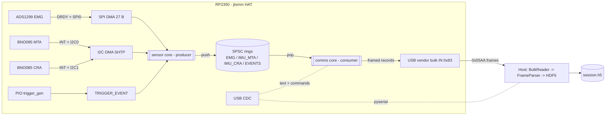

<!--
This file is part of JTS-MM (https://github.com/paulotto/jts-mm).
SPDX-FileCopyrightText: 2026 Paul-Otto Müller
SPDX-FileCopyrightText: 2026 David Stebich
SPDX-License-Identifier: CC-BY-4.0
-->

# h05 — Sensor Pipeline Architecture (dual-core, DMA, USB)

> **Companion to** [`h05_microcontroller_firmware.md`](h05_microcontroller_firmware.md) (pin map, PIO, register
> targets, build/flash). This document explains **how a sample gets from an electrode to `session.h5`**:
> the dual-core split, the DMA engines, the two USB pipes, the lock-free rings, and the back-pressure
> policy that keeps EMG and both IMUs streaming at the same time without corrupting either.

**Audience:** an engineer new to this codebase. It assumes you can read C and a block diagram, but not that
you know this firmware. Every acronym is in the glossary (§1); every number in §7 is measured on the bench.

---

## 1. Glossary

| Term | Meaning in this system |
|------|------------------------|
| **`t_master_us`** | The one clock that matters: RP2350 64-bit hardware timer, microseconds since MCU boot. Every record in every stream carries it. Multimodal fusion is only tractable because of this single rule. |
| **DRDY** | *Data-ready.* The ADS1299 (EMG front-end) pulls its `/DRDY` line low each time a fresh 8-channel sample is latched. It is the EMG sample clock. |
| **SHTP** | *Sensor Hub Transport Protocol.* The packet format the BNO085 IMU speaks over I2C. A quaternion "report" arrives as an SHTP packet. |
| **INT** | The BNO085 `/INT` line, asserted when an SHTP packet is ready to read. It is the IMU sample clock. |
| **SPI / I2C** | The two serial buses. EMG uses **SPI0** (fast, ~4 MHz); each IMU uses its own **I2C** bus (400 kHz). |
| **DMA** | *Direct Memory Access.* A hardware engine that copies bytes between a peripheral and RAM **without the CPU**. We use it so a sample read costs almost no CPU time. |
| **DREQ** | *Data request.* The peripheral-to-DMA handshake line that paces a DMA transfer (e.g. "SPI RX FIFO has a byte, take it"). |
| **SPSC ring** | *Single-producer / single-consumer ring buffer.* A queue with exactly one writer and one reader, so it needs **no lock** — just memory barriers. This is the backbone of the core-to-core hand-off. |
| **CDC** | *USB Communications Device Class.* A virtual serial port (`/dev/ttyACM0`). We use it for **text**: commands and log lines. |
| **Vendor bulk** | A raw USB bulk endpoint on a vendor-specific interface. We use it for the **binary** record stream. Keeping binary off the CDC port means the parser never has to resync around log text. |
| **`missed_drdy`** | Counter: DRDY fired but the sensor core could not service it (SPI DMA still busy, or EMG ring full). Real EMG sample loss. Healthy = ~0/s. |
| **ring drop** | Counter (`emg_drops`, `imu_*_drops`): the producer tried to push a record but the SPSC ring was full. The consumer is not draining fast enough. |
| **`tx_drop`** | Counter: a whole frame was dropped because the USB vendor TX FIFO could not hold it. The host is not reading the bulk pipe fast enough. |
| **physical vs logical core** | "Sensor core" / "comms core" are **roles**. Which physical RP2350 core runs each is a separate question — see §3. |

The three drop counters answer three different questions: **`missed_drdy`** = sensor couldn't read the chip;
**ring drop** = the other core wasn't draining; **`tx_drop`** = the host wasn't reading. Diagnosing a bad
bench run starts with "which counter moved?"

---

## 2. End-to-end data flow



A single EMG sample's journey:

1. The ADS1299 finishes a conversion and drops **`/DRDY`**.
2. The **sensor core** notices (it polls the DRDY line) and kicks an **SPI DMA** read of 27 bytes
   (3 status + 8×24-bit channels). The CPU does not shift bytes; the DMA does.
3. On DMA completion the sensor core stamps `t_master_us`, wraps the bytes in an `EMG_BLOCK` record, and
   **pushes it into the EMG SPSC ring**.
4. The **comms core** pops the record, frames it (`0x55 0xAA … CRC16`), and writes it to the **USB vendor
   bulk IN** endpoint.
5. On the host, `BulkReader` drains the bulk pipe, `FrameParser` validates the CRC and decodes the payload,
   and the writer appends it to `/emg` in `session.h5`.

IMU quaternions follow the same shape but over I2C/SHTP; triggers originate in a PIO state machine. All three
share the rings and the bulk pipe.

---

## 3. Dual-core model (and the core-naming trap)

The firmware runs two independent super-loops, one per physical core, with **no RTOS**. The split is strict:

| Role | Source file | Runs on (physical) | Does | Never does |
|------|-------------|--------------------|------|------------|
| **Sensor core** (producer) | [`src/app/sensor_core.c`](../../firmware/jtsmm/src/app/sensor_core.c) | **physical core 1** | ADS SPI, IMU I2C, PIO events; **only** writer of the rings | touch USB; block on I/O |
| **Comms core** (consumer) | [`src/app/comms_core.c`](../../firmware/jtsmm/src/app/comms_core.c) | **physical core 0** | USB (bulk + CDC), commands, config, panel, heartbeat; **only** reader of the rings | touch ADS/IMU buses |

### Physical-core mapping

The file names describe the **logical role**, not the Pico physical core number. The mapping is fixed by the
SDK, so keep this table handy:

| Logical role | Source file | Entry symbol | `get_core_num()` | Pico SDK name |
|--------------|-------------|--------------|------------------|---------------|
| Sensor producer | `sensor_core.c` / `sensor_core.h` | `sensor_core_entry` (via `multicore_launch_core1`) | `1` | "core 1" (launched core) |
| Comms consumer | `comms_core.c` / `comms_core.h` | `comms_core_main` (from `main()`) | `0` | "core 0" (boot core) |

The Pico SDK **requires** `main()` to run on physical core 0, and `multicore_launch_core1()` necessarily
launches physical core 1. So the sensor core (launched) always lands on physical core 1 and the comms core
(boot) on physical core 0 — there is no hardware reason to choose otherwise. The files were renamed from the
original `core0.c` / `core1.c` to `sensor_core.c` / `comms_core.c` precisely so the name matches the role;
the SDK calls (`multicore_launch_core1`, `get_core_num()`) keep their original numbers.

### Sensor core loop

```c
// firmware/jtsmm/src/app/sensor_core.c — sensor_core_entry(), simplified
void sensor_core_poll(void) {
    for (unsigned i = 0; i < 6; i++) { spi_dma_service(); ads1299_drdy_service(); }  // EMG first
    imu_stream_poll_service(); i2c_dma_service();                                     // then IMU
    /* lead-off status once/second, only when the SPI DMA is idle */
}
```

EMG is serviced six times per loop before IMU, reflecting its higher rate. Nothing here blocks: `*_service()`
functions either advance a DMA state machine or return immediately.

### Comms core loop

Per iteration it pumps USB (`tud_task()`), drains the rings **twice**, and handles one CDC command / config
step. Once per second it emits `HEARTBEAT` + `REC_STATS` and runs the sensor-health watchdog (§6).

### Inter-core hand-off

The rings are the **only** shared mutable state on the hot path. Because each ring has exactly one producer
(sensor core) and one consumer (comms core), no mutex is needed — a data-memory-barrier (`__dmb()`) around the
head/tail updates is sufficient (§4).

---

## 4. SPSC rings

Defined in [`src/runtime/ringbuf.c`](../../firmware/jtsmm/src/runtime/ringbuf.c). Four rings, each with its
own backing array sized to its real need:

| Ring | Depth (slots) | Producer | Consumer | Why this depth |
|------|---------------|----------|----------|----------------|
| `RING_EMG` | **2048** | sensor core | comms core | High volume (up to 4 kHz); ≈0.5 s at the default 4 kHz (≈1.0 s at 2 kHz) absorbs host stalls; open USB before `ads_start` (the ~1.5 s libusb start would overflow it) |
| `RING_IMU_MTA` | 64 | sensor core | comms core | ~390 Hz; drains quickly |
| `RING_IMU_CRA` | 64 | sensor core | comms core | ~390 Hz |
| `RING_EVENTS` | 32 (max 64) | sensor core | comms core | Triggers (40 Hz template; 30 Hz preset), LED-flash and button events |

Slots are sized per ring: a 16 B header (`t_master_us`, len, type) plus that ring's largest payload. EMG frames
are 31 B, so `RING_EMG` uses compact **48 B** slots (payload ≤ 32 B; a longer record is refused and counted as a
drop); the IMU and event rings keep **256 B** slots (≤ 240 B payload). The consumer reads a slot through
`ringbuf_peek()`'s view, not a `jtsmm_record_t` pointer. Backing arrays: 2048 × 48 B + 3 × 64 × 256 B ≈ 144 KB of
the RP2350's 520 KB SRAM. (With full 264 B slots the EMG ring held only 248 records, 124 ms; measured on the HAT
2026-09-25: the new ring overflows only after ≈1.2 s without a USB reader at 2 kHz.)

**Why a per-ring backing store?** Earlier the code used one uniform `MAX_SLOTS = 64` array for every ring,
which silently capped `RING_EMG` at 64 even when the config asked for 128 — losing exactly the back-pressure
headroom EMG needs most. Sizing each ring independently honors a deep EMG ring without paying 2048 full slots of
RAM for the shallow IMU/event rings.

**Lock-free correctness.** `push` writes the slot, issues `__dmb()`, then advances `head`; `pop` reads the
slot, issues `__dmb()`, then advances `tail`. The barrier guarantees the consumer never sees an advanced
`head` before the slot data it points to is committed. A ring holds `capacity − 1` usable entries (one slot is
always left empty to distinguish full from empty).

---

## 5. USB composite device: two pipes, one cable

The firmware enumerates as a **composite** device with both a CDC interface and a vendor interface
([`src/platform/usb/`](../../firmware/jtsmm/src/platform/usb/)):

| Pipe | USB interface | Endpoint | Carries | Host side |
|------|---------------|----------|---------|-----------|
| **CDC** (serial) | 0 + 1 | ACM | **Text**: `config apply`, `info`, `LOG` lines, command replies | `pyserial` (`/dev/ttyACM0`) |
| **Vendor bulk** | 2 | bulk IN `0x83` | **Binary**: every framed `0x55 0xAA` record | `pyusb`/libusb (`BulkReader`) |

**Why split text and binary?** In the bring-up firmware everything shared one CDC pipe, so a stray log line in
the middle of the binary stream forced the parser to resync (and usually to drop a frame). Putting binary on a
dedicated bulk endpoint means the record stream is **never** contaminated by text, and the host can pull large
batches (16 KB reads) in one USB transaction, keeping the pipe saturated.

The RP2350 USB is **Full-Speed only** (12 Mbit/s, ~1 MB/s practical). The default 4 kHz EMG +
dual IMU uses ≈220 kB/s of it; the ceiling is one of the limits on higher EMG rates over this transport (§8).

### Frame format

```
+------+------+------+------+
| 0x55 | 0xAA | TYPE | LEN  |
+------+------+------+------+
|   t_master_us (8 B, LE)   |
+---------------------------+
|   PAYLOAD (LEN bytes)     |
+---------------------------+
|   CRC16-CCITT (2 B, LE)   |   over TYPE..PAYLOAD (not the sync word)
+---------------------------+
```

Record types (`EMG_BLOCK = 0x10`, `IMU_*_QUAT = 0x11/0x14`, `TRIGGER_EVENT = 0x20`, `REC_STATS = 0x51`, …) are
enumerated in [`records.h`](../../firmware/jtsmm/include/jtsmm/records.h) and mirrored on the host in
[`records.py`](../../software/jtsmm/jtsmm/protocol/records.py). The CRC and framing constants are shared with
the firmware ctest so the two implementations cannot drift.

---

## 6. Concurrency, DMA, and back-pressure

### What runs where

| Work | Mechanism | Core / engine |
|------|-----------|---------------|
| EMG sample read | **true async SPI DMA** (TX dummy bytes + RX 27 B paced by DREQ) | SPI0 DMA, kicked by sensor core |
| IMU SHTP read | **I2C DMA**, non-blocking | I2C0/I2C1 DMA, kicked by sensor core |
| Camera trigger | PIO state machine | PIO, autonomous |
| Ring drain + USB TX | polled loop | comms core |
| Command / config | polled loop | comms core |

EMG SPI and both IMU I2C transfers overlap because they run on **independent DMA channels and buses**; the
sensor core only kicks and polls them. Wedge watchdogs abort stuck transfers: **SPI** (`SPI_DMA_WEDGE_US ≈ 2000 µs`)
and **I2C** (~8 ms per slot in `i2c_dma_service`) so one bad read cannot stall a stream forever.

### The back-pressure policy (the important part)

When the host cannot read the bulk pipe fast enough (Python/libusb jitter), the vendor TX FIFO fills. Something
must be dropped. The rule: **EMG yields first; IMU and triggers are protected.** Two mechanisms enforce it,
both in [`host_link.c`](../../firmware/jtsmm/src/runtime/host_link.c):

1. **Drain order** — `host_link_drain()` services the rings in the order `IMU_MTA → IMU_CRA → EVENTS → EMG`.
   Whichever ring is drained first wins FIFO space under pressure.
2. **FIFO reserve** — `HOST_LINK_CRITICAL_RESERVE = 8192 B` at the tail of the TX FIFO is refused to
   `EMG_BLOCK` frames. Low-volume IMU/trigger/stat frames may use the whole FIFO; EMG may only use
   `FIFO − 8192`. So EMG backs off while there is still guaranteed room for the ~390 Hz IMU streams.

A ring record is only taken once the FIFO can hold it; otherwise it stays queued and the deep ring absorbs the
stall. Loss happens only when a ring itself overflows (`*_drops` in `REC_STATS`, counted by the producer).
`tx_drops` (split into `tx_drops_emg` / `tx_drops_imu` / `tx_drops_other`) counts frames lost at the USB
boundary: direct sends (logs, acks, stats) with no FIFO space, and ring records discarded while no host is
mounted.

This is deliberate: EMG runs at up to 4 kHz with a **deep ring and a generous rate budget (≥99%)**, so it absorbs
the occasional dropped frame without failing continuity. The IMU streams run near their native rate with a
tight **0.5% drop budget**, so they must not lose frames in proportion to EMG volume.

### Host read path (native)

Real recording **always** uses the C++/libusb async bulk capture
([`software/jtsmm/native/`](../../software/jtsmm/native/)) and errors without the build; the Python
`BulkReader` path is for `--mock`/tests only. HDF5 goes through the native libhdf5 writer unless
`--optical-track`, CT calibration or an experiment plan is active (then the Python `Hdf5Writer`). This keeps the vendor FIFO clear at the default **4 kHz** `acquisition` rate.

### Integrity budgets (host `integrity --strict`)

| Stream | Budget | Rationale |
|--------|--------|-----------|
| EMG rate / continuity | ≤1% | Deep ring + reserve policy protect continuity; small rate slack tolerated |
| IMU MTA / CRA drop rate | ≤0.5% | Orientation must be dense; declared rate (390 Hz) sits below the BNO085 native ~398 Hz so the sensor over-delivers |
| Optical `/optical` (when tracking) | lock / SE(3) / drops | Host-only; see [`s02` §8.5](../software/s02_data_pipeline.md) |

### Sensor-health watchdog

Once per second the comms core computes the per-second `missed_drdy` delta. If it stays above a threshold for
several consecutive seconds, the firmware latches the **panel FAULT LED** and emits one `REC_LOG`
(`watchdog: sustained missed_drdy`); when the rate recovers it clears the fault and logs recovery. Separately,
if an IMU slot's ring push count is unchanged for **3 s** while that slot is streaming, the comms core calls
**`imu_slot_recover()`** (I2C DMA abort, BNO085 SHTP soft-reset, re-enable reports). On **`ads_start`** when
EMG was not already streaming, **`host_link_reset_tx_stats()`** zeroes `tx_drops` and its per-stream split so
each session's drop counters are per-capture, not cumulative since boot (`usb_tx_bytes` keeps counting). These are advisory — the stream keeps running and EMG keeps
absorbing back-pressure first — but they turn silent degradation into visible, logged events.

---

## 7. Bench expectations (measured at sign-off)

Populated HAT (MTA + CRA, no electrodes), J_USB1 CDC + vendor bulk, `scripts/hil/run_bench_hw.sh`:

| Metric | 2 kHz EMG + dual IMU (former default `acquisition`) | Notes |
|--------|----------------------------------------------------|-------|
| EMG blocks / 10 s | ~19 k (**~1900 Hz**) | `missed_drdy` ≈ 0.2% |
| Quaternions / slot / 10 s | ~3.8 k | Both MTA and CRA |
| BNO085 native quat rate | **~398 Hz** | We declare **390 Hz** to keep the 0.5% budget robust |
| `integrity --strict` | **clean** (native backend) | Also clean over a 60 s soak with native path |
| Sensor loop rate | ~200 kHz | `sensor_loop_hz` in `REC_STATS` |
| Comms loop rate | ~156 kHz | `comms_loop_hz` |

At **4 kHz** (default; Pi with both IMUs and both cameras): a 274 s take lost **8 samples
(0.0007 %)**, each after one read ~1.7 periods late (IMU work on the sensor core); worst sample step 430 µs
(period 250 µs). The same rig at 2 kHz lost 1 sample (start-up), worst step 657 µs.

At **1 kHz** (override `sample_rate_sps` or `bench` profile): ~9.5 k EMG blocks / 10 s, `missed_drdy = 0`.

**`high_rate`** (`EMG_PROFILE_HIGH_RATE`): same rate and silicon path as `acquisition` (4 kHz) today. With the
**native** host pipeline the bulk FIFO stays drained; the pure-Python path already showed occasional EMG
continuity gaps at 2 kHz.

---

## 8. Rate-selection guide

| EMG rate | Profile | Use it for | Status |
|----------|---------|------------|--------|
| 250–500 Hz | `bench` / override | Low-power / smoke tests | supported |
| 1000 Hz | override | Legacy / comparison | supported |
| 2 kHz | override | Former default; 2× DRDY timing margin | validated, strict-clean (native host) |
| **4 kHz** | **`acquisition`** | **Default masticatory capture** | default since 2026-09-25; 8 samples lost in 274 s with IMUs + cameras (§7) |
| **4 kHz** | `high_rate` | Alias of acquisition rate today | same silicon path |
| **4 kHz** | `noise_characterization` | Amplifier noise characterization (lead-off off) | supported; 8/16 kSPS are rejected by the firmware (would need RDATAC / higher SPI clock) |

### Why 4 kHz, and does more help?

**4 kHz instead of 2 kHz** is about the ADS1299's sinc³ decimation filter, not the EMG band: at 4 kSPS it is
−0.7 dB at 500 Hz (−2.7 dB at 2 kSPS) and rejects the first alias by 51 dB (31 dB), at unchanged in-band noise
density (gain 6: 0.93 µVrms over 1048 Hz vs 0.66 µVrms over 524 Hz). The cost: 2× USB and file volume
(≈180 kB/s EMG, ≈18 MB/min HDF5), half the ring time (≈0.5 s) and a 250 µs DRDY read deadline.

**More than 4 kHz:** for masticatory intent recognition, **generally no.** Surface-EMG energy lives in **20–450 Hz**
([`s04_emg_signal_processing.md`](../software/s04_emg_signal_processing.md)), so Nyquist is satisfied well
below 1 kHz. Envelope, MAV/RMS, and onset (TKEO) features saturate in benefit above 1–2 kHz because muscle
activation dynamics are slow (tens of ms). At 2 kHz there are already 40 samples per 50 Hz line cycle, which is
plenty for notch/comb filtering. **16 kHz is valuable only for amplifier noise characterization**, not for the
production acquisition profile.

### Theoretical ceilings by layer

| Layer | Practical max | Limiter |
|-------|---------------|---------|
| Physiology / DSP | 1–2 kHz | Useful band 20–450 Hz; SENIAM convention |
| ADS1299 silicon | 16 kSPS | Rejected by the firmware today (max 4 kSPS) |
| SPI + RDATA framing @ 4 MHz | ~4–8 kHz | 28-byte frame ≈ 56 µs vs 62.5 µs sample period at 16 kHz |
| MCU sensor core | 4 kHz proven | `missed_drdy` ~0 @ 1 kHz, ~0.2% @ 2 kHz (former default); 8 samples in 274 s @ 4 kHz (default, IMUs + cameras) |
| USB Full-Speed | ~8–12 kHz EMG solo | ~45 B/frame × rate approaches ~1 MB/s ceiling |
| **Host (native, when built)** | **4 kHz default** | **Production path** — async libusb + C++ parse |
| **Host Python** | **~2 kHz** | `--mock` / tests only; real recording requires the native build |

---

## 9. Where to look in the code

| Concern | File |
|---------|------|
| Sensor core loop, DMA kicks, launch | [`src/app/sensor_core.c`](../../firmware/jtsmm/src/app/sensor_core.c) |
| Comms core loop, heartbeat, watchdog | [`src/app/comms_core.c`](../../firmware/jtsmm/src/app/comms_core.c) |
| SPSC rings | [`src/runtime/ringbuf.c`](../../firmware/jtsmm/src/runtime/ringbuf.c) |
| Framing, drain order, FIFO reserve | [`src/runtime/host_link.c`](../../firmware/jtsmm/src/runtime/host_link.c) |
| True async SPI DMA | [`src/platform/spi_dma.c`](../../firmware/jtsmm/src/platform/spi_dma.c) |
| I2C DMA | [`src/platform/i2c_dma.c`](../../firmware/jtsmm/src/platform/i2c_dma.c) |
| USB descriptors / TinyUSB config | [`src/platform/usb/`](../../firmware/jtsmm/src/platform/usb/) (descriptors); [`include/tusb_config.h`](../../firmware/jtsmm/include/tusb_config.h) |
| Host bulk reader / parser | [`capture/usb_bulk.py`](../../software/jtsmm/jtsmm/capture/usb_bulk.py), [`protocol/frame.py`](../../software/jtsmm/jtsmm/protocol/frame.py) |

See also: [`h05_microcontroller_firmware.md`](h05_microcontroller_firmware.md) (task model, PIO, registers),
[`s02_data_pipeline.md`](../software/s02_data_pipeline.md) (host capture + HDF5 schema),
[`01_architecture.md`](../01_architecture.md) (system block diagram).
