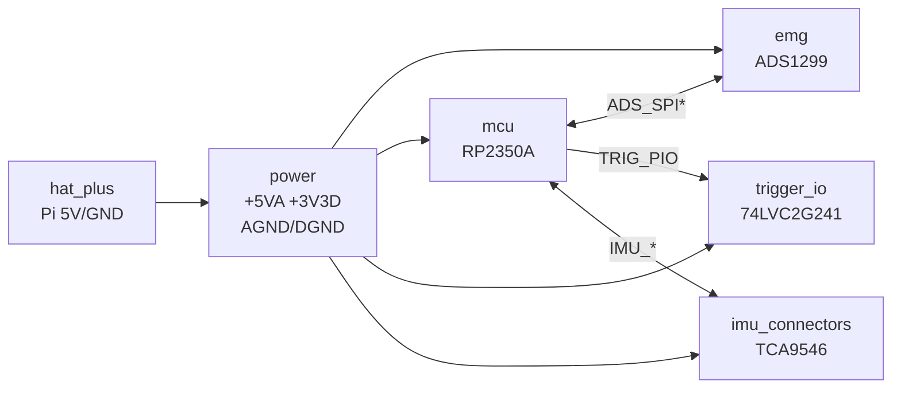

<!--
This file is part of JTS-MM (https://github.com/paulotto/jts-mm).
SPDX-FileCopyrightText: 2026 Paul-Otto Müller
SPDX-License-Identifier: CC-BY-4.0
-->

# h10 — Schematic Logical Review (JTS-MM HAT)

> **PCB layout** (made after this review): [`h10_kicad_pcb_layout_guide.md`](h10_kicad_pcb_layout_guide.md).  

Record of the logical review of the KiCad schematics of the **JTS-MM HAT+ revision 0.0.1** (`hardware/jtsmm_hat/`), made before the PCB layout. It states what was checked (architecture, wiring discipline, and per-sheet logic against the spec docs), what was found, and what was changed — it is **not** a duplicate of the build guides. The per-sheet tables give the result for the released schematic; changes made after the review are listed under [Findings and changes](#findings-and-changes).

## Summary verdict

**No electrical fix was required before the PCB layout.** The hierarchical bus plan matches [`h02_custom_hat_shield.md`](h02_custom_hat_shield.md) and the power/grounding tree in [`h07_power_grounding_safety.md`](h07_power_grounding_safety.md). Capacitor and resistor networks on the EMG front-end follow [`h03_emg_frontend.md`](h03_emg_frontend.md); MCU pin mux matches [`h05_microcontroller_firmware.md`](h05_microcontroller_firmware.md).

ERC run of 2026-06-12: **0 errors, 16 warnings** — all benign (13 library symbol drift, 3 intentional net aliases).

## Method

1. Cross-checked each `.kicad_sch` against its spec doc and build guide.
2. Verified root hierarchical wiring per [`h02_hat_plus_schematic_build_guide.md`](h02_hat_plus_schematic_build_guide.md) Part B.
3. Ran `kicad-cli sch erc` on the full project.

---

## Root — `jtsmm_hat.kicad_sch`

| Check | Result |
|-------|--------|
| No ICs on root | Pass — sheet symbols and wires only |
| Power fan-out | Pass — `HAT_5V0` → `+5V_IN`, `HAT_GND` → `GND_IN`; `+5VA`, `+3V3D`, `AGND`, `DGND` distributed to consumers |
| SPI / ADS control | Pass — all eight nets wired mcu ↔ emg |
| Trigger | Pass — `TRIG_PIO` mcu → trigger_io |
| IMU buses | Pass — I2C, INT, NRST, mux reset, LED drive nets wired mcu ↔ imu_connectors |
| Unused Pi GPIOs | Pass — `no_connect` on exported but unused header pins (intentional) |
| `SYNC_LED_PIO` | Pass — `no_connect` on root; correct for the default GS build (sync LED block not captured) |

---

## `hat_plus` — Raspberry Pi HAT+ interface

| Check | Result |
|-------|--------|
| 2×20 stacking header | Present — pass-through for M.2 HAT+ below |
| Power export | Pass — pin 2/4 → `HAT_5V0`; GND pins → `HAT_GND` |
| No analog 3.3 V tap | Pass — system logic uses on-board `+3V3D` from TPS73633, not Pi header 3.3 V for front-end |
| HAT ID EEPROM | AT24CS64 on `GPIO0_ID_SDA0` / `GPIO1_ID_SCL0` with pull-ups |
| Mounting holes | H1–H4 present |

**Note:** Many `GPIOxx` hierarchical labels exist on this sheet for template completeness; only ID pins and power nets are wired on the root. This is expected.

---

## `power` — Power tree and ground domains

| Check | Result |
|-------|--------|
| Digital 3.3 V | TPS73633DBV: `EN` → `VIN`, `NR` + 10 nF, decoupling on IN/OUT |
| Analog 5 V | TPS61252 boost (~6.5 V) → ADP7142AUJZ-5.0 → `+5VA`; boost on **DGND** |
| Remote sense | `ALDO1_SENSE` tied to `+5VA` at load — intentional (ERC warns as net alias) |
| Pi return | `GND_IN` tied to **DGND** at sheet entry — intentional (Pi header GND is digital return) |
| Ground domains | Separate `AGND` / `DGND` globals; **one tie only** (next row) |
| Star tie | Net tie **`NT_GND_TIE1`** (`Device:NetTie_2`, `AGND`–`DGND`) on the `emg` sheet, placed at `U_ADS1` — [`h07_power_grounding_safety.md`](h07_power_grounding_safety.md) §2.2. The reviewed schematic had no tie symbol (the tie was planned on the PCB only) |
| Status LEDs | Panel LEDs for 5 V in, +3V3D, boost PG, +5VA OK |

Architecture matches the tree in [`h07_power_grounding_safety.md`](h07_power_grounding_safety.md) §1.

---

## `emg` — ADS1299 analog front-end

| Check | Result |
|-------|--------|
| ADS1299 supplies | `+5VA` → AVDD; `+3V3D` → DVDD; AVSS/VREFN → AGND |
| Input protection | TPD4E1B06 arrays per channel group; GND → AGND |
| CM chokes | DLW21SN900SQ2L on each channel path |
| Series R | 100 Ω per leg before ADC inputs |
| Differential filter | 4.7 nF C0G across INxP–INxN at package |
| DRL / bias | SBAS499 Fig. 33/34: **`J_EMG_DRL1`→`R5`→`D8`→`FL7`→`R6`→IN8N**; **`C2`** 4.7 nF RFI; **`BIASREF→AGND`**, BIASIN↔BIASOUT, **`R8`∥`C78`** → BIASINV; **`TP_BIASOUT1`** on IN8N/DRL net; IN7P/IN7N and IN8P not connected |
| Bench TPs | **`TP_ADS_DRDY1`**, **`TP_AGND1`**, **`TP_VREFP1`**, **`TP_BIASOUT1`**, **`TP_VCAP1`** on `emg` |
| Decoupling | Per-pin AVDD/DVDD caps; VCAP1 = 100 µF; VREFP ≥ 10 µF + 0.1 µF |
| Strap pins | CLKSEL high; GPIO1–4 to DGND if unused; RESV1 → DGND |
| Patient connector | **Option 0:** `J_EMG_N1` (1×6) + `J_EMG_P1` (1×6) + `J_EMG_DRL1` (1×1) = 13 conductors — matches [`h03_emg_frontend.md`](h03_emg_frontend.md) §10.2 |
| SPI / control | Hierarchical labels to mcu sheet |

**Cosmetic:** the sheet annotation names the pin headers (`J_EMG_N1` / `J_EMG_P1` / `J_EMG_DRL1`).

---

## `mcu` — RP2350A, flash, USB, debug

| Check | Result |
|-------|--------|
| Core supply | VREG_VIN from `+3V3D`; 3.3 µH on VREG_LX → DVDD; VREG_AVDD RC filter |
| IO / flash | **0402** 100 nF at the `+3V3D` pads (**C47,C48,C50,C51,C67–C71**) and on **DVDD** (**C64,C65**); W25Q128 + **ABM8-272-T3** / **15 pF** / 1 kΩ (**R53**) crystal (Pi §4) — [`h05`](h05_mcu_schematic_build_guide.md) §1.1.2 / §1.3 |
| USB | USB-C + USBLC6-2SC6 ESD; DM/DP to RP2350A |
| SWD | J_SWD1 for Debug Probe |
| Buttons | RESET, BOOTSEL, USER1 (GPIO10), USER2 (GPIO11) — wired with pull-up path |
| SPI to ADS1299 | GPIO0 MISO, GPIO2 SCK, GPIO3 MOSI, GPIO5 CS; GPIO6–9 for DRDY/RESET/PWDN/START |
| IMU / trigger exports | I2C1, INT lines, NRST, mux reset, LED drive, `TRIG_PIO`, `SYNC_LED_PIO` |
| `SYNC_LED_PIO` | Exported but NC on root — correct without the sync LED block |

Pin map matches [`h05_microcontroller_firmware.md`](h05_microcontroller_firmware.md) §1.1.

---

## `trigger_io` — Camera trigger fan-out

| Check | Result |
|-------|--------|
| Default build | **Populated:** 74LVC2G241 buffers, CSI JST connectors, **1.5k/1.8k** XTRIG dividers (**R57/R59 + R58/R60**), scope test pads, trigger panel LED |
| `TRIG_PIO` | Hierarchical input from mcu; star-routed to buffer inputs |
| Optional blocks | SYNC_LED FET/JST, USB opto trigger, BNC jack — **not captured** (not part of the default GS build) |
| Power | `+3V3D` / `DGND` only on this sheet |

The optional blocks are described in [`h06_trigger_io_schematic_build_guide.md`](h06_trigger_io_schematic_build_guide.md).

---

## `imu_connectors` — External BNO085 harnesses

| Check | Result |
|-------|--------|
| I2C mux | TCA9546APW on I2C1: channel 0 → CRA, channel 1 → DP; MTA direct on I2C0 |
| Connectors | 3× 7-pin JST-SH (6 signals + shield on pin 7) |
| Pull-ups | 2.2 kΩ on SDA/SCL to `+3V3D` |
| Shield | Pin 7 → `IMU_SHLD` → **AGND** (ERC net-alias warning is intentional) |
| Signal GND | Pin 2 → **DGND** |
| Activity LEDs | Per-IMU green LEDs driven from mcu |

Matches [`h04_imu_subsystem.md`](h04_imu_subsystem.md) §3.3 and [`h07_power_grounding_safety.md`](h07_power_grounding_safety.md) §2.3.

---

## ERC summary (2026-06-12)

| Severity | Count | Notes |
|----------|-------|-------|
| Errors | **0** | — |
| Warnings | **15** | All acceptable |

| Warning type | Sheets | Action |
|--------------|--------|--------|
| `lib_symbol_mismatch` (13) | root | Library version drift vs KiCad stock libs — accepted |
| `multiple_net_names` GND_IN / DGND | power | Intentional — Pi return enters digital domain |
| `multiple_net_names` +5VA / ALDO1_SENSE | emg | Intentional — remote LDO sense |
| `multiple_net_names` AGND / IMU_SHLD | imu_connectors | Intentional — shield lands on AGND |

Command:  
`kicad-cli sch erc hardware/jtsmm_hat/jtsmm_hat.kicad_sch`

---

## Findings and changes

| # | Item | Severity | Outcome |
|---|------|----------|---------|
| 1 | ERC before fabrication | Info | Run on 2026-06-12: 0 errors |
| 2 | EMG sheet annotation (“7× DIN”) | Cosmetic | Changed: the annotation names the pin headers |
| 3 | h06 sentence that called `trigger_io` a stub | Doc | Changed: the build guide describes the populated sheet |
| 4 | Sync LED | Optional | Not captured. A build with the sync LED needs a `SYNC_LED_PIO` hierarchical pin on `trigger_io` and the root wire |
| 5 | USB opto / BNC | Optional | Not captured. Capture per the h06 build guide |
| 6 | Star ground tie | — | Changed after the review: the tie, planned on the PCB only, is in the schematic as net tie `NT_GND_TIE1` on the `emg` sheet |
| 7 | PCB layout | — | Made after the review: `jtsmm_hat.kicad_pcb`, revision 0.0.1 ([`h10_kicad_pcb_layout_guide.md`](h10_kicad_pcb_layout_guide.md)) |

---

## References

| Doc | Role |
|-----|------|
| [`h02_custom_hat_shield.md`](h02_custom_hat_shield.md) | HAT philosophy, floor plan, layout rules |
| [`h07_power_grounding_safety.md`](h07_power_grounding_safety.md) | Power tree, star ground, patient safety |
| [`h03_emg_frontend.md`](h03_emg_frontend.md) | ADS1299 front-end spec |
| [`h05_microcontroller_firmware.md`](h05_microcontroller_firmware.md) | GPIO / SPI pin map |
| Build guides h02–h07 | Capture walkthroughs per sheet |
