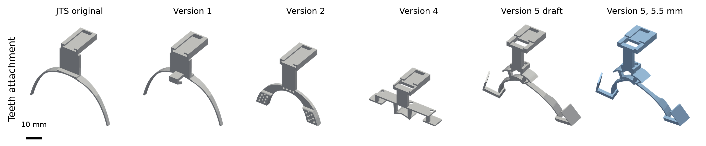
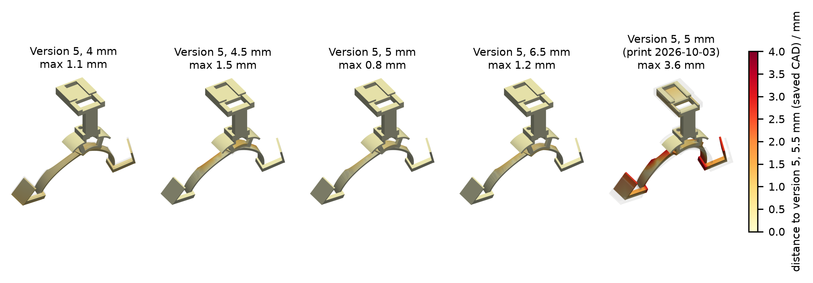
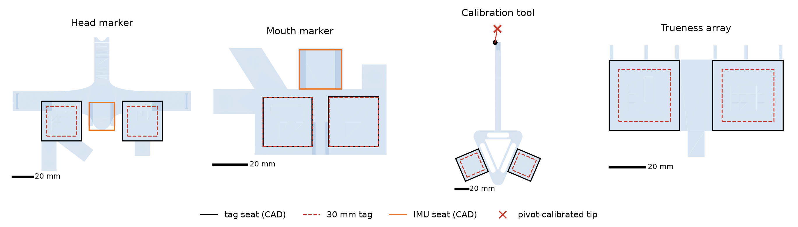

<!--
This file is part of JTS-MM (https://github.com/paulotto/jts-mm).
SPDX-FileCopyrightText: 2026 Paul-Otto Müller
SPDX-License-Identifier: CC-BY-4.0
-->

# h11 — Mechanical Parts (3D-Printed Hardware)

> **Files, versions and workflows:** [`hardware/mechanical/`](../../hardware/mechanical/README.md)
> (one FreeCAD file per part, every version as STL, `parts.yaml`, `make all`, 3D viewer:
> `make serve` → `/hardware/mechanical/viewer/`). This page is the design record: what the parts
> are, why they look as they do, and how the print geometry checks against the configuration.

The JTS-MM setup has three worn or handled printed bodies — the **head piece** (head marker,
strapped to the head: maxilla reference), the **mouth piece** (mouth marker on a **teeth
attachment** bonded to the lower teeth: mandible), the **calibration tool** (pointer for landmark
digitisation) — plus bench parts: the **CT calibrater** (pivot cup for the tip calibration), the
**trueness ladder and array** ([cv05](../calibration_validation/cv05_reference_validation_protocol.md))
and a small **teeth protector**. The original JTS parts
([`software/jaw_tracking/models/`](../../software/jaw_tracking/models/)) are the first version of
each; the head marker, mouth marker and calibration tool were redrawn for 30 mm ArUco tags and the
BNO085 IMU ([h04 §3](h04_imu_subsystem.md)), and for the validation study combined with Qualisys
marker positions.

**Names.** Here and in the CAD, versions are short (V1 … V5, concepts C1 … C5; variant ids
`v1` … `v5_5mm` in `parts.yaml`). Reader-facing text says "Version 5" and "Concept 1": the paper
pipeline replaces plan codes such as V5 or C1 by their meaning, so the manifest titles avoid
them (a test enforces this).

## 1. Which version was used

[`parts.yaml`](../../hardware/mechanical/parts.yaml) `usage` states the variant per study (and per
participant, `usage.overrides`). While it is not specified for a study:
- the setup figures of both papers (`icorr_setup`, `val_setup`, form `schematic`) keep the
  original JTS renders;
- the parts supplement items show each part's `candidate` version, marked "(candidate)": the
  teeth attachment printed on 2026-10-03 (`v5_print_2026-10-03`, 30 parts), the Qualisys + ArUco
  head marker, mouth marker and calibration tool, and version 1 of the bench parts;
- `biomech check-outputs` warns "part versions of the study specified".

Filling `usage` is the only step needed to update all of them
([README](../../hardware/mechanical/README.md#which-version-a-study-used)). A study without a
`usage` entry (the synthetic test study) lists every part with its candidate.

## 2. Teeth attachment: design history

- **JTS original → V1 → V2 → V4**: an arch with the mouth-marker interface on the lower incisors
  (the adhesive procedure of [op02 §5](../operations/op02_subject_preparation.md)); in the renders,
  V2 has perforated arch ends and V4 replaces the arch by a flat bar with holes.
- **Incisor analysis (2026-09-22,
  [`analyses/incisor_attachment`](../../hardware/mechanical/analyses/incisor_attachment/README.md)).**
  A lower incisor crown is a wedge (2.1 → 6.6 mm, 3° labial and 33° lingual face): flat jaws that
  squeeze it push the part off unless the friction coefficient reaches tan 33° = 0.65. Fix: an
  incisal stop that takes the push-off force and a pad on the 33° lingual slope. Straight wings
  stand off the arch by 1.3, 2.9 and 9.4 mm at ±8, ±13 and ±19 mm, so anything past the canine
  must follow the arch.
- **Molar-clamp concepts (2026-09-23,
  [`analyses/molar_clamp_concepts`](../../hardware/mechanical/analyses/molar_clamp_concepts/README.md),
  report [PDF](../../hardware/mechanical/analyses/molar_clamp_concepts/latex/molar_clamp_concepts.pdf)).**
  The lower molars have 0.3–1.2 mm lingual undercut (buccal ≈ 0.1 mm) on the scan, the incisors
  none, so a clamp that holds without adhesive must grip the molars from the lingual side. Five
  concepts (C1 snap shell, C2 clothespin jaw on a printed flexure, C3 stainless Adams clasps, C4
  pre-spread stainless arch, C5 rigid clamp with a TPU liner) were sized (spring preload, strain,
  stress) and drawn; C5 was the recommended first build. **None was built**; the study informed V5.
- **V5** (2026-10): the mouth-marker interface on a post over an inner arc and a molar arc on
  each side (FreeCAD features `InnerArc*`, `MolarAttachmentArc*`), parametrised by the inner-arc
  separation `ta_separation` (sheet `Params`, cell B40).

### 2.1 V5 variants

Five V5 variants were exported (4, 4.5, 5, 5.5 and 6.5 mm). They differ only in the inner arc:

| Variant | Max. distance to V5 5.5 mm | Surface moved | From the CAD |
|---|---|---|---|
| 4 mm | 1.1 mm | 46 % | no (earlier state, *CAD pending*) |
| 4.5 mm | 1.5 mm | 16 % | yes (`ta_separation` 4.5) |
| 5 mm | 0.8 mm | 15 % | yes (5.0) |
| 6.5 mm | 1.2 mm | 15 % | no (6.5 leaves `Sketch110` unsolvable) |
| print 2026-10-03 (5 mm, 30 parts, PETG, H2C) | 3.6 mm | 78 % | earlier V5 state (from the 3MF) |

The saved CAD reproduces 4.5, 5 and 5.5 mm exactly (Hausdorff 0.000 mm); the molar-arc
offset reads a second copy of the parameter (`Params004`), which must stay at 6.5 mm.

## 3. Mass

From the print geometry ([`tables/parts.csv`](../../hardware/mechanical/tables/parts.csv),
computed by `tools/render.py` into `renders/index.json`): solid = 100 % infill; printed = the
walls (2 lines × 0.42 mm over the surface) solid plus the inside at the infill, an estimate. The
infill is that of the slicer record where one exists (15 %), else about 10 %, as the parts were
printed (the authors, 2026-11-04). The parts were not weighed: the IMU and its cable are fixed to the
mouth piece.

| Part | Material | Solid | Printed (estimate) |
|---|---|---|---|
| Teeth attachment version 5 (print 2026-10-03; other version-5 variants 3.0–3.2 g) | PETG | 2.9 g | ≈ same (thin walls) |
| Mouth marker, ArUco (current model, dataset) | PLA | 11.2 g | ≈ 10.5 g |
| Mouth marker, Qualisys + ArUco (reflective markers, systems study) | PLA | 15.9 g | ≈ 13.8 g |
| Head marker, ArUco (current model, dataset) | PLA | 55 g | ≈ 28 g |
| Head marker, Qualisys + ArUco (systems study) | PLA | 62 g | ≈ 30 g |
| Calibration tool, Qualisys + ArUco | PLA | 80 g | ≈ 31 g |

The worn mouth piece (teeth attachment + mouth marker) is about 13 g in the dataset and about
17 g in the systems study, plus the mandible IMU, its cable and the glue. The markers are thin
plates that print almost entirely as walls, so the infill hardly matters (10 % or 15 % changes
the mouth marker by less than 0.3 g); the authors' rough figure of about 10 g is the same order.
h04 §3 quotes "~3 g" for the original JTS mouth piece with markers; the original JTS STLs give
2.0 g (attachment) + 8.8–14.9 g (marker, printed–solid), so that figure is too low. Relevant for
the question of loading the jaw.

## 4. Print geometry against the configuration

Tag seats, the IMU seats and the calibration-tool rod measured on the STLs
([`tables/crosscheck.csv`](../../hardware/mechanical/tables/crosscheck.csv)) against
[`optical.yaml`](../../software/optical/etc/optical.yaml) `markers.mounts_T_body_tag` and the pivot
calibration (`ct_tip_calibration.json`):

| Body | Quantity | Configuration | CAD |
|---|---|---|---|
| Head marker (HP) | tag spacing | 81.0 mm | 81.0 mm |
| Mouth marker (MP) | tag spacing | 40.0 mm | 40.0 mm |
| Calibration tool (CT) | tag spacing | 84.23 mm | 84.23 mm |
| CT | in-plane tag rotation | 66.8° | 66.8° |
| CT | tip beyond the printed rod end | — | 22.0 mm (metal dart point) |
| CT | tip off the rod axis (in plane) | — | 0.6 mm |
| CT | rod axis below the tag plane | 5.50 mm (pivot tip z) | 5.01 mm |
| Trueness array | tag spacing | 59.90 mm (measured) | 60.0 mm |
| HP / MP | IMU seat centre from the tag midpoint | — | 5.0 / 31.9 mm (in plane) |

- The configured tag poses — still commented "identity placeholders" in `optical.yaml` — agree
  with the print geometry to 0.01 mm and 0.1°, so the placeholder comment is outdated.
- The pivot-calibrated tip lies on the printed rod axis within 0.6 mm and 22 mm beyond its end
  (the dart point), and 0.5 mm deeper than the CAD rod axis (tag thickness and calibration RMS
  1.9 mm).
- The IMU seat centres give a CAD lever-arm reference (mouth IMU 31.9 mm in plane from the
  mouth-plate origin, head IMU 5.0 mm); the accelerometer die position inside the BNO085 module is
  not modelled. Compare with the estimated lever arm of the jaw IMU (24 mm) — reported, no
  analysis input changed.

## 5. Settled and open items

### 5.1 Settled

- **`usage`** (filled 2026-11-04 from the authors' statement). Dataset: teeth attachment version 5
  (the printed 5-mm part, print record 2026-10-03), mouth marker `aruco` and head marker
  `aruco_2026-08-18` (the current FreeCAD model), calibration tool `aruco`. Systems study (P1,
  P2): version 5, mouth, head marker and calibration tool `qualisys_aruco` (the reflective-marker
  model), the bench parts `v1`. The version-5 print and the calibration tool per study were
  confirmed by the authors.
- **Marker models** (2026-11-04). The Qualisys + ArUco head marker, mouth marker and
  calibration tool have their FreeCAD model: the reflective-marker model
  (a combined FreeCAD file outside the repository), split
  into `parts/<part>/qualisys_aruco.FCStd` (bodies 005, 002, 003; volume and bounding box equal
  to the source) and referenced by the variant field `fcstd`. The exports match the
  committed STLs (mouth 0.010 mm, calibration tool 0 mm Hausdorff); the head marker differed by
  0.026 mm (tessellation, volume 0.04 %), so its STL was replaced by the CAD export.
- **Fixation of the teeth attachment** (2026-11-04). Held on the lower front teeth by the
  clamping fit its design gives, and glued (op02 §5); no screws. In the part's purpose text.

### 5.2 Open

- **CAD pending** (STL only): the CT calibrater, version 5 4 / 6.5 mm and the trueness parts.
  For the trueness ladder and array no CAD source was found.
- **V5 is not seated on the scan** (`parts.teeth_attachment.seat_on_scan`), so there is no
  contact/gap fit map.
- **Teeth protector**: its purpose is not documented.
- The two `ta_separation` copies (`Params`, `Params004`) in `teeth_attachment.FCStd` are not
  unified.

## 6. In the papers

Both paper sets carry the parts as supplement items, built from the same manifest
(`software/biomech/biomech/viz/views/hardware.py`, loader `biomech/hwparts.py`):

| Item | Paper | Forms |
|---|---|---|
| `hw_parts` / `val_hw_parts` | dataset (journal) / systems | `used` (default: renders of the used or candidate versions), `lineage`, `variants`, `concepts`, `incisor` |
| `hw_table` / `val_hw_table` | dataset (journal) / systems | `parts` (default: version, purpose, material, size, mass, CAD source), `crosscheck` (§4) |

The paper sets carry `hw_parts`·`used` and `hw_table`·`parts` (dataset) and `val_hw_parts`·`used`,
`val_hw_table`·`parts` and `val_hw_table`·`crosscheck` (systems); the other forms are in the
gallery to choose from. The setup figures (`icorr_setup`, `val_setup`, form `schematic`) show the
render of the used head marker, mouth marker and calibration tool once `usage` is stated (the mouth
piece panel shows the mouth marker), and name the versions in the caption. Image resolution: part
renders 2000 × 1600 px, figures 300 dpi, image panels up to 2100 px (text width at 300 dpi).
