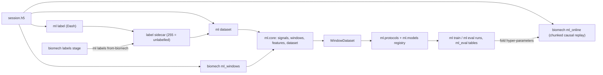

<!--
This file is part of JTS-MM (https://github.com/paulotto/jts-mm).
SPDX-FileCopyrightText: 2026 Paul-Otto Müller
SPDX-License-Identifier: CC-BY-4.0
-->

# Machine learning: jaw-motion intent decoding (`ml/`)

This directory specifies how discrete jaw-motion classes are decoded from the JTS-MM recordings:
where the ground truth comes from, how EMG and IMU are conditioned and windowed, which models and
evaluation protocols are used, and how runs are reported.

> **Status:** implemented in
> [`software/ml/`](../../software/ml/README.md). One corrected core serves two entry points:
>
> - the **`ml` CLI** (`ml label`, `ml labels from-biomech`, `ml dataset`, `ml train`, `ml eval`),
>   which reads `session.h5` plus a label sidecar;
> - the **biomech stages** `ml_windows` / `ml_eval` of the ICORR 2027 analysis
>   ([`ml07`](ml07_array_pipeline.md)), plus the pseudo-online replay `ml_online`
>   ([`ml08`](ml08_online.md)).
>
> On equal settings both entry points produce identical windows (verified on pilot participants
> s01-s03: same window times, labels, EMG and IMU features). EMG + IMU early and late fusion, the IMU
> path and the GRU are implemented; nothing is a stub. The package does not depend on the
> `optical` package; every module imports and every command runs on
> synthetic data in the tests.

## 1. Document index

| File | Topic |
|------|-------|
| [`ml01_ground_truth_labeling.md`](ml01_ground_truth_labeling.md) | Classes, label sources (Dash app, biomech `labels` stage), sidecar format |
| [`ml02_emg_preprocessing.md`](ml02_emg_preprocessing.md) | Channels, causal EMG chain, masks, normalization, leakage rules |
| [`ml03_feature_extraction.md`](ml03_feature_extraction.md) | Windows, window labels, rejection, feature registry, GRU sub-frames, dataset file |
| [`ml04_models_and_training.md`](ml04_models_and_training.md) | Model registry, protocols, inner search, reproducibility |
| [`ml05_evaluation.md`](ml05_evaluation.md) | Metrics, run artifacts, `ml eval`, comparison |
| [`ml06_sensor_fusion.md`](ml06_sensor_fusion.md) | IMU signals and features, early and late fusion |
| [`ml07_array_pipeline.md`](ml07_array_pipeline.md) | The biomech stages `ml_windows` / `ml_eval`: data flow, outputs, configuration, CLI equivalence |
| [`ml08_online.md`](ml08_online.md) | Pseudo-online (simulated real-time) replay: stage `ml_online` (X4), causal chain, calibration modes, metrics, pilot |

Related: [`software/s02_data_pipeline.md`](../software/s02_data_pipeline.md) (HDF5 schema),
[`software/s04_emg_signal_processing.md`](../software/s04_emg_signal_processing.md),
[`software/s05_imu_processing.md`](../software/s05_imu_processing.md),
[`analysis/an05_timing_and_onsets.md`](../analysis/an05_timing_and_onsets.md) §4-5 (labels and
decoding in the study).

## 2. Architecture



| Module | Role |
|--------|------|
| `ml/core/signals.py` | causal EMG (`jtsmm.viewer.processing.CausalEmgFilter`, tracking mains canceller), masks, MVC / rest references, IMU signals |
| `ml/core/windows.py` | trailing windows, gap rejection, window labels (end / majority), purity |
| `ml/core/features.py` | the feature registry (vectorized), EMG / IMU / sub-frame features |
| `ml/core/dataset.py` | `WindowConfig`, `WindowDataset` (blocks, I/O, feature sets), `build_windows` |
| `ml/models/registry.py` | LDA, SVM, MLP (scikit-learn), GRU (PyTorch), late fusion |
| `ml/fusion/{early,late}.py` | per-block scaling, posterior combiners (mean, weighted, stacking) |
| `ml/protocols/{folds,evaluate}.py` | `loso_subject`, `loso_session`, `blocked`; fitting, inner search, scoring, permutation, parallel workers |
| `ml/protocols/variants.py` | exploratory decoding variants of `ml_eval` (late fusion, reduced EMG, few-shot calibration) |
| `ml/datasets/`, `ml/io/` | `session.h5` and sidecar reading, `ml labels from-biomech`, discovery |
| `ml/training/`, `ml/evaluation/` | run directories, metrics, `ml eval`, comparison tables, `fusion_diagnostics` |
| `ml/online/` | pseudo-online replay: `stream` (chunked causal chain), `decoder`, `release`, `metrics`, `stage` (`ml_online`) |
| `ml/biomech_stages.py` | adapter for the biomech pipeline (`ml_windows`, `ml_eval`; imports `ml.online.stage`) |

## 3. Classes

| Id | Class | Axis (anatomical frame) |
|----|-------|-------------------------|
| 0 | `REST` | no significant motion |
| 1 | `OPEN` | +Z |
| 2 | `CLOSE` | −Z |
| 3 | `PROTRUSION` | +Y |
| 4 | `RETRUSION` | −Y |
| 5 | `LEFT` | −X |
| 6 | `RIGHT` | +X |

Sidecars store 255 for *unlabelled*; inside the window pipeline it is −1 (*ignore*). Unlabelled
time is never REST.

## 4. Data contract (recorded `session.h5`)

| Group | Used | Notes |
|-------|------|-------|
| `/emg` | `samples_uv` (N, 8), `t_master_us`, `leadoff_status`, attrs `sample_rate_sps`, `channel_names`, `lsb_uv_per_channel` | 4000 Hz in the pilot; channel order `masseter_r, temporalis_r, digastric_r, digastric_l, masseter_l, temporalis_l, bias_debug, drl` (files before 2026-11-03 name CH3/CH4 the other way round; `ml.io.session` corrects that on read, an03 §1; the feature blocks follow the configured order, ml02 §2) |
| `/imu_mta`, `/imu_cra` | `quat` + `t_master_us_quat`, `accel` + `t_master_us_accel`, `*_accuracy` | `accel` **includes gravity**; there is no `linear_accel` and no gyro (pilot: quaternion ≈ 350 Hz, accel ≈ 250 Hz) |
| `/optical` | `t_master_us` | label time base (40 Hz trigger grid) |
| `/phases` | `name`, `kind`, `t_start_us`, `t_end_us` | windows are cut per experiment phase |
| `/meta` | `experiment_name`, `recording_date`, ... | the pilot files have **no** `session_id` / `subject_id`; the subject comes from the folder name (`session_<pid>_<sex>_<age>_...`) or the sidecar |

Rates are always read from the file; every length is specified in seconds or Hz.

## 5. Quick start

```bash
# Labels: from the biomech labels stage (ICORR pilot) ...
ml labels from-biomech --store data/analysis/icorr2027 \
    --cohort experiments/icorr2027/cohort.yaml      # -> data/analysis/icorr2027/ml_labels/
# ... or by hand in the browser
ml label path/to/session_dir/session.h5

# Windows + features (one take, or a pool)
ml dataset --labels-dir data/analysis/icorr2027/ml_labels          # every sidecar
ml dataset data/pilot_study/jtsmm_data/session_s01_... --labels-dir data/analysis/icorr2027/ml_labels

# Protocol runs and evaluation
ml train --dataset ~/ml_data/processed/<name> --model lda --feature-set emg+imu --protocol loso_subject
ml eval --run ~/ml_data/ml_runs/<run>
ml train --compare ~/ml_data/ml_runs/

# The biomech stages (ICORR 2027): windows, offline decoding, pseudo-online replay
biomech run --config experiments/icorr2027/study.yaml --stage ml_eval
biomech run --config experiments/icorr2027/study.yaml --stage ml_online
```

The label sidecars are subject-derived data; the default location under `data/analysis/` is
git-ignored.

## 6. Configuration

`software/ml/etc/ml.yaml` (packaged default) has the sections `paths`, `label`, `dataset`
(`emg`, `imu`, `window`) and `train` (`model`, `feature_set`, `protocol`, `models`). Another file
is used only with `--config`; `~/ml.yaml` is **not** read implicitly. Every command prints the
config file it used. Parsing is strict: unknown keys fail, and keys whose meaning changed raise
with a migration hint (`causal`, `windowing`, `splits`, `normalization: robust`, `loso`).

Data roots: `~/ml_data` (`ML_DATA_DIR`) for `processed/`, `ml_runs/`, `ml_evals/`;
`~/jtsmm_data` (`JTSMM_DATA_DIR`) for recordings.

The biomech stages do not read `ml.yaml`: they are configured in
`software/biomech/biomech/etc/biomech.yaml` under `stages.ml_windows`, `stages.ml_eval`
([`ml07`](ml07_array_pipeline.md) §2) and `stages.ml_online` ([`ml08`](ml08_online.md) §6),
overridable in the study YAML.

## 7. Conventions

- Class ids follow §3 everywhere; 255 / −1 means *ignore*.
- Everything a model sees is causal and label-free: filters, masks fill, references (MVC take or
  unlabelled rest phase), ZC/SSC/WAMP thresholds (rest phase). Feature scaling is fit per fold on
  the training rows only.
- Every internal split (inner search, SVM calibration, MLP/GRU early stopping) is grouped by the
  protocol's unit (subject, session or block), never by window.
- One scorer: macro-F1 over the classes present in the true labels.
- Fold spread is the sample SD (ddof = 1). Predictions are tied to dataset rows by index.
