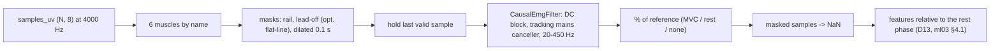

<!--
This file is part of JTS-MM (https://github.com/paulotto/jts-mm).
SPDX-FileCopyrightText: 2026 Paul-Otto Müller
SPDX-License-Identifier: CC-BY-4.0
-->

# ml02 — EMG conditioning

The signal chain applied to `/emg` before windowing. It is the same code for the `ml` CLI and the
biomech stage (`ml/core/signals.py`, called from `ml/core/dataset.py`).

> **Status:** implemented and **causal by construction**: there is no zero-phase option. The chain
> is the one the JTS-MM real-time viewer uses (`jtsmm.viewer.processing`), so offline features are
> what an online decoder would compute; the pseudo-online replay ([`ml08`](ml08_online.md)) runs
> the same chain chunk by chunk.

## 1. Chain



Per experiment phase the chain starts `warmup_s` (2 s) before the phase; the warm-up output is
discarded, so every phase starts with a settled filter and no window crosses a phase edge.

## 2. Channels

Selection is by name from `channel_names`; a missing muscle is an error. The recorded file order
(as cabled; `jtsmm.config.catalog.FULL_CHANNEL_NAMES`) is:

| Index | `channel_names` | Use |
|-------|-----------------|-----|
| 0 | `masseter_r` | input |
| 1 | `temporalis_r` | input |
| 2 | `digastric_r` | input |
| 3 | `digastric_l` | input |
| 4 | `masseter_l` | input |
| 5 | `temporalis_l` | input |
| 6 | `bias_debug` | dropped |
| 7 | `drl` | dropped |

Files recorded before 2026-11-03 store the names of index 2 and 3 the other way round
(`digastric_l`, `digastric_r`), the reverse of the cables; the loader exchanges exactly that
list on read (`jtsmm.io.session_reader.montage_corrected`, called in `ml.io.session`; an03 §1,
erratum E37), so every channel carries the muscle it was cabled to.

The feature-block order is the configured one, not the file order: `dataset.emg.channels`
(§7; default `ml.config.classes.MUSCLE_CHANNEL_NAMES`) = `masseter_r, temporalis_r,
digastric_l, digastric_r, masseter_l, temporalis_l`.

The pilot recordings run at **4000 Hz**; rates are read from `sample_rate_sps`.

## 3. Masks

| Rule | Definition |
|------|------------|
| rail | non-finite, or `|raw| ≥ rail_frac` (0.99) × ADC full scale (`lsb_uv_per_channel` × (2²³ − 1)) |
| lead-off | `leadoff_status` `[statp, statn]`; bit *i* = CH(*i*+1) of the **recorded** channel index (looked up per column, not per position) |
| flat-line | optional (`flatline_window_s` > 0): zero variance over the window |

Masks are dilated by `dilate_s` (0.1 s) on both sides, as in biomech. Masked raw samples are held
at the last valid value before filtering (causal; the former linear interpolation read later
samples), and set to NaN after filtering. Movement artifacts are not masked: a wearable decoder
sees them too.

## 4. Filter

`jtsmm.viewer.processing.CausalEmgFilter(mains_mode="track")` fed through `process_timed`
(dropped samples split the stream, so the canceller stays on the grid): DC block, tracking
canceller over the in-band harmonics of the mains frequency (up to 8, below Nyquist), then
2nd-order Butterworth biquads, 20 Hz high-pass and 450 Hz low-pass (clamped to 0.9 × Nyquist).
The mains frequency is **measured** once per take on the loudest channel over the first 60 s from
the first phase start (`ml.core.signals.line_hz` → `jtsmm.emg.mains.measure_line_hz`): first
around the nominal `line_hz` (50 Hz), then, if no tone is found there, around the other grid
frequency (60 Hz for a 50-Hz nominal and vice versa), so a 60-Hz recording is not cleaned at
50 Hz; with neither tone, or less than 1 s of data, the nominal value is used. This is the 50/60-Hz
rule of biomech's `take_line_hz`; the biomech stage `ml_windows` takes the frequency biomech measured
(`signals.emg.nominal_line_hz`, `line_hz_window_s`). The fixed-frequency notch bank of earlier
versions removed nothing when the grid was off 50.000 Hz.

## 5. Normalization (`dataset.emg.normalization`)

| Mode | Reference (per channel) |
|------|-------------------------|
| `mvc` (default) | MVC take: p95 of the trailing RMS envelope (0.15 s) in `mvc_opening` (digastrics) / `mvc_closing` (closers), computed on the **causal chain of §1** (`meta.ref_chain = causal`). Source, in order: `--mvc`, `dataset.emg.mvc_session`, the sidecar's `mvc_session`; only without an MVC take the sidecar's `mvc_ref_uv` (biomech's zero-phase reference, copied by `ml labels from-biomech`; `ref_chain = zero-phase (biomech)`, gain may differ); none → error |
| `rest` | RMS of the filtered unlabelled `rest` phase |
| `none` | features in µV |

The reference must come from the same chain as the windows: a reference from biomech's
zero-phase Butterworth + mains fit has a different gain than the causal jtsmm chain, so "% of
reference" would not be comparable. The biomech stage `ml_windows` computes the reference of the
definition biomech uses (`signals.emg.reference`: `p95`, `max_recorded` = largest envelope over
the MVC phase and every task (D11), `max1s`) on the causal chain
([`ml07`](ml07_array_pipeline.md) §1).

With the default `window.emg_norm: rest_relative` (D13, [`ml03`](ml03_feature_extraction.md)
§4.1) the features do not depend on a per-participant gain at all, so the reference only matters
for `emg_norm: mvc` (kept for comparison).

The former `robust` mode (median/IQR over the whole recording, test data included) is removed.

## 6. Leakage rules

1. No step reads labels: references, thresholds and the D13 statistics come from the MVC take or
   the unlabelled rest phase (selected by phase, whatever its labels), never from REST-labelled
   windows.
2. No step reads the future: causal filter, hold fill, trailing windows.
3. Learned statistics (feature scaling) are fit per fold on training rows only
   ([`ml04`](ml04_models_and_training.md) §4). Windows overlap by 75 %, so within-subject CV cuts
   time blocks with a guard band ([`ml04`](ml04_models_and_training.md) §3).

## 7. Configuration

```yaml
dataset:
  emg:
    channels: [masseter_r, temporalis_r, digastric_l, digastric_r, masseter_l, temporalis_l]
    line_hz: 50.0
    normalization: mvc          # mvc | rest | none
    mvc_session: null
    mvc_percentile: 95.0
    envelope_s: 0.15
    quality: {use_leadoff: true, rail_frac: 0.99, dilate_s: 0.1, flatline_window_s: 0.0}
  window: {warmup_s: 2.0, emg_band_hz: [20.0, 450.0], emg_norm: rest_relative, ...}   # ml03
```
