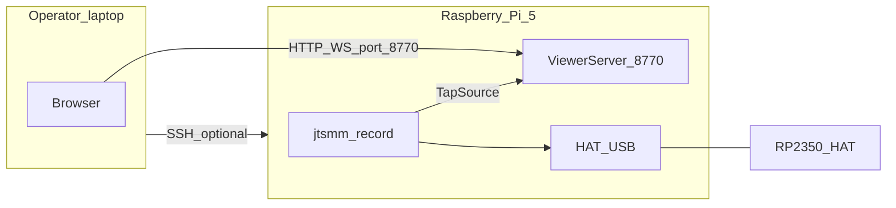

<!--
This file is part of JTS-MM (https://github.com/paulotto/jts-mm).
SPDX-FileCopyrightText: 2026 Paul-Otto Müller
SPDX-License-Identifier: CC-BY-4.0
-->

# Remote viewer over LAN

Operator guide for live EMG/IMU viewing from a laptop while the Pi owns the HAT USB connection.

## Architecture



| Role | USB | Network |
|------|-----|---------|
| **Pi (production)** | HAT → Pi USB | Serves viewer on `0.0.0.0:8770` |
| **Laptop** | Not required | Opens `http://<pi-ip>:8770/` |
| **Dev PC** | HAT → PC USB | Viewer on localhost |

**Important:** only one process may own the HAT USB bulk endpoint. During recording use `jtsmm record` (with `host.viewer.enabled: true` or `--viewer`), not a separate `jtsmm view` in parallel.

## One-time Pi setup

```bash
# Ethernet-only rig (viewer + SSH + hostname jtsmm; no Wi-Fi profile):
./scripts/install_pi.sh --skip-wifi

# Wi-Fi rig — prefer running WITHOUT sudo (privileged steps use sudo internally).
# sudo strips exported JTSMM_WIFI_* unless you use sudo -E or ~/.jtsmm/wifi.env
export JTSMM_WIFI_SSID='LabNet'
export JTSMM_WIFI_PSK='secret'
./scripts/install_pi.sh

# Or credentials file (works with sudo ./scripts/install_pi.sh):
mkdir -p ~/.jtsmm
printf '%s\n' "JTSMM_WIFI_SSID='LabNet'" "JTSMM_WIFI_PSK='secret'" > ~/.jtsmm/wifi.env
chmod 600 ~/.jtsmm/wifi.env
sudo ./scripts/install_pi.sh

# Re-install on same network: SSID only (password optional)
./scripts/install_pi.sh --wifi-ssid 'LabNet'
```

The installer sets hostname **`jtsmm`**, mDNS (`jtsmm.local`), `ufw` (SSH + port 8770), and Wi-Fi profiles when configured. Default: **dual profiles** per SSID (`jtsmm-wifi-<ssid>-5` and `-24`); **5 GHz autoconnect priority 100**, 2.4 GHz **50**.

Manual Wi-Fi re-run when the password is already stored:

```bash
# Each SSID gets dual profiles: jtsmm-wifi-<ssid>-5 (preferred) and -24
sudo ./scripts/pi_network.sh --wifi-ssid LabNet --wifi-psk 'secret'
sudo ./scripts/pi_network.sh --wifi-ssid OtherNet --wifi-psk 'secret'   # both bands if visible
sudo ./scripts/pi_network.sh --wifi-ssid LabNet --wifi-band 5      # 5 GHz only
# pass --wifi-psk only for a new SSID or password rotation
```

Optional `~/.jtsmm/wifi.env` keys: `JTSMM_WIFI_BAND=both|5|2.4`, `JTSMM_WIFI_CHANNEL=36`.

List profiles: `nmcli connection show | grep jtsmm-wifi-`  
Active profile is tracked in `/var/lib/jtsmm/wifi_active_profile` (used by `pi_wifi enable`).

## Each session

**On the Pi (SSH):**

```bash
source ~/jtsmm/venv/bin/activate
jtsmm doctor
jtsmm record --config ~/jtsmm.yaml
# stderr prints LAN viewer URLs when host.viewer.enabled is true
```

**On the laptop (same LAN):**

```
http://jtsmm.local:8770/
# or http://<pi-ip>:8770/
```

**SSH tunnel fallback:**

```bash
ssh -L 8770:127.0.0.1:8770 pi@jtsmm.local
# laptop browser: http://localhost:8770/
```

## Modes

| Goal | Pi command | Laptop |
|------|------------|--------|
| Record + live view | `jtsmm record` (viewer on by default in Pi template) | Browser → `:8770` |
| Record without viewer | `jtsmm record --no-viewer` | — |
| Live monitor only | `jtsmm view` | Browser → `:8770` |
| Replay finished session | `jtsmm replay ~/jtsmm_data/.../session.h5` | Browser → `:8770` |

## Operator notes

Type into the note bar at the bottom and press Enter (or **mark**). During `jtsmm record` each note is written to the session file's `/events` (`kind = "note"`) with the master-clock time of its arrival on the Pi (network delay: milliseconds); the flash says "note saved to session file" and the end-of-take summary prints `viewer notes: N saved to /events`. In `jtsmm view` / `jtsmm replay` notes are kept in viewer memory only. Check them afterwards with `jtsmm integrity check` (row "viewer notes") or `Session.open(path).notes()`.

## Wi-Fi off during capture (RF quiet)

When recording over Ethernet, disable Wi-Fi near the EMG rig:

```bash
pi_wifi disable --duration 3h
jtsmm record ...
pi_wifi enable   # or auto after duration
```

State persists across reboot via `jtsmm-wifi-guard.service` + timer.

## Configuration (`host.viewer`)

```yaml
host:
  viewer:
    enabled: true
    bind_host: 0.0.0.0
    port: 8770
```

CLI flags (`--viewer`, `--no-viewer`, `--viewer-host`, `--viewer-port`) override YAML.

## Troubleshooting

| Symptom | Likely cause | Fix |
|---------|--------------|-----|
| Connection refused on laptop | Viewer not running, wrong port, or `ufw` | `jtsmm record`; check `sudo ufw status` for `8770/tcp` |
| `ImportError: fastapi` on Pi | Viewer extra not installed | Re-run `install_pi.sh` or `pip install 'jtsmm[viewer]'` |
| USB conflict / garbled capture | `jtsmm view` + `jtsmm record` together | Use in-recording tap only (`record`, not parallel `view`) |
| Wi-Fi install fails / no `jtsmm-wifi-*` profile | AP not visible on scanned band, or script exited before Wi-Fi step | `git pull`; for 2.4-only SSID use `--wifi-band 2.4`; for lab 5 GHz use `--wifi-band 5 --wifi-channel 36` |
| Script stops after first line | `set -e` exit (bad `wifi.env`, sudo, nmcli) | Re-run with `bash -x ./scripts/pi_network.sh ...`; check `~/.jtsmm/wifi.env` syntax |
| Stale docs mentioning `:8443/viewer` | Old nginx plan | Use `http://jtsmm.local:8770/` (HTTPS is a future optional module) |

## Future extensions (not implemented)

- HTTPS on `:8443` via nginx/Caddy proxy to `127.0.0.1:8770`
- Path prefix `/viewer` behind a reverse proxy
- Auth token / basic auth
- Separate `jtsmm-viewer.service` for `jtsmm view` / replay only

See also: [`op01_setup_checklist.md`](op01_setup_checklist.md), [`s07_visualization_storage.md`](../software/s07_visualization_storage.md).
