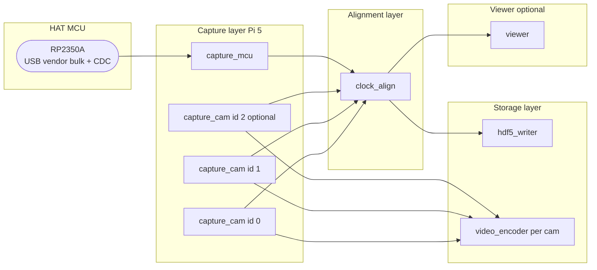

<!--
This file is part of JTS-MM (https://github.com/paulotto/jts-mm).
SPDX-FileCopyrightText: 2026 Paul-Otto Müller
SPDX-FileCopyrightText: 2026 David Stebich
SPDX-License-Identifier: CC-BY-4.0
-->

# s02 — Data Pipeline

This document describes how data flows from the MCU and cameras to the HDF5 file on disk: process layout, queues, backpressure, error handling, and the on-disk HDF5 schema (which is a strict superset of the existing JTS schema).

> **Implementation status (v1):** Production capture is orchestrated by a **single Python process** — [`software/jtsmm/jtsmm/capture/session.py`](../../software/jtsmm/jtsmm/capture/session.py) driving [`SessionSupervisor`](../../software/jtsmm/jtsmm/capture/supervisor.py) — with inline `ClockAligner` and HDF5 output. Real (non-mock) recording **requires** the native extension: the supervisor uses **C++/libusb** for MCU bulk capture (`NativeCapture`); HDF5 goes through the **libhdf5** writer (`NativeWriter`) unless `--optical-track`, CT calibration or a phase plan (`--use-experiment-plan` / `--mvc`) is active; those use the Python `Hdf5Writer`. `jtsmm record --mock`/`run_session(mock_only=True)` (tests, camera-only smoke runs) skip MCU capture entirely and always use the Python `Hdf5Writer`; there is no pure-Python fallback for real hardware — build with `software/jtsmm/native/build.sh` (the pre-native Python multi-process MCU worker added bulk-drain jitter at 2 kHz and has been removed). The **multi-process** layout below (separate `capture_mcu`, `clock_align`, `video_encoder` workers) is the **target architecture** for scaling; sections note what is implemented today vs planned.

## 1. Process layout

### 1.1 Target (multi-process)



### 1.2 Implemented (`jtsmm record`)

| Component | Module | Notes |
|-----------|--------|-------|
| Orchestrator | `capture/session.py` | `run_session()` — load config, optional `doctor`, `config apply`, loop until `duration_s` |
| MCU reader | `capture/capture_mcu.py` or `capture/native_backend.py` | `NativeCapture` — C++/libusb async bulk + C++ `FrameParser`; no fallback for real recording (`McuCapture` in `capture_mcu.py` is test-only) |
| Cameras | `capture/capture_cam.py` | `CameraCapture` — picamera2 when available, else **mock** frames; optional half-res **lores** RGB for ArUco/viewer |
| Optical | `capture/optical_bridge.py` | `OpticalTrackBridge` — off-thread ArUco into `/optical/` when `--optical-track` |
| Alignment | `sync/clock_align.py` | `ClockAligner.ingest_mcu` / `ingest_cam` — inline, not a separate process |
| HDF5 | `io/hdf5_writer.py` | `Hdf5Writer` — append + periodic `flush()`; used for `--optical-track`, CT calibration and phase plans (native `NativeWriter` otherwise) |

Entry point: `jtsmm record` ([`cli/record.py`](../../software/jtsmm/jtsmm/cli/record.py)).

Each box in §1.1 is a separate **OS process** in the target design. Communication is via `multiprocessing.Queue` for in-process Python and ZeroMQ `IPC` sockets for cross-language hooks (a future ROS 2 node bridge).

Why processes (not threads)?

- The GIL would serialize NumPy work on the capture path.
- Process isolation contains failures: a libcamera segfault in `capture_cam1` does not take down the writer.
- Pi 5 has 4 cores; explicit process pinning gets us actual parallelism.

## 2. Queue topology

All inter-process queues are bounded. **Bounded queues + drop-oldest policy** is how we keep capture-side processes from blocking on a slow downstream.

| Queue | Producer | Consumer | Max depth | Policy on full |
|-------|----------|----------|-----------|----------------|
| `q_mcu_raw` | `capture_mcu` | `clock_align` | 4096 records | drop_oldest, log warning |
| `q_cam0_frame` | `capture_cam[0]` | `clock_align` | 60 frames (1 s at 60 fps) | drop_oldest |
| `q_cam0_vid` | `capture_cam[0]` | `video_encoder[0]` | 120 frames | block (storage must keep up) |
| `q_sync_emg` | `clock_align` | `hdf5_writer` | 8192 | drop_oldest |
| `q_sync_imu` | `clock_align` | `hdf5_writer` | 4096 | drop_oldest |
| `q_sync_cam` | `clock_align` | `hdf5_writer` | 120 | block |
| `q_viewer` | `clock_align` | `viewer` | 60 | drop_oldest (viewer never blocks recording) |

Camera-video queues use **block-on-full** because we never want to silently drop video frames; the encoder must keep up. The processing-side queues use **drop-oldest** because the alignment + viewer code can recover from a brief stall (alignment uses recent history; viewer just shows live data).

Dropped records are **counted** in the `/sync/` group of the HDF5 file so the analysis pipeline can detect partial data:

```python
/sync/drops/emg     -- (N, 2): t_master_us, count
/sync/drops/imu_mta -- (N, 2)
...
```

## 3. capture_mcu process

**Implemented:** `McuCapture` in [`capture_mcu.py`](../../software/jtsmm/jtsmm/capture/capture_mcu.py) — a standalone, unit-tested Python USB/CRC reader (see [`test_bulk_transport.py`](../../software/jtsmm/tests/test_bulk_transport.py)). It is **not** wired into `SessionSupervisor`'s real-recording path (which requires the native extension, §1.1's implementation note); the multi-process Python `worker_mcu` wrapper that used to bridge it into a session was removed as unreachable dead code once `SessionSupervisor` started requiring native for non-mock sessions.

Responsibilities:

1. Open the **USB vendor bulk IN** endpoint via libusb ([`BulkReader`](../../software/jtsmm/jtsmm/capture/usb_bulk.py)) and `drain()` any stale buffered records so the session starts at "now". Text/commands stay on the CDC serial port (`pyserial`); binary records are read from the bulk endpoint only.
2. Read bytes; resync to `0x55 0xAA`; parse `TYPE`, `LEN`, `T_MASTER_US`, payload, CRC16.
3. Verify CRC; on mismatch, log + drop, resync.
4. Push a decoded `McuRecord` into the record queue.
5. Maintain link statistics (bytes/s, records/s, dropped, CRC errors).

The implementation splits reading from parsing across **two threads**: a tight *read* thread pulls large (16 KB) chunks off the bulk endpoint and hands them to a *parse* thread via a raw-byte queue. This keeps a USB transfer always armed (the endpoint never sits unpolled during the comparatively slow Python parse), which is what prevents the MCU vendor FIFO from overflowing (`tx_drops`) at high EMG rates.

Throughput: ~220 kB/s sustained at the default rates (4 kHz EMG ≈ 180 kB/s + dual IMU); the RP2350 Full-Speed link has ~1 MB/s headroom. At the default **4 kHz** `acquisition` profile the built native backend keeps several async USB transfers in flight and parses off the GIL.

## 4. capture_cam *(target: one process per camera; today: in-supervisor helper)*

**Target design** (still valid as the end state):

- **Track B (picamera2)**: frames + `SensorTimestamp`; metadata queue + pixel queue for the encoder.
- **Track A (V4L2)**: UVC PTS + LED-flash detection.

**Implemented today** in [`capture/capture_cam.py`](../../software/jtsmm/jtsmm/capture/capture_cam.py) + [`supervisor.py`](../../software/jtsmm/jtsmm/capture/supervisor.py):

- Opens picamera2 (or mock), applies host YAML controls (`ae_enable`, `gain`, …).
- Drains **metadata** from the full-res `main` stream (`SensorTimestamp`, exposure/gain) and writes aligned camera rows to `/cameras/<id>/`.
- When `--optical-track` or `--viewer` is set, also configures a half-res **lores** BGR stream (e.g. 728×544 for 1456×1088 main). ArUco and the in-recording viewer copy **lores** pixels, not full-res `main`.
- Does **not** call `video_encoder` yet (no sidecar `.mkv`).
- Does **not** read a camera-side `trigger_id` (libcamera has none) — see [`s06`](s06_time_synchronization.md) §4.1.

`/cameras/` and `/optical/` are different groups on purpose: cameras store **every** trigger-aligned frame's timing metadata; optical stores **ArUco poses** (same `t_master_us` when a lores RGB sample was processed). With lores at camera rate they typically share one row per frame.

### 4.1 Marker detection placement *(target)*

Marker detection (ArUco, dictionary from `optical.yaml`) belongs in the camera process so metadata carries corners without shipping pixels through `clock_align`. **Not wired** in the current supervisor loop.

**Implemented:** ArUco runs inside `jtsmm record --optical-track` via [`OpticalTrackBridge`](../../software/jtsmm/jtsmm/capture/optical_bridge.py) (worker thread + `ArucoJawTracker`). Intrinsics from the calibration bundle are scaled to the lores resolution before PnP. Standalone `optical track` uses the **same half-res lores Y** path (728×544) with scaled intrinsics — not full-res main.

**Experiment phases:** `jtsmm record --use-experiment-plan` walks SPACE start/end for motion names. Landmark calibration is inserted before the first motion phase. `jtsmm record --mvc` is a separate EMG-only take (`mvc_opening`, `mvc_closing`; cameras and ArUco off; IMU still arrives on USB). Capture is **not** paused between presses on a motion plan. Edges go to `/events` and `/phases`. Optional JTS sidecar maps **optical** intervals only. Timed capture (no plan, no `--mvc`) runs for `duration_s` only.

**CT tip pivot:** `session.ct_calibration: true` runs an interactive cone + SPACE×N OLS tip solve before the take; tip offset is applied to `/optical/pose_ct` when optical tracking is on.

Detection details: [`s03_camera_pipeline.md`](s03_camera_pipeline.md).

## 5. clock_align *(target: dedicated process; today: in-process `ClockAligner`)*

**Target responsibilities** (multi-process pipeline in the diagram above):

1. Route MCU records by `TYPE`.
2. Match camera frames to `TRIGGER_EVENT`.
3. Maintain affine fits for **foreign** clocks (Pi PPS, Track A PTS; camera residual).
4. Emit `SyncReport` / `/sync/*` history.

**Implemented:** [`sync/clock_align.py`](../../software/jtsmm/jtsmm/sync/clock_align.py) inside `SessionSupervisor`:

- Forwards EMG/IMU/trigger with MCU `t_master_us` (no affine).
- Camera: exact `trigger_id` when provided; otherwise the first frame is anchored on the trigger nearest its PPS-mapped `SensorTimestamp`, then cadence tracking (prediction / slip recovery as fallbacks); store matched trigger time; update residual fit.
- Frames whose trigger has not arrived yet are **held** in a short queue (not counted as drops); see [`s06`](s06_time_synchronization.md) §4.1.
- `pps` handshakes at take start and end feed `_pi_fit`; phase/event stamps are re-mapped with the final fit at close.

Details and status table: [`s06_time_synchronization.md`](s06_time_synchronization.md).

## 6. hdf5_writer process

**Implemented:** [`io/hdf5_writer.py`](../../software/jtsmm/jtsmm/io/hdf5_writer.py) — runs in the `jtsmm record` process.

Responsibilities:

1. Open the session HDF5 file at session start with `h5py.File(..., 'w', libver='latest', track_order=True)`.
2. Create one resizable dataset per modality with **chunking** sized for ~1 s of data; e.g. EMG samples are chunked `(4000, 8)` so each chunk holds 1 s of 8-channel samples at the default rate.
3. Drain queues; append to datasets via `dataset.resize` + slice assignment.
4. `H5Fflush` at most every 1 s and at close, to bound data loss in case of crash.
5. On `SIGTERM` (controlled stop): flush, write final attrs (duration, sample counts), close.

The writer is the **only** process that writes to disk in HDF5. Per-camera videos are encoded by separate `video_encoder` processes that write `.mkv` files directly; the writer stores **only the file offsets / frame indices** in HDF5, so the HDF5 stays small and re-openable.

> **v1 gap:** `video_encoder` processes and sidecar `.mkv` files are **not implemented** — camera rows store metadata (`t_master_us`, `sensor_timestamp_ns`, `trigger_id`, `frame_idx`) only. Full video pipeline remains per §7 target.

## 8. HDF5 schema

The schema is a **strict superset** of the existing JTS schema. New code understands old files. Old code reads new files and ignores the new groups it does not know about.

### 8.0 Written today vs target (v1)

| Group / dataset | Target (§8.1) | **Written by v1 `Hdf5Writer`** |
|-----------------|---------------|--------------------------------|
| `/meta` attrs | session_id, versions, calibration refs | `software_version`, `jts_schema_version`, `config_hash`, `mcu_config_json`, `host_config_json`, `created_unix_utc`, `recording_date` (ISO-8601 UTC), `mode`, plus whatever `jtsmm record --subject`/`--protocol`/`--meta KEY=VALUE` supplied (typically `subject_id`, `protocol`, `operator`, ...) |
| `/emg/samples`, `samples_uv`, `t_master_us`, `seq` | full | **yes** (on flush) |
| `/emg/leadoff_status` | muscle CH1-6 `statp`/`statn` masks (DRL excluded — see [`h03`](../hardware/h03_emg_frontend.md) §6) | **yes** (Python + native writers) |
| `/imu_mta/quat` (+`quat_report_id`), `accel`, `gyro`, `mag`, `linear_accel` (each + own `t_master_us_*`) | full IMU streams | **yes** — one dataset per enabled report (Python + native writers) |
| `/imu_cra/*` | same as MTA | **yes** (both slots) |
| `/triggers/trigger_id`, `t_master_us` | full | **yes** |
| `/cameras/<id>/t_master_us`, `sensor_timestamp_ns`, `trigger_id`, `frame_idx` | + markers, video refs | **metadata only** (mock cam when no picamera2) |
| `/optical/t_master_us`, `pose_*`, `quality/{mta,cra,ct}/`, `corners/` | per-frame SE(3) + lock quality + the 2D corners they came from | **yes** when `jtsmm record --optical-track` (Python `Hdf5Writer`); see §8.5 |
| `/sync/*_to_master` time series | per-fit history | **`sync.attrs.report_json`** snapshot only |
| `/events` | phase_start/end, viewer notes (`note`) and firmware log lines (`mcu_log`: IMU recovery/watchdog, apply warnings; stamped on the MCU clock, `map_quality` `mcu_clock`) — columns `kind`, `text`, `phase_kind`, `t_master_us`, `t_host_ns`, `map_quality`, `viewer_t_s` | **yes** — notes whenever the viewer runs, firmware log lines whenever the MCU sends one (Python + native writers), phase edges with a plan; rows in write order |
| `/phases` | phase intervals on `t_master_us` | **yes** when `jtsmm record --experiment-plan` (Python `Hdf5Writer`) |
| `/calibration` | per spec | **no** (downstream / legacy JTS) |

## 7. video_encoder process *(target — not implemented in v1)*

One process per camera. Pipes raw frames to `ffmpeg` via `subprocess`:

- Track B (mono 8-bit, 1456×1088, 60 fps): `ffmpeg -f rawvideo -pix_fmt gray -s 1456x1088 -r 60 -i - -c:v ffv1 -level 3 -context 1 out.mkv` (lossless mono ~50 MB/s).
- Track A (color RGB, 1920×1080, 30 fps): `ffmpeg -f rawvideo -pix_fmt bgr24 -s 1920x1080 -r 30 -i - -c:v libx264 -preset veryfast -crf 18 out.mkv` (visually lossless, ~10 MB/s).

The encoder writes a single video file per camera per session, plus a sidecar JSON with per-frame `t_master_us` and offsets. The HDF5 stores the same JSON content under `/cameras/<id>/`.

We chose **lossless FFV1** for Track B to preserve marker-detection-ready pixel data; for Track A, where pixel precision is less critical (AprilTag IDs and corners are already in the metadata), CRF-18 H.264 is fine and saves disk.

### 8.1 Top-level layout

```
session.h5
├── meta/                   (NEW; attrs)
│   ├── attr: session_id              str
│   ├── attr: subject_id              str (anonymized hash)
│   ├── attr: subject_consent_ref     str (study + signed consent ID)
│   ├── attr: operator                str
│   ├── attr: start_unix_utc          int (also kept as readable ISO)
│   ├── attr: protocol                str (e.g. "motion_battery_v1")
│   ├── attr: hardware_serial         str
│   ├── attr: firmware_version        str
│   ├── attr: software_version        str
│   ├── attr: calibration_ref         str (path to calibration HDF5)
│   └── attr: jts_schema_version      "1.1" for JTS-MM, "1.0" for original JTS
│
├── optical/                (when `jtsmm record --optical-track`)
│   ├── t_master_us          (T,) float64 / uint64 — same master clock as `/cameras`
│   ├── pose_mta             (T, 4, 4) float32 — mouthpiece / MP (`T_world←MP`)
│   ├── pose_cra             (T, 4, 4) float32 — headpiece / HP (`T_world←HP`)
│   ├── pose_ct              (T, 4, 4) float32 — calibration tool / CT
│   └── quality/             per-row lock diagnostics (same T as poses)
│       ├── attr: rms_kind   "reprojection_px" (PnP) or "kabsch_mm" (triangulation)
│       ├── mta/             n_tags, n_cameras, reprojection_rms
│       ├── cra/             same
│       └── ct/              same
│   └── corners/             2D tag corners behind each pose (since 2026-10), one row per
│       │                    (frame, camera, tag); re-triangulate offline with
│       │                    `jtsmm.io.optical_corners.read_optical_corners`
│       ├── optical_row      (K,) uint32 — index into the arrays above
│       ├── t_master_us      (K,) uint64 — = /optical/t_master_us[optical_row]
│       ├── cam              (K,) uint8  — index into attr cam_ids
│       ├── tag_id           (K,) uint16
│       ├── corners_px       (K, 4, 2) float32 — TL, TR, BR, BL in the tracked image
│       │                    (lores, mount rotation applied); all detected tags
│       └── calibration/<cam>/  K, dist, T_world_cam (+ attrs image_size, rms_px) as used live
│   # Failed / missing detections stay as NaN poses so the stream stays gap-free.
│   # Body names in JTS / standalone optical HDF5 are HP↔cra, MP↔mta, CT↔ct.
│
├── emg/                    (NEW)
│   ├── samples              (N, 8) int32 (24-bit sign-extended)
│   ├── seq                  (N,) uint32 (acquisition sequence from the 31-byte EMG record)
│   ├── samples_uv           (N, 8) float32 (calibrated, channel × LSB × 1e6)
│   ├── t_master_us          (N,) uint64
│   ├── leadoff_status       (N, 2) uint8 [statp_mask, statn_mask]; bit i = CH(i+1),
│   │                        muscle CH1-6 only (bits 6-7 always 0). All-zero for the
│   │                        whole session unless emg.leadoff.during_recording was
│   │                        true. DRL (CH8/IN8N) deliberately excluded — its
│   │                        comparator only means something with CH1-6 muted
│   │                        (see `jtsmm emg check`, h03 §6).
│   └── attrs (incl. leadoff_status_note; see above):
│       ├── sample_rate_sps             4000
│       ├── gain                        6
│       ├── lsb_uv                      scalar muscle LSB (VREF = 4.5 V internal, gain from config)
│       ├── lsb_uv_per_channel          (8,) — CH7/CH8 run at a fixed gain 24
│       ├── channel_names               ["masseter_r", "temporalis_r", "digastric_r", "digastric_l",
│       │                               "masseter_l", "temporalis_l", "bias_debug", "drl"]
│       │                               (files before 2026-11-03: CH3/CH4 digastric_l/_r, the
│       │                               reverse of the cables; corrected on read, an03 §1)
│       ├── adc_filter                  ADS1299 on-chip sinc order + decimation
│       │                               (NOT the Pi DSP chain; that is in s04)
│       └── mvc_ref                     link to /calibration/mvc_ref (session-level; cv03 §6)
│
├── imu_mta/                (only datasets for reports enabled in the applied config)
│   ├── quat                 (M, 4) float32 (w, x, y, z); attrs: quat_report_id, fusion_mode
│   ├── gyro                 (M_g, 3) float32 rad/s   (from int16 Q9 on the wire)
│   ├── accel                (M_a, 3) float32 m/s²    (from int16 Q8 on the wire)
│   ├── linear_accel         (M_l, 3) float32 m/s²    (float32 on the wire)
│   ├── mag                  (M_m, 3) float32 µT      (from int16 Q4; optional)
│   ├── t_master_us_quat     (M,) uint64
│   ├── t_master_us_gyro     (M_g,) uint64
│   ├── t_master_us_accel    (M_a,) uint64
│   ├── t_master_us_linear_accel (M_l,) uint64
│   ├── t_master_us_mag      (M_m,) uint64
│   ├── quat_accuracy, accel_accuracy, ...  (per stream, row-aligned) uint8: BNO085
│   │                        calibration status 0..3, 255 = not sent (s05 §1)
│   └── attrs (per stream: device="BNO085", units, rate_hz):
│       ├── fusion_mode                  "game_rotation_vector"
│       ├── rates_hz                     {quat: 390, accel: 250, ...}  (default kinematics_accel; others when enabled)
│       ├── mounting_transform           (4, 4) float32 (IMU → MTA frame)
│       └── calibration_ref              link
│
├── imu_cra/                (NEW, same shape as /imu_mta)
│
├── cameras/                (NEW)
│   ├── cam0/
│   │   ├── frame_idx        (K,) uint64 packed (file_idx << 48) | frame_in_file
│   │   ├── t_master_us      (K,) uint64
│   │   ├── trigger_id       (K,) uint64 (links to /triggers/)
│   │   ├── exposure_us      (K,) uint32
│   │   ├── gain             (K,) float32
│   │   ├── markers/
│   │   │   ├── ids          (K, M_max) int32 (-1 padded)
│   │   │   ├── centers      (K, M_max, 2) float32 (px)
│   │   │   ├── confidence   (K, M_max) float32
│   │   │   └── attrs: detector ("apriltag" / "aruco" / "retroreflective_blob")
│   │   └── attrs:
│   │       ├── backend                  "picamera2" / "v4l2"
│   │       ├── resolution               [1456, 1088]
│   │       ├── pixel_format             "GREY8" / "BGR8"
│   │       ├── intrinsics_ref           link
│   │       ├── extrinsics_ref           link
│   │       └── video_file               "cam0_session_001.mkv"
│   ├── cam1/, cam2/  ...
│
├── triggers/               (NEW)
│   ├── trigger_id           (P,) uint64
│   ├── t_master_us          (P,) uint64
│   └── attrs: rate_hz, source ("mcu_pio")
│
├── sync/                   (NEW)
│   ├── pi_to_master/        (S, 4) [t_pi_ns, t_master_us, a, b]
│   ├── cam0_to_master/      (S, 4) [t_cam_ns, t_master_us, a, b]
│   ├── cam1_to_master/      ...
│   ├── drops/
│   │   ├── emg              (D, 2) [t_master_us, count]
│   │   ├── imu_mta          (D, 2)
│   │   └── ...
│   └── attrs: residual_rms_us per stream
│
├── events/                 (phase edges, viewer notes, firmware log; write order, sort by t_master_us)
│   ├── t_master_us          (E,) uint64   host stamp mapped like phase edges, final-fit re-mapped (mcu_log: MCU stamp)
│   ├── kind                  (E,) vlen str ("phase_start", "phase_end", "note", "mcu_log")
│   ├── text                  (E,) vlen str (phase name / note text / firmware line)
│   ├── phase_kind            (E,) vlen str ("" for notes)
│   ├── t_host_ns             (E,) uint64   Pi CLOCK_MONOTONIC at the edge / note arrival (0 for mcu_log)
│   ├── map_quality           (E,) vlen str ("pi_fit", "mcu_arrival", "mcu_clock", ...)
│   └── viewer_t_s            (E,) float64  browser display time of a note (NaN otherwise)
│
└── calibration/            (link or embedded)
    ├── ads1299              attrs: lsb_uv, leadoff_thresh, ...
    ├── imu_mta              attrs: gyro_bias, accel_bias_scale, mag_ellipsoid, mounting_T
    ├── imu_cra              same shape
    ├── cameras/
    │   ├── cam0/intrinsics  (3, 3), (5,) for distortion
    │   ├── cam0/extrinsics  (4, 4) world ← camera
    │   └── ...
    └── world/
        └── reference_pose_csaratmax  (4, 4)
```

The `attr: jts_schema_version` lets readers branch on schema version. **All existing JTS code reads JTS-MM files unchanged**; new fields appear under new groups it does not navigate to.

### 8.2 Why some redundancy

- `samples` (raw int24) **and** `samples_uv` (calibrated float32). The raw is the source-of-truth; the calibrated is convenience-of-use. The conversion is `samples * lsb_uv_per_channel`; storing both costs ~50 % more disk but saves every consumer from doing the conversion.
- IMU `quat` (fused) **and** `gyro`/`accel` (raw). Anyone wanting to re-do the fusion has the raw; anyone using the system as a black box has the fused output ready.

### 8.3 Cross-modality time alignment in analysis code

Because every dataset carries `t_master_us`, alignment in analysis is a simple `numpy.searchsorted`:

```python
import h5py, numpy as np

f = h5py.File("session.h5", "r")
t_emg = f["/emg/t_master_us"][:]
emg = f["/emg/samples_uv"][:]
t_quat = f["/imu_mta/t_master_us_quat"][:]
quat = f["/imu_mta/quat"][:]

# For each EMG sample, find the most recent IMU quaternion:
idx = np.searchsorted(t_quat, t_emg, side="right") - 1
quat_at_emg = quat[idx]
```

This pattern is wrapped in `jtsmm.io.aligned_view()` for convenience but the underlying mechanism is trivially reusable.

### 8.4 `frame_idx` encoding

A camera session may roll over into multiple video sidecar files (size cap, encoder restart after a `capture_cam` crash). `frame_idx` is therefore a **packed `uint64`**:

```
frame_idx = (file_idx << 48) | frame_in_file
```

- `file_idx` (top 16 bits) selects the sidecar (`cam0_session_001.mkv`, `..._002.mkv`, …) listed in the `/cameras/<id>/attrs:video_files` array.
- `frame_in_file` (low 48 bits) is the zero-based frame number within that file.

This is defined **once here**; [`s07_visualization_storage.md`](s07_visualization_storage.md) references this encoding rather than redefining it.

### 8.5 Optical validity (live + `jtsmm integrity`)

When `jtsmm record --optical-track` is on, `/meta` gets `optical_tracking=true` and every lores frame produces one `/optical` row (NaN pose if that body did not lock). Standalone `optical track` writes a different HDF5 layout (`bodies/HP|MP|CT` + `quality/HP|MP|CT`) — see [`docs/optical/03_pose_estimation_and_output.md`](../optical/03_pose_estimation_and_output.md).

**Live (tracker, before write):**

| Gate | Config / code | On fail |
|------|---------------|---------|
| PnP tag RMS | `tracker.pnp.max_reprojection_rms_px` (default **8.0** in [`optical.yaml`](../../software/optical/etc/optical.yaml)) | skip that tag |
| Kabsch residual | `tracker.triangulation.max_residual_mm` (**5.0**), `min_views` (**2**) | skip that body |
| Rigid SE(3) | `is_rigid_se3()` on fused `T_world←body` | write NaN pose for that body |
| Tracker exception | `OpticalTrackBridge` | NaN poses + empty quality for that row |

**Post-session** (`jtsmm integrity check`, same budgets in `eval_optical_session --strict`): implemented in [`jtsmm/integrity/optical.py`](../../software/jtsmm/jtsmm/integrity/optical.py). Runs when `/optical/t_master_us` has rows, or when `optical_tracking` is set (empty optical then errors). `integrity --strict` and `eval_optical_session --strict` treat **warnings as failures** (eval exits **2**).

| Check | Error | Warn |
|-------|-------|------|
| `optical_tracking` but no `/optical/t_master_us` | missing/empty | — |
| Pose shape ≠ `(T, 4, 4)`; `t_master_us` decreasing | yes | duplicate timestamps |
| Finite pose not rigid SE(3) (`atol` 1e-2, float32) | yes | — |
| Stereo lock (HP and MP among stereo camera timestamps; ≥20 stereo ts) | both < **5%** | either < **30%** |
| Optical vs stereo timestamp coverage | < **20%** | < **50%** |
| Phase lock (≥10 optical rows in phase) | `mand_*`: MP+CT ≥50%; `max_*`: HP+CT ≥50%; motion (`open_close`, `left_right`, `protrusion_retrusion`, `chewing`): HP+MP ≥40% | — |
| Inter-frame origin jump | ≥ **250 mm** | ≥ **100 mm** |
| HP–MP distance (both finite) | > **800 mm** | outside **20–500 mm** |
| Origin vs world | — | > **2000 mm** |
| `/optical/quality` | length ≠ `T` | missing group/slot (legacy sessions) |
| `sync.attrs.report_json` → `optical` | `pair_dropped` ≥50%; `queue_dropped` ≥25%; `failed` ≥10 | pair ≥25%; queue ≥10%; any `failed` > 0 |

The integrity table prints `opt.HP` / `opt.MP` / `opt.CT` lock fractions. Operator symptoms: [`op03`](../operations/op03_troubleshooting.md) §5b.

Timing between `/optical` and the IMUs is checked separately by [`jtsmm/integrity/optical_imu_sync.py`](../../software/jtsmm/jtsmm/integrity/optical_imu_sync.py), which correlates angular speed across the two modalities and errors above **120 ms** of lag. None of the checks above can see a constant camera↔trigger misassignment, because the per-camera affine residual is computed against a fit seeded from that same pairing — see [`s06`](s06_time_synchronization.md) §4.1 and §4.3.

### 8.6 Derived / analysis groups (written post-hoc, optional)

These groups are **not** produced by the realtime capture path; they are written by offline analysis ([`s04_emg_signal_processing.md`](s04_emg_signal_processing.md), [`s05_imu_processing.md`](s05_imu_processing.md)) and are optional. Old JTS code ignores them; JTS-MM tools create them on demand.

```
session.h5
├── emg/
│   ├── features/            (NEW, optional — s04)
│   │   ├── rms              (F, 6) float32   windowed RMS envelope
│   │   ├── mnf              (F, 6) float32   mean/median frequency
│   │   ├── t_master_us      (F,) uint64
│   │   └── attrs: window_ms, hop_ms, feature_list
│   └── onsets/              (NEW, optional — s04 TKEO)
│       ├── t_master_us      (O,) uint64
│       ├── channel          (O,) uint8
│       └── attrs: method ("tkeo"), threshold
└── derived/                 (NEW, optional)
    ├── relative_orientation/   mandible-vs-cranium quaternion (s05)
    │   ├── quat             (R, 4) float32
    │   ├── t_master_us      (R,) uint64
    │   └── attrs: definition ("q_cra^-1 * q_mta")
    └── pose/                   fused optical+IMU pose (s05)
        ├── pose_mta         (R, 4, 4) float32
        ├── t_master_us      (R,) uint64
        └── attrs: source ("optical" / "imu" / "fused")
```

## 9. Backwards-compatibility test

The recorder's JTS-facing output is covered by the `software/jtsmm` tests; the JTS code itself is in [`software/jaw_tracking/`](../../software/jaw_tracking/README.md) (vendored from [paulotto/jaw_tracking_system](https://github.com/paulotto/jaw_tracking_system)):

- `test_fix_I_timegrid.py`: the recorder and the JTS export use the same time grid, and the export carries the master time;
- `test_fix_I_mock_session.py`: a mocked session's JTS sidecar uses the trigger grid;
- `test_fix_F_jts_period.py`, `test_run_jts_analysis.py`, `test_jts_path.py`: the trigger period in the export, the JTS configuration lookup and the vendored-or-installed JTS import.

The test originally planned here (run JTS on a mocked JTS-MM session and compare its output byte for byte with a reference HDF5 file recorded under the old system) is not implemented.

## 10. ROS 2 bridge (optional)

For labs that want ROS 2 integration, `software/jtsmm/ros2_bridge/` (not delivered in v1 but reserved) wraps each capture process with a small ROS 2 node that publishes:

| Topic | Type | Source |
|-------|------|--------|
| `/jtsmm/emg` | `std_msgs/Float32MultiArray` | `q_sync_emg` |
| `/jtsmm/imu_mta` | `sensor_msgs/Imu` | `q_sync_imu` (MTA stream) |
| `/jtsmm/imu_cra` | `sensor_msgs/Imu` | `q_sync_imu` (CRA stream) |
| `/jtsmm/camera/cam0` | `sensor_msgs/Image` + `sensor_msgs/CameraInfo` | `q_sync_cam` (cam0 stream) |
| `/jtsmm/sync/status` | `diagnostic_msgs/DiagnosticArray` | `clock_align` reports |

Timestamps on ROS 2 messages use the `t_master_us` → wall clock conversion derived from `pi_to_master`.

## 11. Failure modes

| Symptom | Likely cause | Effect on session | Recovery |
|---------|--------------|-------------------|----------|
| USB unplugged / HAT lost | cable, power | dead-link watchdog ends the take after > 1 s without records (`end_reason` `watchdog`); data up to then is kept | reconnect, restart `jtsmm record` |
| `capture_cam` exits | libcamera daemon crashed | session continues without that camera | restart the cam process; existing video file is kept; new file starts |
| `clock_align` exits | bug in fit code | session loses sync | writer keeps appending local timestamps; analysis must redo sync offline |
| `hdf5_writer` exits | disk full | session **stops** | operator clears disk; rerun |
| Pi power loss | mains hiccup | last ~1 s of unflushed data lost; HDF5 file may be partially corrupted (h5py uses libver=latest which provides some robustness) | future v2: write through a journaling buffer |

The writer uses `libver=latest` without SWMR; the live viewer is fed in-process, not by reading the HDF5.
