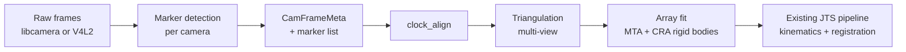

<!--
This file is part of JTS-MM (https://github.com/paulotto/jts-mm).
SPDX-FileCopyrightText: 2026 Paul-Otto Müller
SPDX-FileCopyrightText: 2026 David Stebich
SPDX-License-Identifier: CC-BY-4.0
-->

# s03 — Camera Pipeline

The camera pipeline lives between the raw camera frames (provided by libcamera or V4L2) and the optical-pose output (consumed by the existing JTS kinematic code). It does three things: **calibration**, **marker detection**, and **multi-view triangulation**.

The existing JTS pipeline does the *downstream* work — converting marker trajectories to anatomical mandible-vs-cranium kinematics. That code is unchanged. JTS-MM only replaces the source of marker trajectories from Qualisys QTM to the per-camera capture pipeline described here.

## 1. Stage overview



The boundary in §1 with the rest of the system is:

- Input: a stream of `(camera_id, frame_idx, raw_image_array)` plus the camera's intrinsics + extrinsics from calibration.
- Output: a stream of `(t_master_us, mta_pose_4x4, cra_pose_4x4)` for the existing JTS code.

## 2. Marker detection

Markers (dictionary, IDs, sizes) are configured in [`software/optical/etc/optical.yaml`](../../software/optical/etc/optical.yaml) — currently classic ArUco **`DICT_4X4_50`** ([`../optical/01_marker_setup.md`](../optical/01_marker_setup.md)). AprilTag 36h11 is the design target (larger Hamming distance, better occlusion tolerance) and needs only a dictionary change there plus reprinted tags. `host.cameras.marker_detector` in `jtsmm.yaml` is a label only and must stay `apriltag` (other values are rejected). Retroreflective blob mode is optional ([`../04_component_catalog.md`](../04_component_catalog.md#9-fiducials--scene-lighting)).

### 2.1 AprilTag / ArUco

Tags of **15–25 mm** are printed on matte PETG pads on the MTA (3 tags) and CRA (3 tags). The relative pose of each tag w.r.t. the array's anatomical origin is captured during a one-time CAD calibration and stored in the calibration HDF5.

Per-frame processing:

1. Detect all tags via `cv2.aruco.detectMarkers` (AprilTag dictionary).
2. For each detected tag, solve PnP via `cv2.solvePnP` using the tag's known 3D corners → 6-DoF pose.
3. Group tags by array (MTA or CRA via ID ranges assigned in CAD).
4. Robustly merge poses from multiple tags using **quaternion average** + **translation median**, weighted by reprojection residual.
5. Output: one `(R, t)` per array per frame → written to `/optical/pose_mta` and `/optical/pose_cra` (and `pose_ct`). Tags above `tracker.pnp.max_reprojection_rms_px` are skipped; a fused pose that is not rigid SE(3) is stored as NaN. Per-row `n_tags` / `n_cameras` / RMS go under `/optical/quality/`.

**Lighting:** diffuse visible light; locked exposure; avoid glare on tags. No IR ring required.

### 2.2 Retroreflective blob (optional, not default)

Only for experiments comparing against Qualisys native markers. Requires IR rings, 850 nm filters, and Scotchlite spheres — see optional kit in [`../04_component_catalog.md`](../04_component_catalog.md#optional--retroreflective-kit-qualisys-comparison). Software path remains in the repo but is **not** used for the pilot.

## 3. Triangulation

Given 2D detections in N cameras and the camera projection matrices `P_i = K_i * [R_i | t_i]`:

1. For each marker (or each ArUco tag corner), gather all `(camera_i, u_i, v_i, σ_i)` observations.
2. Form the linear system `A x = 0` from each pair of observations (DLT method).
3. Solve via SVD for the 3D point.
4. Refine via non-linear minimization of reprojection error using `scipy.optimize.least_squares` (Huber loss for outlier robustness).

For the MTA / CRA rigid bodies, we go one step further:

1. Triangulate all markers per frame independently.
2. Fit a rigid body transform `(R, t)` to the marker constellation using the **Kabsch algorithm** (the same algorithm the existing JTS uses for the world-from-CRA fit) with the known marker geometry from calibration.
3. The residual of the Kabsch fit is a per-frame quality indicator; large residuals trigger the IMU-based bridging mode (the IMU pose is used until the optical pose stabilizes).

The 3D reconstruction code lives in [`software/optical/optical/tracking/triangulation.py`](../../software/optical/optical/tracking/triangulation.py) (and PnP in `pose_estimation.py`). **`jtsmm record --optical-track`** runs the same `ArucoJawTracker` and writes `/optical/` (poses + quality) into the multimodal `session.h5` (see [`s02_data_pipeline.md`](s02_data_pipeline.md) §8.5). Standalone `optical track` still writes a dedicated tracking HDF5 for experiment-phase workflows.

## 4. Calibration files

### 4.1 Intrinsics

Per camera, computed once via the protocol in [`../calibration_validation/cv01_camera_calibration.md`](../calibration_validation/cv01_camera_calibration.md):

```
/calibrations/cam0/intrinsics/
├── K                (3, 3) float64
├── dist             (5,) float64        Brown-Conrady model
├── image_size       (2,) int32
├── rms_error        scalar float        in pixels
└── attrs: date, n_images, charuco_squares, charuco_marker_size
```

### 4.2 Extrinsics

Per camera, w.r.t. a common world frame (which is the CRA pose at t=0 by convention):

```
/calibrations/cam0/extrinsics/
├── T_world_cam      (4, 4) float64
├── rms_error        scalar float
└── attrs: date, method ("charuco_multi_view"), board_size
```

### 4.3 World coordinate convention

We adopt the same convention as the existing JTS paper: the world frame is `OVM` (virtual model frame), and the maxilla anatomical frame `CSAnatMax` is registered into it by Kabsch from the digitized maxillary landmarks. This means the **same downstream registration code from the original JTS** processes JTS-MM data without modification.

## 5. Latency budget

For the 40 fps Track B configuration (template trigger rate) with **half-res lores** ArUco (728×544):

| Stage | Per-frame time (Pi 5, typical) |
|-------|--------------------------------|
| Drain `main` metadata (no full-res copy) | ≪1 ms |
| `make_array("lores")` half-res BGR | ~1–2 ms |
| ArUco detection (off-thread, one camera) | ~4–6 ms at half-res |
| PnP / body fusion | ~1–2 ms |
| Total budget vs 25 ms frame period | comfortable for 1–2 cameras at 40 Hz |

Full-res `make_array("main")` + ArUco on the capture thread previously starved picamera2's tiny request queue and collapsed camera/optical rates. That path is intentionally avoided: metadata stays on `main`, pixels for tracking come from **lores**, and ArUco runs in [`OpticalTrackBridge`](../../software/jtsmm/jtsmm/capture/optical_bridge.py)'s worker thread.

Use `optical eval-quality` to confirm marker size × resolution tradeoffs before changing the lores size.

## 6. Failure modes and fallbacks

### 6.1 Marker occlusion

The single largest source of optical drop-out. Mitigations:

1. Each array (MTA, CRA) carries **3 AprilTag 36h11** pads; fused pose is robust with **≥2** tags visible (3 preferred).
2. If too few tags are visible, the pose for that frame is marked `nan` in the output, and the **IMU bridging mode** kicks in — the previous optical pose is propagated forward using the IMU's gyro integration until the optical pose is re-acquired.
3. The HDF5 schema explicitly stores which frames are optical vs. IMU-bridged via an attribute on the pose dataset.

### 6.2 Calibration drift

A wall-mounted ChArUco board visible in one camera's FOV during a session lets us detect changes in extrinsics from thermal / mechanical drift. If the board's measured pose deviates by >1 mm from its calibration value, the live viewer raises a warning.

### 6.3 Ambient lighting changes

AprilTag tracking is sensitive to **motion blur**, **glare**, and **occlusion**. Mitigations: shorten exposure, add diffuse light, enlarge tags, add a third camera view.

## 7. CLI tools

| Command | Purpose |
|---------|---------|
| `jtsmm record --optical-track --optical-config …` | Multimodal session with `/optical/` poses (lores ArUco) |
| `jtsmm integrity check --strict SESSION.h5` | EMG/IMU/cameras **and** optical lock / SE(3) / drop budgets |
| `python -m jtsmm.tools.eval_optical_session SESSION.h5 --strict` | Optical-only report + same optical budgets (exit 2) |
| `jtsmm record --use-experiment-plan` | Interactive SPACE phase markers on `t_master_us` (continuous capture; plan from `session.experiment`) |
| `jtsmm view` / `jtsmm record --viewer` | Live web viewer (recording reuses lores RGB; no second Picamera2) |
| `optical calibrate …` | Intrinsics / extrinsics / calibration bundle |
| `optical track …` | Standalone tracking session (HAT trigger + `t_master_us`) |
| `optical eval --config … [--resolution WxH] [--n-cameras 1|2]` | Live marker-size study (1-cam PnP or 2-cam triangulation) |
| `optical eval-quality --config …` | Offline size × image-quality ladder (lores tradeoff) |
| `optical markers …` | Printable ArUco / ChArUco PNGs |

Legacy `jtsmm cam …` names in older drafts map to the `optical` / `jtsmm record` commands above.

## 8. Integration with the existing JTS code

**Implemented today:**

1. **Standalone optical package** ([`software/optical/`](../../software/optical/README.md)) — `optical calibrate`, `optical track`, replay, and eval tools. Writes `data/optical/tracking/*.h5` for [`software/jaw_tracking/`](../../software/jaw_tracking/README.md).
2. **Unified multimodal capture** — `jtsmm record --optical-track --optical-config <optical.yaml>` runs ArUco during the same take as EMG/IMU/triggers and writes `/optical/{t_master_us,pose_mta,pose_cra,pose_ct,quality}` into `session.h5`, aligned to the MCU master clock.

Recording path details:

- picamera2 `main` = full-res metadata; `lores` = half-res BGR for ArUco (intrinsics scaled accordingly).
- [`OpticalTrackBridge`](../../software/jtsmm/jtsmm/capture/optical_bridge.py) owns the worker thread and HDF5 append.
- `/cameras/<id>/` still holds per-frame timing metadata; missing or rejected markers produce NaN poses so `/optical` stays gap-free (`/optical/quality/` records why).

The existing JTS code consumes pose trajectories (`pose_mta` / `pose_cra` / digitization via CT). [`software/jaw_tracking/jts/aruco_camera.py`](../../software/jaw_tracking/jts/aruco_camera.py) loads the standalone optical HDF5; multimodal `session.h5` `/optical/` uses the same body naming (MTA↔MP, CRA↔HP). This is the **backwards-compatibility contract** the project commits to.

## 9. Future work

- Native HDF5 writer support for `/optical/` (today optical forces the Python writer).
- Sidecar video (`video_encoder`) while keeping lores-only ArUco.
- GPU-accelerated detection / learned fiducials — not in scope on Pi 5.
- Bundle adjustment at session-end to refine extrinsics from recorded data.
