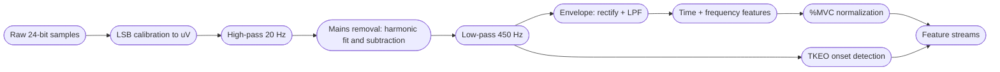

<!--
This file is part of JTS-MM (https://github.com/paulotto/jts-mm).
SPDX-FileCopyrightText: 2026 Paul-Otto Müller
SPDX-FileCopyrightText: 2026 David Stebich
SPDX-License-Identifier: CC-BY-4.0
-->

# s04 — EMG Signal Processing

This document specifies the offline (and optional online) EMG signal-processing pipeline that turns raw ADS1299 samples into features that an intent classifier can consume.

## 1. Pipeline overview



Each stage is independently testable; the offline pipeline is `software/biomech/biomech/emg/pipeline.py` (band-pass, mains removal, envelope), built on the pure-function blocks in `software/jtsmm/jtsmm/emg/` (`mains.py`, `onset.py`, `outliers.py`) so each is unit-tested on its own.

## 2. Stage 1: calibration to microvolts

The ADS1299 raw output is a 24-bit signed integer. The LSB in microvolts depends on the gain and the reference voltage:

```
LSB_uV = (V_ref / gain) / 2^23 * 1e6
```

With `V_ref = 4.5 V` (ADS1299 internal reference, default) and `gain = 6`:

```
LSB_uV = (4.5 / 6) / 8388608 * 1e6 ≈ 0.0894 µV
```

(Equivalent to `(2 × V_ref) / (gain × 2^24) × 1e6` nV.)

The `samples_uv` dataset in HDF5 is precomputed at write-time as `samples × lsb_uv_per_channel` (CH7/CH8 at gain 24). Downstream code uses `samples_uv` directly; no further unit conversion is needed.

## 3. Stage 2: high-pass filter (20 Hz)

DC offset and very-low-frequency motion artifacts (electrode displacement, baseline shift) live below 20 Hz. The 20 Hz cutoff is the SENIAM recommendation for surface EMG.

- Filter: **4th-order Butterworth, zero-phase (filtfilt)**.
- Cutoff: 20 Hz.
- Implementation: `scipy.signal.butter(4, 20, btype='high', fs=4000)` + `scipy.signal.filtfilt` (`fs` is the session's `sample_rate_sps`, 4000 by default).

We use **zero-phase filtering** because phase distortion would shift muscle onset and make EMG-leading-motion claims unreliable. The trade-off is that filtfilt requires the full signal, so online use needs a causal alternative (see §10).

## 4. Stage 3: mains removal (50 Hz + harmonics)

Even with the ADS1299's superb CMRR and the DRL electrode, residual 50 Hz pickup is the dominant non-EMG contaminant on a typical lab bench (Germany; in 60 Hz countries, swap 50 → 60).

- Method (implemented): **no notch filter**. The interference itself is fitted and subtracted: for each short block a least-squares fit of sine and cosine at the line frequency and its harmonics, then the fit is subtracted (`jtsmm.emg.mains.remove_mains`, pure NumPy). Only the coherent sinusoid leaves; broadband EMG at the same frequencies stays (a notch bank would remove a fixed band around every harmonic and still miss a grid at 50.016 Hz).
- Line frequency: measured from the recording, per take and refined per phase (`measure_line_hz`, `biomech.emg.pipeline.take_line_hz` / `refine_line_hz`), not assumed to be 50.000 Hz; the value used is stored per phase (`mains__<phase>__line_hz`).
- Online (live viewer): the causal variant of the same idea, `jtsmm.viewer.processing.HarmonicCanceller`.
- Details, measured effect and limits: `s09_mains_removal.md`.

## 5. Stage 4: low-pass filter (450 Hz)

Above 450 Hz, surface EMG has very little energy and what remains is mostly amplifier noise. We low-pass to clean it up.

- Filter: **4th-order Butterworth, zero-phase**.
- Cutoff: 450 Hz.

After Stages 3–4 the signal occupies 20–450 Hz, the canonical surface-EMG bandwidth.

## 6. Stage 5: envelope

The envelope is the rectified, smoothed amplitude of the EMG. It is the form most useful for intent recognition because muscle force tracks envelope amplitude monotonically over short time scales.

Three envelope methods are implemented and selectable per analysis:

| Method | Formula | When to use |
|--------|---------|-------------|
| **RMS sliding window** | `sqrt(mean(x² over window))` | Default; window = 100–200 ms; good SNR, smooth |
| **Rectify + low-pass** | `LPF_5Hz(|x|)` | Smoother, slightly more delay |
| **Hilbert envelope** | `|hilbert(x)|` then LPF | Most precise for short bursts; expensive |

The default is RMS with a 150 ms sliding window (Hann-weighted to avoid edge artifacts).

## 7. Stage 6: time-domain features

For each window (50 ms by default, 25 ms hop) we compute:

| Feature | Formula | Notes |
|---------|---------|-------|
| MAV | `mean(|x|)` | Mean absolute value |
| RMS | `sqrt(mean(x²))` | |
| IEMG | `sum(|x|)` | Integrated EMG; window-length-dependent |
| ZC | count of zero crossings | With a small threshold to ignore noise |
| SSC | count of slope-sign changes | With threshold |
| WL | `sum(|x[k] - x[k-1]|)` | Waveform length |
| WAMP | count of `|x[k]-x[k-1]| > T` | Threshold T set per channel via baseline |

Features are stored in a separate group `/emg/features/` of the HDF5 on request:

```
/emg/features/
├── t_master_us           (W,) uint64
├── mav                   (W, 6) float32
├── rms                   (W, 6) float32
├── iemg                  (W, 6) float32
├── zc                    (W, 6) int32
├── ssc                   (W, 6) int32
├── wl                    (W, 6) float32
├── wamp                  (W, 6) int32
└── attrs: window_ms, hop_ms, zc_threshold_uv, wamp_threshold_uv
```

## 8. Stage 7: frequency-domain features

Per window, compute:

| Feature | Formula |
|---------|---------|
| MNF | `Σ f·P / Σ P` (mean frequency) |
| MDF | frequency where cumulative power = 50 % |
| TTP | total power = `Σ P` |
| Power in 20–50 / 50–100 / 100–200 / 200–450 Hz bands | summed power per band |

Implemented via Welch's method (`scipy.signal.welch`) on each window.

## 9. Stage 8: %MVC normalization

EMG amplitudes are highly inter-subject-variable. We normalize each channel's envelope to **percent maximum voluntary contraction (MVC)**:

```
EMG_norm = EMG / MVC_per_channel
```

The MVC trials are SPACE-bounded on a dedicated `jtsmm record --mvc` take (`mvc_opening`, `mvc_closing`). Slice `/emg/samples_uv` to `/phases` intervals with `kind: mvc`. Offline analysis may still write `/calibration/mvc/` if you persist the 95th-percentile scale factors.

The protocol is described in [`../calibration_validation/cv03_emg_setup_mvc.md`](../calibration_validation/cv03_emg_setup_mvc.md).

## 10. Online vs. offline

The pipeline above is described for **offline** processing on a recorded HDF5 file. For online use (live viewer + future real-time control), we replace the zero-phase filters with **causal** alternatives:

| Stage | Offline | Online |
|-------|---------|--------|
| HPF / LPF | 4th-order Butterworth + filtfilt | 4th-order Butterworth + lfilter (causal), or biquads |
| Mains | block-wise harmonic fit and subtraction (`remove_mains`) | causal harmonic canceller (`HarmonicCanceller`) |
| Envelope | RMS-sliding, full window | RMS-sliding, causal trailing window (window starts at sample, looks back) |

The online pipeline has ~80 ms group delay (mostly the envelope's 150 ms / 2 trailing window); the offline pipeline has zero phase.

The two pipelines are **gated by the same Python class** (`Pipeline(causal=False/True)`) so analysis code can switch between them with one argument.

## 11. Onset detection

Two onset detectors are implemented; they run in parallel and store onsets in a single dataset:

### 11.1 Teager-Kaiser Energy Operator (TKEO)

```
TKEO[n] = x[n]² - x[n+1] * x[n-1]
```

TKEO amplifies fast amplitude changes and is the standard EMG onset detector. We threshold the TKEO signal at `mean_TKEO + k · std_TKEO` where `k = 3` by default and the mean/std are estimated from a known-rest baseline at the start of each session.

### 11.2 Bayesian change-point (offline only)

A two-state hidden Markov model (rest vs. active) with Gaussian emissions in the log-envelope space. Output is the posterior probability of "active" per sample; threshold at 0.5 → onset / offset.

Both detectors emit onset events into:

```
/emg/onsets/
├── t_master_us          (O,) uint64
├── channel              (O,) int32
├── kind                 (O,) string ("onset" / "offset")
├── detector             (O,) string ("tkeo" / "bayes")
└── confidence           (O,) float32
```

## 12. Cross-modality: feeding the classifier

The intent classifier consumes a feature matrix `(T, F)` where T is the time axis (aligned to camera frames at the 40 Hz template trigger rate by default) and F is the feature vector. The feature vector concatenates:

- 6 channels × N_time_features = 42 features per time step.
- 6 channels × N_freq_features = 24 features per time step.
- 2 IMU quaternions × 4 = 8 features.
- 2 IMU angular velocities × 3 = 6 features.
- Optical mandible-vs-cranium pose: 6 features (3 translation + 3 Euler).

Total ~86 features per time step at 40 Hz. A convenience function `jtsmm.io.feature_matrix(session, window_ms=50, hop_ms=25)` is planned (not implemented).

## 13. Performance acceptance criteria

The EMG processing pipeline is accepted when:

- [ ] On synthetic data (sum of sine waves + Gaussian noise), the pipeline recovers ground-truth band power within ±0.5 dB.
- [ ] On bench-recorded data with the input shorted, the post-pipeline envelope is <0.5 µV in the 20–450 Hz band (i.e. <2× the ADS1299 input-referred noise).
- [ ] On a pilot recording of a clear voluntary clench (MVC trial), TKEO onset detection produces an onset within ±10 ms of the visually-marked motion onset.
- [ ] Pipeline runs at >2× real-time on the Pi 5 for the full 6-channel feature extraction (so it can run during online sessions).

## 14. References

- De Luca CJ. *"The Use of Surface Electromyography in Biomechanics"*, J Appl Biomech 1997.
- SENIAM project — recommendations for sensor placement and signal processing: <http://www.seniam.org/>.
- de Cheveigné A. *"ZapLine: a simple and effective method to remove power line artifacts"*, NeuroImage 2020.
- Solnik S. et al., *"Teager-Kaiser energy operator signal conditioning improves EMG onset detection"*, Eur J Appl Physiol 2010.
- Castroflorio T. et al., *"Surface EMG of jaw-elevator muscles: effect of electrode location and inter-electrode distance"*, J Oral Rehabil 2005.
