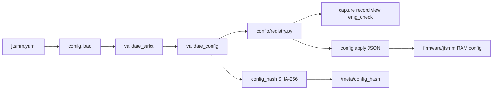

<!--
This file is part of JTS-MM (https://github.com/paulotto/jts-mm).
SPDX-FileCopyrightText: 2026 Paul-Otto Müller
SPDX-FileCopyrightText: 2026 David Stebich
SPDX-License-Identifier: CC-BY-4.0
-->

# s08 — Runtime configuration (schema v1)

Single operator contract for JTS-MM: **`~/jtsmm.yaml`** on the Pi (`JTSMM_CONFIG` overrides; legacy fallback: `/etc/jtsmm.yaml`; last resort: the shipped template, with a warning on every command), validated by [`schema/v1/jtsmm.schema.json`](../../schema/v1/jtsmm.schema.json), strictly checked on every load ([`strict.py`](../../software/jtsmm/jtsmm/config/strict.py)), cross-checked in [`validate.py`](../../software/jtsmm/jtsmm/config/validate.py), and applied to the MCU via USB `config apply` JSON ([`mcu_apply.py`](../../software/jtsmm/jtsmm/config/mcu_apply.py)).

**Template:** [`software/jtsmm/etc/jtsmm.yaml`](../../software/jtsmm/etc/jtsmm.yaml) — one monolithic file with **every** tunable key explicit. Profile fragments in [`schema/v1/profiles/`](../../schema/v1/profiles/) are used only by `jtsmm doctor imu-rates --preset` (`resolve_profiles`); they are **not** merged when a config is loaded.

**Precedence:** `CLI flag` > `env var` (deprecated) > **`jtsmm.yaml`** > code fallback.

## Load pipeline



**Strict checks** (default `strict=True` on every `load()` and `apply_mcu()`): YAML parse, JSON Schema, required-path completeness, unknown-key rejection, then cross-subsystem rules (skipped while schema errors remain — they assume the schema's types). `host.schema.relaxed_unknown_keys: true` turns unknown keys into warnings; `jtsmm config validate --no-strict` (= `load(strict=False)`) also skips completeness. Use `jtsmm config validate` or `jtsmm config audit --strict` before sessions ([`op06`](../operations/op06_config_hardware_validation.md)).

**Apply order on MCU:** `platform` → `emg` → `imu_mta` → `imu_cra` → `trigger`.

**Ownership rule:** `mcu.platform` owns bus speeds, IRQ priorities, and ring buffer sizes. Device blocks (`emg`, `imu_*`, `trigger`) own chip-specific settings only.

## Top-level keys

| Key | Sent to MCU? | Purpose |
|-----|--------------|---------|
| `schema_version` | yes (in apply payload) | Must be `1` |
| `hat` | no | Serial port, firmware version gate |
| `mcu` | yes (subset) | RP2350-owned blocks |
| `host` | **never** | Pi cameras, storage, capture/record tuning, viewer, paths |
| `session` | no | Per-record mode/duration and HDF5 `/meta` defaults (`subject_id`, `protocol`, `meta`) |

## `jtsmm config` CLI

| Command | Purpose |
|---------|---------|
| `jtsmm config show` | Print loaded YAML (validated) |
| `jtsmm config show --mcu-json` | MCU `config apply` payload only |
| `jtsmm config validate` | Exit 1 on hard errors |
| `jtsmm config audit` | Parameter coverage report for the config `jtsmm` would load (or `--config`): `MISSING_YAML` (required key absent), `MISSING_WIRE` (no host consumer / not in the MCU payload), `MISSING_FW` (key `config_json.c` does not parse), `DEFAULT` (optional key absent — fine) |
| `jtsmm config audit --strict` | Exit 1 if any parameter gap |
| `jtsmm config init` | Write `~/jtsmm.yaml` (or `$JTSMM_CONFIG`) from the template if missing; `--force` overwrites |

CI gate: `python scripts/sync_config_template.py --check`

## Submodule pattern

The monolithic template lists every scalar explicitly. `profile:` keys on `mcu.*` blocks are **labels**: the host sends every value (and each slot's `reports` map) explicitly, and the firmware treats such a block as custom. Changing only `profile:` therefore changes nothing. The firmware's own presets apply only to a boot without a host apply and differ from the host presets in places (EMG `acquisition` keeps lead-off off while recording; IMU `raw_only` at 100 Hz; `datasheet_motion` unknown). An enabled IMU slot must list at least one enabled report (≤ 8), or validation fails — otherwise the MCU would fall back to its own preset.

---

## `hat` (host link)

| Key | Type | Default | Notes |
|-----|------|---------|-------|
| `serial_port` | string | `/dev/jtsmm_hat` | udev symlink ([`s01`](s01_pi5_software_stack.md) §4) |
| `firmware_version` | string | `>=1.0.0,<2.0.0` | PEP 440 range, enforced |

---

## `mcu.platform`

Preset fragment (doctor only): [`platform_default.yaml`](../../schema/v1/profiles/platform_default.yaml).

The firmware **refuses the whole apply** on a value it cannot honour; the host rejects the same values first (schema / `validate.py`).

| Key | Default | Allowed | MCU apply | Notes |
|-----|---------|---------|-----------|-------|
| `profile` | `default` | `default` \| `custom` | label | anything else is refused |
| `system.cpu_mhz` | 150 | 150 only | fixed | no reclocking |
| `system.xosc_hz` | 12000000 | 12000000 only | fixed | board crystal (optional key) |
| `spi0.hz` | 4000000 | 500000–4000000 | yes | EMG stream SPI (`spi_dma`) |
| `i2c.hz` | 400000 | 100000–400000 | yes | Both IMU buses |
| `pio.trigger.clock_hz` | 1000000 | 1000000 only | fixed | one PIO tick = 1 µs |
| `buffers.emg_ring` | 98304 | **bytes** | yes | Requested EMG ring size in bytes; the MCU converts to slots with the EMG ring's compact slot size (`bytes / 48 B`) and caps at its backing depth of **2048 slots** (≈ 0.5 s at the default 4 kHz, ≈ 1.0 s at 2 kHz). IMU/event budgets divide by their 256 B slots. `config dump` multiplies back, so the value round-trips |
| `buffers.imu_ring` | 16384 | **bytes** | yes | Per IMU slot; MCU caps at the IMU ring backing depth (64 slots) |
| `irq.emg` | 0 | 0 only | fixed | EMG is polled on core 1 |
| `irq.imu` | 1 | 1 only | fixed | IMU is polled on core 1 |
| `irq.trigger` | 2 | 0–3 | yes | trigger PIO IRQ priority |

---

## `mcu.emg`

Preset fragment (doctor only): [`emg_acquisition.yaml`](../../schema/v1/profiles/emg_acquisition.yaml).

| Key | Default (`acquisition`) | Range | Notes |
|-----|-------------------------|-------|-------|
| `profile` | `acquisition` | see table below | |
| `sample_rate_sps` | **4000** | 250, 500, 1000, 2000, 4000 | `validate.py` whitelist (the firmware rejects 8000/16000). Why 4000: sinc³ −0.7 dB at 500 Hz (−2.7 dB at 2000), first alias rejected by 51 dB (31 dB), same in-band noise density. Cost vs 2000: 2× USB and file size (≈180 kB/s, ≈18 MB/min), MCU EMG ring ≈0.5 s, 250 µs DRDY read deadline. Bench 2026-09-25 with both IMUs + both cameras: 274 s, 8 samples lost (0.0007 %), worst sample step 430 µs |
| `default_gain` | 6 | 1, 2, 4, 6, 8, 12, 24 | PGA for patient channels |
| `bias.enabled` | true | bool | DRL drive |
| `leadoff.enabled` | true | bool | Detection available |
| `leadoff.during_recording` | **true** | bool | DC comparator stays on during recording/viewing by default (safe: its constant current only offsets connected inputs by a DC term the 20 Hz high-pass removes, and rails disconnected ones — see [`h03`](../hardware/h03_emg_frontend.md) §6). `--no-leadoff` (`jtsmm record`/`jtsmm view`) forces it off. **warn** if true *and* `ac_tone` (that combination injects a 31.2 Hz tone into the EMG band). When false, firmware programs the LOFF registers off at config apply; viewer shows **n/a** (status bits are stale). |
| `leadoff.ac_tone` | **false** | bool | DC comparator (false) vs fixed 31.2 Hz AC tone for quantitative \|Z\| (true); see `jtsmm emg impedance`. Stays off during recording even with `during_recording: true` — only `jtsmm emg impedance`/`jtsmm emg check` turn it on, in their own isolated sessions. |
| `leadoff.current_na` | **6** | 6, 24 | ADS1299 ILEAD_OFF; wired to LOFF register (only 6/24 nA are usable for skin \|Z\| — the µA options saturate the PGA) |
| `test_signal.enabled` | false | bool | Bench only; enables internal cal tone via `ads1299_test_signal` |

**Firmware wiring notes:** `default_gain`, `sample_rate_sps`, `bias.enabled`/`channels`, `pd_channels` (from `active_channels`), `leadoff.*`, `test_signal.enabled` and `enabled` (refuses `ads_start` when false) are applied. Single-value keys (anything else is rejected): `stream_channels: 6` (every EMG block carries 8 channels; nothing reads the key), `bias.ch7_readback: false`, `test_signal.amplitude_mv: 0`.

**CLI overrides (`jtsmm record` / `jtsmm view`):** `--gain {1,2,4,6,8,12,24}` overrides `mcu.emg.default_gain` for the session (validated against the same whitelist as `validate_config`); the production default is **6**, chosen deliberately over 24 for headroom against electrode-offset/motion-artifact saturation on the DC-coupled front end — see [`h03`](../hardware/h03_emg_frontend.md) §3 for the full trade-off. Only override to `--gain 24` for controlled, low-motion recordings where finer quantization on small signals matters more than saturation margin. `--bias-drive/--no-bias-drive`, `--bias-channels`, `--active-channels`, and `--leadoff/--no-leadoff` map onto `apply_emg_overrides` (`jtsmm/config/overrides.py`) as described above. `jtsmm record` additionally accepts `--subject <id>` (→ `/meta/subject_id` — pass an already-anonymized hash per [`s07`](s07_visualization_storage.md) §4, not the raw identity), `--protocol <name>` (→ `/meta/protocol`), and repeatable `--meta KEY=VALUE` for anything else (e.g. `--meta operator=jd`); these are merged into the HDF5 `/meta` group verbatim by both the Python and native writers and may not collide with the fixed schema attrs (`config_hash`, `mcu_config_json`, …) or with `subject_id`/`protocol` themselves.

**EMG presets** (what `resolve_profiles` fills in; as a label in `jtsmm.yaml` a profile changes nothing — set the keys):

| Profile | `sample_rate_sps` | Leadoff while recording | Use |
|---------|-------------------|-------------------------|-----|
| **`acquisition`** | **4000** | on (DC only) | **Default science** |
| `high_rate` | 4000 | on (DC only) | Max EMG bandwidth |
| `bench` | 250 | on (DC only) | Electrode check |
| `noise_characterization` | 4000 | off | Lab noise only. To record it, set `leadoff.during_recording: false` (or `--no-leadoff`) explicitly |
| `custom` | explicit | explicit | Full control |

Every profile above leaves `ac_tone: false` — none of them inject the 31.2 Hz
impedance tone during recording; only `jtsmm emg impedance`/`jtsmm emg check`
turn it on, in their own dedicated (non-recording) sessions. Pass
`--no-leadoff` to `jtsmm record`/`jtsmm view` to disable the DC comparator too,
e.g. for a session that must be bit-for-bit free of any injected current.

Channel names (fixed metadata): `masseter_l/r`, `temporalis_l/r`, `digastric_l/r`, `bias_debug`, `drl` — see [`catalog.FULL_CHANNEL_NAMES`](../../software/jtsmm/jtsmm/config/catalog.py).

---

## `mcu.imu_mta` / `mcu.imu_cra`

Independent slots; same schema. Preset fragment (doctor only): [`imu_kinematics_default.yaml`](../../schema/v1/profiles/imu_kinematics_default.yaml).

| Key | Default | Notes |
|-----|---------|-------|
| `enabled` | true | Disable slot entirely |
| `profile` | `kinematics_accel` | `fused_only` \| `raw_only` \| `kinematics_accel` \| `kinematics_default` \| `datasheet_motion` \| `all` \| `custom`. A label: the enabled `reports` run (a mismatch warns) |
| `fusion.primary` | `game_rotation_vector` | `game_rotation_vector` \| `rotation_vector` \| `geomagnetic_rotation_vector` \| `gyro_integrated_rotation_vector` (what the firmware implements); must name the enabled fusion report |
| `fusion.rate_hz` | **390** | Clamped to catalog `max_rate_hz`. See the 390 vs 400 note below. |
| `sync.mode` | `int_driven` | `int_driven` \| `emg_drdy_divisor` |
| `dynamic_calibration.accel` / `.gyro` / `.mag` | **true** | BNO085 motion-engine dynamic calibration per sensor (SH-2 ME Calibration, issued on every apply and after a reset). On = every recording up to 2026-11-02; keep it for additions to that dataset. New studies: calibrate + `imu_savecal`, then `false` for the takes ([`cv02` §7.2](../calibration_validation/cv02_imu_calibration.md)). Missing key = on |
| `reports.<name>.enabled` | see template | The report set actually sent; ≥ 1 and ≤ 8 enabled per enabled slot |
| `reports.<name>.rate_hz` | per catalog | Bus budget check for `profile: all` |

**Why 390 Hz, not 400 Hz?** The BNO085 game-rotation-vector report tops out at its native **~398 Hz**, not a
clean 400 Hz. Declaring 400 leaves no headroom, so the sensor under-delivers by ~0.5% and flaps against the
strict 0.5% IMU drop budget in `integrity --strict`. Declaring **390** makes the sensor reliably
over-deliver, so the drop check is robust. The operator template ([`etc/jtsmm.yaml`](../../software/jtsmm/etc/jtsmm.yaml))
sets 390 for both slots. See [`h05_sensor_pipeline_architecture.md`](../hardware/h05_sensor_pipeline_architecture.md) §6.

**Sync modes** ([`h04`](../hardware/h04_imu_subsystem.md) §6.2):

| `sync.mode` | Firmware path | Constraint |
|-------------|---------------|------------|
| `int_driven` | BNO085 INT → I2C DMA | Default; any rate ratio |
| `emg_drdy_divisor` | Every Nth EMG DRDY kicks IMU read | `emg_fs % imu_rate == 0` required |

### Combinable `reports` API (primary operator surface)

`mcu.imu_<slot>.reports` is the authoritative surface: a map of BNO085 output →
`{ enabled, rate_hz }`. Every one of the seven datasheet outputs can be enabled
independently at its own rate; the firmware emits one **self-describing tagged
record per report instance** (below), so streams do not have to share a rate or
arrive together. Presets expand to a `reports` map
([`IMU_PROFILE_REPORTS`](../../software/jtsmm/jtsmm/config/catalog.py)) only for a
slot without enabled reports (doctor); an explicit map is always used verbatim.
`fusion.primary` / `fusion.rate_hz` must name the one enabled fusion report and
its rate (validation error otherwise).

**The seven datasheet outputs** (cross-ref the BNO085 datasheet, [`h04`](../hardware/h04_imu_subsystem.md) §6):

| Datasheet name | `reports` key | SH-2 id | Wire record | Host units | Max Hz |
|----------------|---------------|---------|-------------|-----------|--------|
| Accelerometer | `accelerometer` | 0x01 | `RAW` (int16 Q8) | m/s² | 500 |
| Gyroscope | `gyroscope` | 0x02 | `RAW` (int16 Q9) | rad/s | 400 |
| Magnetometer | `magnetometer` | 0x03 | `RAW` (int16 Q4) | µT | 100 |
| Linear acceleration | `linear_acceleration` | 0x04 | `LIN_ACCEL` (f32) | m/s² | 400 |
| Rotation vector | `rotation_vector` | 0x05 | `QUAT` (f32) | quaternion | 400 |
| Game rotation vector | `game_rotation_vector` | 0x08 | `QUAT` (f32) | quaternion | 400 |
| Geomagnetic rotation vector | `geomagnetic_rotation_vector` | 0x09 | `QUAT` (f32) | quaternion | 400 |

`gyro_integrated_rotation_vector` (0x2A, up to 1000 Hz) is an optional extra
fusion off the core list; AR/VR stabilized vectors and `gravity` are rejected
by validation (not implemented by the firmware).

**Presets** (`IMU_PROFILE_REPORTS`):

| Preset | Resolves to |
|--------|-------------|
| `fused_only` | one `fusion.primary` quaternion @ `fusion.rate_hz` (390) |
| `kinematics_accel` | game_rv @ 390 + accel @ 250 (**default**; orientation + gravity-included accel, gravity removed offline with the optical orientation, [s05](s05_imu_processing.md) §3.1) |
| `kinematics_default` | game_rv @ 390 + linear_accel @ 250 (orientation + the BNO085's gravity-free accel. Measured: game_rv ~350, linear_accel ~220 Hz) |
| `datasheet_motion` | accel @ 400 + gyro @ 400 + mag @ 100 + linear_accel @ 200 (no fusion) |
| `raw_only` | accel @ 400 + gyro @ 400 (+ optional mag) |
| `all` | accel @ 400 + gyro @ 400 + mag @ 100 + linear_accel @ 200 + the `fusion.primary` quaternion (the firmware's `all`) |
| `custom` | explicit `reports:` map |

`datasheet_motion` exists only on the host. The firmware rejects a profile name it
has no preset for unless the reports come with it; `config apply` always sends
the resolved reports, so the MCU runs the host's set for every preset.

**When to use which profile**

| Goal | Profile | Why |
|------|---------|-----|
| Jaw tracking with optical (default) | `kinematics_accel` | Game rotation vector + accelerometer; gravity removed offline with the optical orientation (avoids the BNO085's ~2.5° tilt error, ~0.4 m/s²). The viewer's translation estimate uses accel too |
| Live jaw tracking without optical | `kinematics_default` | Game rotation vector (~350 Hz) + linear accel (~220 Hz) — enough for orientation and a drift-bounded translation *estimate* in the viewer |
| Orientation only, lowest bus load | `fused_only` | Single fusion quaternion; no raw motion streams |
| Offline Madgwick / custom fusion | `raw_only` with `gyro` + `accel` @ 250 | Raw inertial vectors at matched rates; host fuses offline |
| Max translation bandwidth without fusion | `custom`: `gyro@250` + `linear_accel@250` | Linear accel stays high when gyro is paired without a fusion report |
| Full datasheet motion (no fusion) | `datasheet_motion` | Accel + gyro + mag + linear accel — shares hub budget; rates drop vs single-report configs |
| Research / debug everything | `custom` or `all` | Explicit report map; validate bus budget with `jtsmm doctor imu-rates` |

> **Per-bus throughput ceiling.** MTA and CRA are on **separate** I2C buses
> (i2c0/i2c1, both 400 kHz Fast Mode), so they do not compete. But each BNO085
> sensor hub sustains only **~740 reports/s** across all of its enabled reports
> (I2C clock-stretching + SHTP overhead; confirmed against the Hillcrest/BNO08x
> community reports). A single report reaches its full rate (game_rv ~398, gyro
> ~399, accel ~500, mag 100); simultaneous reports share the budget **and the hub
> prioritizes the fusion report, quantizing each report to its own convenient
> interval**. That is why both kinematics presets request the 3-axis vector
> (`accel` or `linear_accel`) @250 next to `game_rv@390`: measured with
> linear_accel, game_rv ~350 Hz + linear_accel ~220 Hz. The request matters — asking
> for linear_accel@200 (5 ms) aligns badly with the fusion schedule and collapses
> it to ~120 Hz, whereas @250 (4 ms) lands at ~220 Hz. Adding `+ gyro@400` is
> worse — the hub then throttles all three to ~331/331/79 Hz. Enable gyro only
> when you need it via `raw_only` / `datasheet_motion` / `custom`.

**Tagged USB wire format** (records.h; decoders branch on payload length for
legacy fallback):

| Record (per slot) | USB type | Payload | Length |
|-------------------|----------|---------|--------|
| `QUAT` | MTA 0x11 / CRA 0x14 | `[report_id:u8][w,x,y,z:f32×4][acc:u8]` | 18 B (legacy 17) |
| `RAW` | MTA 0x12 / CRA 0x15 | `[sensor_id:u8][x,y,z:int16×3][acc:u8]` | 8 B (legacy 7) |
| `LIN_ACCEL` | MTA 0x13 / CRA 0x16 | `[x,y,z:f32×3][acc:u8]` | 13 B (legacy 12) |

`report_id` is the SH-2 fusion id (0x05/0x08/0x09) so multiple fusion types
coexist unambiguously; `sensor_id` ∈ {0x01 accel, 0x02 gyro, 0x03 mag}. On
`config apply`, firmware disables all previously-enabled reports before enabling
the new set (no stale reports). RAW motion vectors are **int16 Q-point counts**
converted to SI on the host ([`jtsmm/imu/units.py`](../../software/jtsmm/jtsmm/imu/units.py)); only `LIN_ACCEL` and quaternions are float32 on the wire.

**Validation** ([`validate.py`](../../software/jtsmm/jtsmm/config/validate.py)):
each enabled `rate_hz` ≤ catalog `max_rate_hz`; per-slot I2C bus-bandwidth
budget; error on >1 fusion quaternion outside `profile: custom` (warn inside);
recommend enabling `magnetometer` alongside `geomagnetic_rotation_vector`.

**Single source of truth for rates:** the `reports` map in `jtsmm.yaml` is
what the MCU runs. Firmware profile resolution
([`imu_config.c`](../../firmware/jtsmm/src/domain/imu_config.c)) is used only for
boot defaults (`kinematics_accel`); `fused_only` / `kinematics_accel` / `kinematics_default` match the host presets
(`test_imu_config.py`), `raw_only` does not (firmware: SH-2 default 100 Hz).

**Hardware rate validation:** `jtsmm doctor imu-rates` applies a preset over
J_USB1, captures, and reports measured-vs-configured Hz + drop rates per
slot/stream (see [`s05`](s05_imu_processing.md) §1). Offline
fallback: `python -m jtsmm.tools.imu_rate_report session.h5`.

PASS only means "delivered what was requested". The BNO085 picks its own
intervals around the fusion report, so a higher request can deliver less. To
find the best request, `jtsmm doctor imu-rates --sweep` requests the config's one
non-fusion report (or `--sweep-report NAME`) at 100, 125, 200, 250, 333, 400 and
500 Hz (`--sweep-rates`, capped at the catalog maximum), measures both streams
per slot, and marks the request with the highest rate on the slower slot that
keeps the fusion report at ≥ 85 % of its configured rate (`--min-fusion-hz`)
without drops or losses; near-ties (2 %) go to the request closest to what is delivered. Each case also shows the rate the BNO085 granted, the rate from the median sample interval, and the SH-2 sequence gaps between the first and last STATS record of the window: a rate below the granted one without gaps is the sensor's choice (it skips slots; the median interval then stays at the granted rate), gaps mean reports lost between the BNO085 and the MCU. The `since apply` counters (`imu_status`) also hold a one-off jump at stream start from reports queued while nothing read them. `--report` also keeps each case's full `imu_status` (read time, packet length, achieved I2C clock, INT-to-read latency); `--no-emg` repeats it without the EMG load. Combine with `--preset` and `--slot`; the last request stays
applied until the next `config apply` (every `record` does one).

---

## `mcu.trigger`

Preset fragment (doctor only; = firmware boot preset, 30 Hz / 12 ms): [`trigger_imx296_dual_csi.yaml`](../../schema/v1/profiles/trigger_imx296_dual_csi.yaml). `bench_scope` = 10 Hz / 1 ms, `imx296_high_fps` = 100 Hz / 2 ms, `track_a_led` = 30 Hz / 200 µs, as in the firmware.

| Key | Default | Range | Notes |
|-----|---------|-------|-------|
| `enabled` | true | bool | Master enable |
| `profile` | `imx296_dual_csi` | see [`h06`](../hardware/h06_synchronization.md) §3.4 | |
| `rate_hz` | **40** (preset 30) | 1–200 | Must match `host.cameras.list[].trigger.expect_rate_hz`; 40 Hz is the template / Oct 2026 pilot rate |
| `pulse.width_us` | **12000** | 1 … period−1 (`1e6/rate_hz`) | IMX296 low-time ≈ exposure |
| `pulse.polarity` | `imx296_fast` | `imx296_fast` \| `active_high` | Scope-verify ([`h06`](../hardware/h06_synchronization.md) §3.5) |
| `outputs.csi1` / `csi2` / `scope` / `sync_led` | csi1+csi2+scope on | csi1/csi2/scope `true`, sync_led `false` only | Hard-wired fan-out; the firmware refuses other values |
| `start_on` | `stream_start` | `stream_start` only | Not sent to the MCU (the host starts the trigger); other values are rejected |

**Exposure constraint** (host validation):

```text
exposure_us ≤ pulse.width_us + 14.26   (IMX296 fast trigger margin)
```

---

## `host` (Pi-only)

Never included in `config apply` JSON.

### `host.cameras`

Applied by [`capture_cam.py`](../../software/jtsmm/jtsmm/capture/capture_cam.py) via picamera2 `set_controls` during `jtsmm record`. Not sent in MCU `config apply`. Not read by `rpicam-vid` (CLI preview is separate).

| Key | Default | Notes |
|-----|---------|-------|
| `track` | `B` | `A` = webcam + LED sync; `B` = CSI + MCU trigger |
| `marker_detector` | `apriltag` | See [`s03`](s03_camera_pipeline.md) |
| `list[].id` | `cam0`, `cam1` | HDF5 group name |
| `list[].device` | `csi0`, `csi1` | picamera2 index alias (`csiN` or integer) |
| `list[].resolution` | `[1456, 1088]` | IMX296 full / binned mode |
| `list[].format` | `YUV420` | Stream pixel format |
| `list[].buffer_count` | `6` | picamera2 video buffers (2–16); 6 ≈ 150 ms of slack at 40 fps, ≈ 36 MB CMA for two cameras |
| `list[].exposure_us` | 12000 | `ExposureTime` when `ae_enable: false`; ≤ `pulse.width_us + 14.26` |
| `list[].gain` | 1.0 | `AnalogueGain` when `ae_enable: false` (1–16) |
| `list[].ae_enable` | **false** | Lock AE for Track B; true warns (AGC fights XTRIG) |
| `list[].awb_enable` | **false** | Lock AWB; use `awb_gains` when false |
| `list[].awb_gains` | `[2.3, 2.3]` | `ColourGains` [red, blue] |
| `list[].sharpness` | 1.0 | libcamera `Sharpness` |
| `list[].brightness` | 0.0 | libcamera `Brightness` (−1…1) |
| `list[].contrast` | 1.0 | libcamera `Contrast` |
| `list[].saturation` | 1.0 | libcamera `Saturation` |
| `list[].noise_reduction_mode` | `high_quality` (schema default `fast`) | `off` \| `fast` \| `high_quality` |
| `list[].trigger.source` | `mcu` | |
| `list[].trigger.expect_rate_hz` | 40 | Must equal `mcu.trigger.rate_hz`; also sets `FrameDurationLimits` for free-run |

**Track B note:** with `imx296` `trigger_mode=1`, integration time is dominated by MCU `mcu.trigger.pulse.width_us`. Keep `exposure_us` matched to that budget and `ae_enable: false` so AGC does not reopen exposure.

### `host.paths`

| Key | Default | Notes |
|-----|---------|-------|
| `paths.data_dir` | `~/jtsmm_data` | Session HDF5 output directory; `JTSMM_DATA_DIR` overrides. `build_install.sh --data-dir` sets it |
| `storage.base_dir` | — | **Deprecated** alias: alone it warns but is honoured; set together with a different `paths.data_dir` it is an error |

Relative paths anywhere in `jtsmm.yaml` (`optical_config`, `ct_tip_calibration`, `experiment_plan`, recordings dirs, `data_dir`) resolve against the repo checkout when repo-relative (`software/...`), else against the config file's directory — never the CWD. `~` is expanded.

### `host.capture`

Supervisor timing and backend selection ([`supervisor.py`](../../software/jtsmm/jtsmm/capture/supervisor.py)).

| Key | Default | Env override |
|-----|---------|--------------|
| `settle_ms` | `500` | `JTSMM_SETTLE_MS` |
| `stream_restart` | `true` | `JTSMM_STREAM_RESTART` |
| `native_prefer` | `true` | `JTSMM_NATIVE` — `false` only picks the Python HDF5 writer; `JTSMM_NATIVE=0` disables the extension, and a real (non-mock) recording then refuses to start |
| `trigger_after_cameras` | `true` | `JTSMM_TRIGGER_AFTER_CAMERAS` |
| `pps_samples` | `8` | `JTSMM_PPS_SAMPLES` |
| `camera_pps_anchor` | `true` | `JTSMM_CAMERA_PPS_ANCHOR` |
| `camera_delta_tracking` | `true` | `JTSMM_CAMERA_DELTA_TRACKING` |

### `host.record`

Record-session gates ([`record.py`](../../software/jtsmm/jtsmm/cli/record.py)).

| Key | Default | Notes |
|-----|---------|-------|
| `emg_check.enabled` | `true` | Run pre-record EMG check |
| `emg_check.block_on_contact_failure` | `true` | Abort on unusable electrode contact; `--force-emg-check` overrides |
| `preflight.enabled` | `true` | Doctor preflight before capture |
| `integrity.enabled` | `true` | Post-record integrity pass (EMG/IMU/cameras **and** `/optical` when tracking was on; budgets in [`s02` §8.5](s02_data_pipeline.md)) |
| `mcu_apply.enabled` | `true` | Push MCU config before capture |

### Letting a run finish regardless

Two knobs, for a session that must not be interrupted. Both default to the
strict behaviour.

| Key | Default | Effect |
|-----|---------|--------|
| `host.record.abort_on_error` | `true` | `false` (or `jtsmm record --no-abort`): the **quality** gates — preflight errors, the pre-recording EMG contact check, and the integrity verdict — report and let the run continue |
| `host.integrity.errors_as_warnings` | `false` | `true`: integrity errors are reported as warnings, so no session is `RESULT: FAIL` and `jtsmm integrity` exits 0 |

Use `abort_on_error: false` for a batch of takes you don't want halted
half-way; use `errors_as_warnings: true` when you want the verdict itself
softened everywhere, including for `jtsmm integrity` run later on the file.

**What still aborts, on purpose.** `abort_on_error` covers quality gates only.
These keep stopping the run because they do not produce a *worse* recording,
they produce no usable recording at all:

- a failed MCU config restore after the EMG check — the ADC would still be in
  its 250 SPS probe configuration;
- a malformed or unloadable experiment plan;
- bad CLI usage (e.g. `--mvc` with `--experiment-plan`);
- an exception from the capture itself.

**Demotion is never silent.** A session passed with the gates off must not be
mistakable for one that passed on its merits — that is how a bad take reaches a
results table. So with `errors_as_warnings: true` the report carries a banner
first, keeps every original message behind a `would-fail:` prefix, appends
`[N error(s) demoted by errors_as_warnings]` to the verdict line, and preserves
the originals in `summary["errors_as_warnings"]["demoted"]`, which `set_hdf5`
writes into `integrity.json`. With `--no-abort` the errors are still printed and
still recorded; only the exit code changes.

Note the recording itself is never at risk either way: the integrity check reads
the **closed** HDF5, and `jtsmm record` only reaches its non-zero exit after the
file and `integrity.json` are written.

### `host.integrity.thresholds`

What the post-session check calls a **failure** rather than a warning. These are
policy, not physics — how much loss or misalignment a session may carry and
still be usable — so a study with a different tolerance sets it here instead of
patching [`integrity/checker.py`](../../software/jtsmm/jtsmm/integrity/checker.py).

They are read from the finished HDF5 **after it is closed**, so they cannot
affect sampling: the only effects are the verdict and the exit code
(`jtsmm record` exits 2 on an integrity error, after the file is safely
written). `host.record.integrity.enabled` above decides whether the check runs
at all; these decide what it concludes.

| Key | Default | Grade | Notes |
|-----|---------|-------|-------|
| `emg_gap_warn_periods` / `emg_gap_err_periods` | `2.5` / `4.0` | warn / **err** | EMG continuity, in nominal sample periods |
| `emg_loss_warn_frac` / `emg_loss_err_frac` | `0.0005` / `0.005` | warn / **err** | EMG samples missing (single samples included; exact from `/emg/seq` when present); also budgets `tx_drops_emg` |
| `emg_missed_drdy_warn_frac` / `..._err_frac` | `0.001` / `0.02` | warn / **err** | Conversions the ADC produced but the firmware never read |
| `imu_ring_drop_err_frac` | `0.005` | **err** | IMU samples lost: ring overflow + SH-2 seq gaps, USB `tx_drops_imu`, timestamp gaps |
| `imu_gap_warn_periods` | `4.0` | warn | IMU gap = step > this × the stream's median step; **err** when the longest exceeds `stream_end_gap_err_s` or loss exceeds `imu_ring_drop_err_frac` |
| `stream_end_gap_err_s` | `0.5` | **err** | A stream stopped before the others did |
| `stream_start_lag_warn_s` / `stream_start_lag_err_s` | `2.0` / `10.0` | warn / **err** | A stream joined late — same blind span as ending early |
| `camera_coverage_min_frac` | `0.95` | **err** | Frames present vs trigger pulses in the camera's own id span |
| `camera_trailing_gap_warn_s` / `..._err_s` | `0.25` / `0.5` | warn / **err** | Camera stopped before the triggers did |
| `sync_residual_warn_us` / `sync_residual_err_us` | `1000` / `50000` | warn / **err** | RMS of frame labels vs a linear SensorTimestamp fit over the whole take |
| `assign_frames_warn` / `assign_frames_err` | `1.5` / `3.0` | warn / **err** | Constant frame↔trigger offset; 3 frames ≈ 75 ms at 40 fps |
| `assign_spread_frames_warn` / `..._err` | `1.0` / `3.0` | warn / **err** | Offset not constant — association slipped mid-take |
| `assign_drift_warn_us_per_s` / `..._err_us_per_s` | `50` / `500` | warn / **err** | Trigger stamps drifting against the camera clock |
| `assign_offset_dev_frames_warn` / `..._err` | `0.25` / `0.5` | warn / **err** | Median residual minus the expected trigger-to-sensor latency (periods); a one-frame association error gives ±1, which the `assign_frames` gate (latency included) cannot see. Warning only when the Pi clock slewed ≥ 200 ppm or the PPS fit is weak |
| `anchor_refined_frames_err` | `300` | warn / **err** | Frames labelled before a mid-take anchor correction (always warned; error above this) |

Two rules worth knowing:

- Every `*_err_*` must sit at or beyond its `*_warn_*` partner. An inverted pair
  makes the warning unreachable, so that pair falls back to its defaults and the
  report says so; so does a NaN, infinite or negative value.
- Precedence: the config passed explicitly (`jtsmm record` passes the one it
  recorded with; `jtsmm integrity check --config X` passes X), then the config
  recorded inside the session, then the defaults. Nothing is read implicitly
  from the machine running the check. Whichever applied is written to
  `report.summary["thresholds"]["source"]` / `["source_path"]`, so a verdict
  can be re-derived later. `--verify-config-hash` additionally fails when the
  session was not recorded with X. `errors_as_warnings` follows the same order.

Not configurable, deliberately: `IMU_RATE_TOL` and `SAMPLES_UV_ABS_TOL_UV`.
Those describe how the BNO085 and ADS1299 actually behave, not how strict you
want to be.

### `host.emg_check`

Phase durations for `jtsmm emg check` ([`emg/check.py`](../../software/jtsmm/jtsmm/emg/check.py)).

| Key | Default |
|-----|---------|
| `line_hz` | `50.0` |
| `settle_ms` | `400` |
| `leadoff.duration_s` | `5.0` |
| `noise.duration_s` | `5.0` |
| `impedance.enabled` | `true` |
| `impedance.duration_s` | `2.0` |
| `drl_isolation.duration_s` | `2.0` |

### `host.emg_filter`

| Key | Default | Notes |
|-----|---------|-------|
| `mains_mode` | `track` | Viewer/plot mains removal: `track` \| `notch` \| `off` ([`s09`](s09_mains_removal.md)) |
| `enabled`, `notch_hz`, `highpass_hz`, `lowpass_hz` | — | **Deprecated, no effect** (the viewer filter is fixed); validation rejects them (error) when set to something that looks effective |

### `host.viewer`

Live web viewer (FastAPI + WebSocket on port 8770 by default). Enabled in the Pi operator template; use `jtsmm record --no-viewer` to disable per session.

| Key | Default (Pi template) | Notes |
|-----|----------------------|-------|
| `enabled` | `true` | Start in-recording viewer tap; CLI `--no-viewer` overrides |
| `bind_host` | `0.0.0.0` | Bind address (`--viewer-host` overrides) |
| `port` | `8770` | HTTP/WS port (`--viewer-port` overrides) |

Remote access: [`op05_remote_viewer.md`](../operations/op05_remote_viewer.md).

---

## `session`

| Key | Default | Notes |
|-----|---------|-------|
| `mode` | `acquisition` | `acquisition` \| `bench` \| `calibration` |
| `duration_s` | `null` | Timed capture: used as the wall-clock length. With `use_experiment_plan`, an explicit value is only a safety timeout; `null` means no timeout. |
| `default_duration_s` | `10.0` | Fallback when `duration_s` is null **and** no experiment plan is walked. |
| `subject_id` | `null` | → `/meta/subject_id` (anonymized hash only) |
| `protocol` | `null` | → `/meta/protocol` |
| `meta` | `{}` | Custom string attrs → `/meta/<key>` |
| `optical_track` | `true` (Pi template) | ArUco into `/optical/` during record; CLI `--optical-track` / `--no-optical-track` |
| `optical_track_hz` | `null` | Live pose rate. `null` detects every stereo pair. `20` / `10` detect every 2nd / 4th pair at the 40 Hz template trigger rate. Camera timestamps stay at the trigger rate. CT tip and IMU mounting calibration ignore this. |
| `optical_config` | `software/optical/etc/optical.yaml` | Marker / calibration / tracker YAML |
| `ct_calibration` | `false` | Interactive CT tip pivot calib before record; CLI `--ct-calibration` / `--no-ct-calibration`. Standalone: `jtsmm ct-calibrate`. |
| `ct_calibration_n_poses` | `20` | SPACE poses for OLS tip solve |
| `ct_tip_calibration` | tip JSON path | Written on calib; loaded when `ct_calibration` is false |
| `persist_ct_calibration` | `false` | Save calib poses + frames under `ct_calibration_recordings_dir` |
| `ct_calibration_recordings_dir` | `~/experiments/5_2_1_pivot_calibration_repeatability/recordings` | Base dir for persisted CT tip calib runs; optional `{experiment_name}`; leaf is `{slug}_{timestamp}` |
| `persist_imu_calibration` | `true` | Copy IMU mounting `session.h5` + `imu_mounting.json` under `imu_calibration_recordings_dir` (repeatability study `experiments/5_2_2_imu_optical_handeye`, and the archive analyses read the mounting from: the measurement sessions do not contain it). CLI: `--persist-imu-calibration` / `--no-persist-imu-calibration`. Not a per-subject cal. |
| `imu_mounting_calibration` | `software/jtsmm/etc/imu_mounting_calibration.json` | Stable IMU mounting (`R_mount` per IMU). `jtsmm imu calibrate` merges every **accepted** fit into it (a rejected fit never replaces a good one); every recorded session embeds it after the take as `/calibration/imu_*/mounting_transform` (attrs `embedded`, `source`, `source_session`, `date`, fit metrics), as the CT tip goes into `/meta`. Not embedded into the IMU calibration take itself. |
| `imu_calibration_recordings_dir` | `~/experiments/5_2_2_imu_optical_handeye/recordings` | Base dir for persisted IMU–optical hand-eye takes; optional `{experiment_name}`; leaf is `{slug}_{timestamp}` |
| `use_experiment_plan` | `true` (template) | Walk SPACE phases from `session.experiment`. CLI `--use-experiment-plan` / `--no-use-experiment-plan`. `--experiment-plan PATH` implies on unless `--no-use-experiment-plan`. Cannot combine with `--mvc`. |
| `experiment` | `{name, description, phases}` | Inline motion plan (same shape as `optical.yaml` `experiment:`). Landmark calibration is inserted before motion. MVC names are **not** plan entries — use `session.mvc` / `jtsmm record --mvc`. Used when `use_experiment_plan` is true and `experiment_plan` is unset. |
| `experiment_plan` | `null` | Optional path override (JSON or `optical.yaml`). Wins over `session.experiment`. |
| `mvc` | `false` | Dedicated EMG-only MVC take (`mvc_opening` then `mvc_closing`). Independent of `session.experiment`. CLI `--mvc` / `--no-mvc`. |
| `write_jts_config` | `true` | JTS sidecar from phase intervals when a **motion** plan is walked |

CLI `--subject`, `--protocol`, and `--meta KEY=VALUE` override YAML. Reserved system attrs (`config_hash`, `mcu_config_json`, …) must not appear in `session.meta`.

When `use_experiment_plan` is **false**, `jtsmm record` captures for `duration_s` (or `default_duration_s`) with no `/events` / `/phases`. When **true**, SPACE starts/ends each phase and the default 10 s does not apply; `--duration` / a non-null `session.duration_s` is an optional safety timeout. `jtsmm record --mvc` is the same SPACE walk for two EMG-only MVC phases, without the motion plan.

---

## Cross-subsystem validation (`validate.py`)

| Rule | Severity |
|------|----------|
| `trigger.rate_hz` == each `cameras.list[].trigger.expect_rate_hz` | error |
| `pulse.width_us` < trigger period `1e6 / rate_hz` (firmware would silently halve the period) | error |
| `trigger.enabled: false` while cameras use `trigger.source: mcu` | error |
| `trigger.profile` known to the firmware | error |
| Camera `id`s unique; `device`s unique (`csi0` ≡ `0`) | error |
| IMU report implemented by the firmware (not `gravity`, `raw_accelerometer`, `arvr_*`) | error |
| `fusion.primary` implemented by the firmware (no `arvr_*`) and equal to the one enabled fusion report; `fusion.rate_hz` equal to its rate | error |
| `exposure_us` ≤ `pulse.width_us + 14.26` | error |
| `exposure_us` < frame period at `expect_rate_hz` | error |
| `gain` in 1…16 | error |
| Track B + `ae_enable: true` | warn |
| `emg.sample_rate_sps` in whitelist | error |
| `emg.default_gain` in whitelist | error |
| IMU `profile: all` bus budget ≤ 40 kB/s per bus | error |
| `emg_drdy_divisor` with non-integer EMG/IMU ratio | error |
| Platform ring SRAM estimate ≤ ~400 KB | error |
| EMG ≥ 2 kHz + SPI &lt; 2 MHz | error |
| `emg.profile: bench` without test signal | warn |
| `leadoff.during_recording: true` *and* `leadoff.ac_tone: true` | warn |
| Enabled IMU slot has 1–8 enabled reports | error |
| `host.storage.base_dir` set and ≠ `host.paths.data_dir` | error (alone: warn, still honoured) |
| `host.emg_filter.enabled: true` / `notch_hz` / `highpass_hz` / `lowpass_hz` (no effect) | error |
| Single-value keys (platform/EMG/trigger rows above, `trigger.start_on: stream_start`, `cameras.marker_detector: apriltag`) at another value; any `*.custom` block | error |

---

## MCU apply JSON (example)

One line over USB-CDC (production firmware):

```text
config apply {"schema_version":1,"platform":{"profile":"default","spi0":{"hz":4000000},...},"emg":{"profile":"acquisition","sample_rate_sps":4000,...},"imu_mta":{"profile":"kinematics_accel","fusion":{"primary":"game_rotation_vector","rate_hz":390},"reports":{...}},"imu_cra":{...},"trigger":{"profile":"imx296_dual_csi","rate_hz":40,"pulse":{"width_us":12000,...},...}}
```

C struct mirror: [`firmware/jtsmm/include/jtsmm/config.h`](../../firmware/jtsmm/include/jtsmm/config.h).

---

## Changing the camera rate (example)

Edit the explicit keys; `profile: custom` / `custom:` blocks are not applied on load.

```yaml
mcu:
  trigger:
    rate_hz: 100
    pulse: { width_us: 2000, polarity: imx296_fast }   # < 1e6 / 100 = 10000
host:
  cameras:
    list:   # for each camera:
      - { ..., exposure_us: 2000, trigger: { source: mcu, expect_rate_hz: 100 } }
```

`jtsmm config validate` checks width < period, `expect_rate_hz == rate_hz` and `exposure_us ≤ width_us + 14.26`.

---

## Related docs

| Topic | Doc |
|-------|-----|
| Pi install + udev | [`s01`](s01_pi5_software_stack.md) |
| HDF5 output | [`s02`](s02_data_pipeline.md) §8 |
| IMU profiles / sync | [`h04`](../hardware/h04_imu_subsystem.md) §6 |
| MCU DMA / commands | [`h05`](../hardware/h05_microcontroller_firmware.md) |
| Trigger + camera alignment | [`h06`](../hardware/h06_synchronization.md) |
